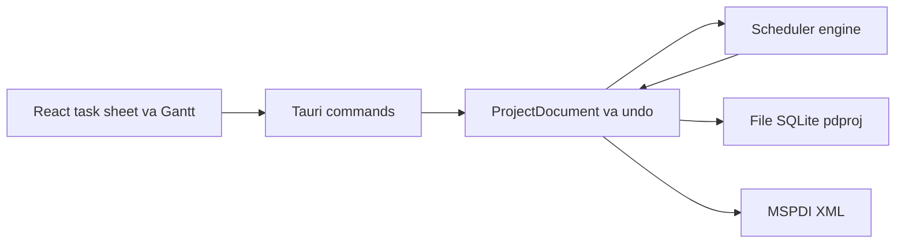

# Sheafly — quản lý dự án kiểu Microsoft Project

Pha 1–10 đã xong. Lõi của pha 1–5 (engine CPM, lịch, nguồn lực, theo dõi và chi phí, leveling, MSPDI, bảng task, Gantt, menu) vào cùng lúc ở PR #1. PR #2 cấu hình CI và định danh app macOS. PR #3 thêm cột WBS. PR #4 thêm bản kế hoạch sửa đổi. PR #5 lấp các chỗ còn thiếu của pha 2, 3 và 5. Pha 6 (lịch trên giao diện) qua PR #6. Pha 7 (lọc, nhóm, highlight) qua PR #7. Pha 8 (PDF Gantt) qua PR #8; hộp thoại file được sửa trong PR #9 đã merge. Pha 9 (công việc lặp) qua PR #15 đã merge. Pha 10 (chỉ số EVM và burn-down) qua PR #16.

Các sửa bổ sung đã merge vào `main`: PR #10 (căn header với độ rộng ngày của Gantt), PR #11 và PR #13 (đồng bộ kế hoạch), PR #12 (bộ chọn ngày giờ trong app), PR #14 (nhóm theo summary ở pha 7).

Sau pha 10 (chi tiết ở mục Sau pha 10): PR #17 (CI build bản cài macOS, Windows, Linux), PR #18 (test frontend với Vitest), PR #19 (phần còn lại của pha 9–10), PR #20 (sơ đồ mạng), PR #21 (tách công việc), PR #22 (CLAUDE.md), PR #23 (an toàn dữ liệu).

Giao diện tiếng Việt. Các pha mở rộng cùng một mô hình lịch trong engine Rust.

## Kiến trúc

- **Engine Rust** (`crates/engine`) là nguồn sự thật, không phụ thuộc Tauri. Mọi ngày bắt đầu, kết thúc, slack, đường găng, EVM và số cho burn-down do engine tính. Giao diện chỉ gửi lệnh và vẽ kết quả. Test CPM bằng `cargo test`.
- **Lệnh + undo**: mỗi thao tác (thêm task, đổi phụ thuộc, indent, gán nguồn lực, sửa lịch) là một command. Undo/redo đi trên log này.
- **File `.sheafly`** (trước khi đổi tên là `.pdproj`; cả hai mở được): một file SQLite. Mở/lưu bằng hộp thoại native của macOS. Snapshot burn-down (pha 10) nằm trong cùng file.
- **Hai chế độ task**, giống Project: *tự lên lịch* (engine dời ngày) và *lên lịch tay* (giữ ngày người dùng ghim).
- **Thời gian**: mốc là timestamp; thời lượng là phút làm việc. Lịch (tuần làm việc, ngoại lệ, ngày nghỉ) đổi phút làm việc thành ngày giờ thật.

Quyết định CPM, đã nằm trong engine:

1. Sắp topo theo phụ thuộc; báo vòng lặp.
2. Forward pass: early start/finish, cộng thời lượng trên lịch làm việc, áp ràng buộc và lag.
3. Backward pass: late start/finish, total slack, free slack.
4. Đường găng: total slack nhỏ hơn hoặc bằng 0.
5. Summary lấy min start và max finish của con.

Mô hình đã chốt: dự án có ngày bắt đầu, lịch chuẩn (thứ Hai–thứ Sáu, 08:00–12:00 và 13:00–17:00), ngày trạng thái. Task có tên, WBS, outline level, milestone (thời lượng 0), summary (rollup từ con), ghi chú, priority. Phụ thuộc FS / SS / FF / SF kèm lag theo phút làm việc. Ràng buộc đủ 8 kiểu: ASAP, ALAP, SNET, SNLT, FNET, FNLT, MSO, MFO. Lịch dự án và lịch task dùng cùng một kiểu lịch; pha 2 gắn lịch nguồn lực vào kiểu đó.

Trao đổi file ngoài dùng MSPDI (pha 5). Reader `.mpp` không nằm trong các pha này.

## Pha 1 — đã xong

- Scaffold Tauri 2 + React + TypeScript + Vite; workspace Cargo với `crates/engine`, `src-tauri` (lệnh mở/lưu) và `src` (React).
- Engine: CPM, lịch làm việc, phụ thuộc, ràng buộc, đường găng.
- Lưu trữ: command log undo/redo, file SQLite `.pdproj`, lệnh Tauri áp command.
- Giao diện: bảng task, Gantt (thanh task, summary, milestone, mũi tên phụ thuộc, đường găng, thang ngày/tuần/tháng), menu macOS, phím tắt (PR #1), cột WBS (PR #3).

## Pha 2 đến Pha 5 — đã xong

Pha 2–5 vào cùng lõi ở PR #1; PR #5 lấp các chỗ còn thiếu (effort-driven, chi phí summary, giờ ngoại lệ trong MSPDI).

### Pha 2 — nguồn lực

Đã xong.

- Resource: người hoặc máy, đơn vị tối đa, lịch riêng, mức giá chuẩn.
- Assignment: task gắn resource với units.
- Ba kiểu task của Project: Fixed Duration, Fixed Units, Fixed Work, kèm cờ effort-driven. Đổi một trong ba đại lượng duration / units / work thì engine tính lại hai đại lượng còn lại theo đúng kiểu task.
- View Resource Sheet và Task Usage (lưới theo ngày). Cột quá tải khi tổng units trong một khoảng vượt max units.

### Pha 3 — theo dõi, baseline, chi phí

Đã xong.

- Phần trăm hoàn thành, actual start/finish, remaining duration, remaining work.
- Baseline 0–10: mỗi mốc lưu start, finish, work, cost.
- Tracking Gantt: thanh kế hoạch và thanh baseline.
- Chi phí: standard rate, overtime rate, cost per use, fixed cost, cách cộng dồn (start / prorated / end).

Pha 10 đọc đúng các số này (baseline 0, ngày trạng thái, % complete, chi phí). UI không tính lại.

### Pha 4 — leveling

Đã xong. Phát hiện quá tải trước. Leveling là heuristic xếp theo priority rồi đến total slack (cùng họ với Project; không cam kết ra cùng một lịch từng giờ với Microsoft). Kết quả ghi vào field leveling delay. Pha này không tách task.

### Pha 5 — trao đổi với Microsoft Project

Đã xong.

- Đọc và ghi **MSPDI** (XML schema công khai của Project) bằng code của mình, cho tập field các pha 1–3 đã có: task, phụ thuộc, lịch, resource, assignment, baseline.
- Không có reader file nhị phân `.mpp` trong pha này. Parser Rust hiện có hoặc đọc một phần (MPP14), hoặc gắn giấy phép LGPL nên không link tĩnh vào app. Hướng đi đã chốt: người dùng Save As XML khi cần đủ field. Reader `.mpp` chỉ được xét lại khi có thư viện tương thích giấy phép và đọc đủ lịch cùng baseline — việc đó nằm ngoài mười pha.

## Pha 6 đến Pha 9

Pha 6–9 đã xong trên `main`.

### Pha 6 — sửa lịch trên giao diện

Đã xong qua PR #6. Bộ chọn ngày giờ được thay bằng popover trong app ở PR #12.

- Các ô ngày giờ đang sửa được (ngày công việc, ngày thực, ngày ràng buộc, ngày bắt đầu dự án, ngày trạng thái, ngày nghỉ) dùng bộ chọn ngày giờ dạng popover viết trong app (lưới tháng bắt đầu từ thứ Hai, nút hôm nay, chọn giờ và phút, nút xóa cho ngày không bắt buộc). Lý do: cửa sổ Tauri trên macOS (WKWebView) không mở bộ chọn gốc cho ô nhập ngày/giờ. Vẫn gõ ngày trực tiếp được. Mốc thời gian trong engine vẫn là millisecond.
- Sửa tuần làm việc: ngày trong tuần và các khoảng giờ. Mặc định giữ thứ Hai–thứ Sáu, 08:00–12:00 và 13:00–17:00.
- Thêm, sửa, xóa ngày nghỉ và ngoại lệ (một ngày hoặc một khoảng Từ–Đến), nghỉ cả ngày hoặc có giờ làm riêng. Ngày của ngoại lệ chọn bằng bộ chọn ngày, không gõ tự do.
- Sửa lịch dự án, lịch task và lịch nguồn lực trên cùng kiểu lịch của engine. Chọn "lịch dự án" vẫn là kế thừa. Tạo hoặc sửa lịch có tên đi qua command nên undo/redo gồm các lần sửa đó.
- Mỗi lần sửa là một command (undo được). Engine tính lại sớm/muộn, slack và đường găng. Giao diện không tự đổi phút làm việc.

### Pha 7 — lọc, nhóm, highlight

Đã xong qua PR #7. Nhóm theo summary được thêm ở PR #14.

- Lọc bảng và Gantt theo ba tiêu chí: đường găng (total slack nhỏ hơn hoặc bằng 0), theo người được gán, task trễ hạn.
- Trễ hạn: task bị coi là trễ nếu thỏa một trong các điều kiện: chưa xong và finish sau ngày trạng thái; finish sau finish của baseline 0; hoặc có đặt deadline và finish sau deadline. Deadline là một ngày tùy chọn của task, sửa bằng bộ chọn ngày, undo được, và không phải một kiểu ràng buộc.
  - Ghi chú (đã sửa ở Pha 13 phần 1): điều kiện đầu khác MS Project. Khi đã đặt ngày trạng thái, mọi task chưa xong có finish trong tương lai đều bị tính là trễ (`Task::is_late` trong `model.rs`). MS Project chỉ tính trễ khi tiến độ thực tế ít hơn phần lẽ ra đã xong tại ngày trạng thái. Sửa ở Pha 13.
- Nhóm có hai kiểu: theo người và theo summary (WBS). Theo người: task có nhiều người hiện dưới từng người, task chưa gán ai nằm trong nhóm "Chưa gán". Theo summary: task lá nằm dưới summary cha gần nhất, tiêu đề nhóm là mã WBS và tên (ví dụ "1.2 Thiết kế"), task lá cấp cao nhất nằm trong nhóm "Không có summary"; nhóm và task trong nhóm giữ thứ tự outline. Nhóm chỉ đổi cách xếp hàng trên view, không ghi đè outline đã lưu.
- Highlight tô đúng ba nhóm trên. Cờ đường găng và trễ hạn lấy từ engine. Bộ lọc và nhóm là trạng thái cửa sổ.

### Pha 8 — in hoặc xuất PDF trang Gantt

Đã xong qua PR #8. Hộp thoại file được sửa trong PR #9 đã merge.

- In hoặc xuất PDF đúng trang đang xem: bảng task bên trái và Gantt bên phải.
- Giữ thang ngày/tuần/tháng, đường găng, mũi tên phụ thuộc, và bộ lọc pha 7 nếu đang bật.
- Cắt trang theo chiều thời gian và theo danh sách task.
- Hộp thoại in/lưu của macOS. Ngày trên trang in là ngày engine đã tính. Không có server.

### Pha 9 — công việc lặp — đã xong (PR #15)

Đã xong qua PR #15 đã merge. Đã làm (module `recurrence.rs` trong engine, hộp thoại `RecurringDialog`):

- Mẫu lặp theo kiểu MS Project: ngày (mỗi N ngày làm việc trên lịch của chuỗi), tuần (mỗi N tuần vào các thứ đã chọn, tuần bắt đầu thứ Hai), tháng (ngày X của mỗi N tháng; X lớn hơn số ngày của tháng thì rơi vào ngày cuối tháng). Kết thúc sau N lần hoặc tại một ngày (tính cả ngày đó). Tối đa 999 lần như Project.
- Chuỗi là một summary task giữ định nghĩa (`Task.recurrence`). Con của nó là các occurrence thật (`series_uid`, `occurrence_date`), mỗi cái có ràng buộc SNET tại giờ làm việc đầu tiên của ngày mẫu sinh ra, theo lịch của chuỗi hoặc lịch dự án. Ngày nghỉ nên occurrence dời sang giờ làm việc kế tiếp. Summary rollup như summary thường, CPM chạy trên occurrence. Occurrence là fixed units, không effort-driven, nên gán nhiều nguồn lực không rút ngắn thời lượng.
- Lệnh `CreateRecurringTask` và `UpdateRecurringTask` đi qua command log, nên undo/redo và lưu `.pdproj` hoạt động. Đổi tên summary cũng sửa tên chuỗi và sinh lại.
- Sửa riêng một occurrence (tên, thời lượng, ngày, ràng buộc, lịch, nguồn lực, tiến độ, chi phí…) đánh dấu `detached`; sinh lại chuỗi giữ nguyên lần đó và không sinh trùng ngày của nó. Occurrence còn theo chuỗi giữ UID theo thứ tự khi sinh lại, nên liên kết và baseline trên chúng còn.
- Xóa một occurrence ghi ngày đó vào `skipped` để sinh lại không tạo lại. Xóa chuỗi xóa summary và các occurrence còn theo chuỗi; occurrence đã tách và task tự thêm bên dưới được giữ lại, lên một cấp.
- Không đổi cấp (thụt vào/ra) từng occurrence; phải sửa cả chuỗi.
- MSPDI: xuất occurrence như task thường dưới summary, summary có `<Recurring>1</Recurring>`. Nhập lại thành task thường (không dựng lại chuỗi).
- Giao diện: nút "Công việc lặp" trên thanh công cụ và mục "Sửa → Công việc lặp…". Hộp thoại có tên, thời lượng, mẫu, ngày bắt đầu và kết thúc (dùng DateTimeField), lịch, nguồn lực. Dòng summary có biểu tượng ↻, bấm để sửa chuỗi; occurrence có dấu ·, lần đã tách có ↺. Inspector có nút "Sửa cả chuỗi…".

Giới hạn:

- ~~Chưa có mẫu "mỗi N ngày lịch", "thứ X thứ Y trong tháng" (ví dụ thứ Hai đầu tiên) hay lặp theo năm.~~ Đã thêm ở PR #19 (`calendar_daily`, `monthly_nth`, `yearly`, `yearly_nth`).
- Nhập MSPDI không dựng lại chuỗi lặp; chuỗi thành summary thường với các task con.
- ~~Nguồn lực của chuỗi luôn gán với đơn vị 1.0.~~ PR #19 cho chọn đơn vị từng nguồn lực của chuỗi.
- ~~Chưa kiểm thử tự động phần giao diện.~~ PR #18 thêm test Vitest cho hộp thoại.

## Pha 10 — chỉ số EVM và burn-down — đã xong (PR #16)

Đã xong qua PR #16. Đã làm (module `evm.rs` trong engine, lệnh Tauri `project_metrics`, panel `EvmPanel`). Cả panel EVM và burn-down chỉ đọc số do engine trả về. JavaScript không tính lại EVM.

- Engine tính BAC, PV, EV, AC, SV, CV, SPI, CPI, EAC, ETC, VAC đúng công thức dưới đây, cộng trên task lá. Cách cộng dồn của PV lấy từ trường cộng dồn của task (Đầu / Phân bổ / Cuối), cùng trường pha 3 dùng cho chi phí thực tế. Với `prorated`, thời lượng baseline là số phút làm việc giữa baseline start và baseline finish trên lịch của task. Baseline thời lượng 0 (mốc) coi như đã lên kế hoạch hết khi tới baseline finish.
- Mẫu số không lớn hơn 0 thì SPI, CPI, EAC, ETC, VAC là `null`; giao diện hiện "—" kèm chú thích. Thiếu ngày trạng thái hoặc không task lá nào có baseline 0 thì engine không trả chỉ số; panel báo rõ thiếu gì và có nút mở hộp thoại tương ứng.
- Snapshot burn-down (ngày, remaining work, EV, AC) nằm trong bảng `burndown` của file `.pdproj`, ngoài command log nên undo không xóa. Ghi khi lưu tệp (Lưu, Lưu thành…) và khi một lệnh làm đổi ngày trạng thái sang một ngày khác rỗng. Ngày của snapshot là 00:00 của ngày trạng thái; chưa có ngày trạng thái thì lấy ngày hiện tại. Cùng ngày thì ghi đè. File cũ không có bảng thì mở với danh sách rỗng.
- Engine trả đường lý tưởng (baseline start, tổng work baseline 0 của task lá) → (baseline finish, 0), các snapshot có ngày không sau ngày trạng thái, và remaining work hiện tại.
- Giao diện: nút "EVM" trên thanh công cụ và mục "Xem → Chỉ số EVM và burn-down" mở panel bên phải Gantt (trong view Gantt và Gantt theo dõi). Panel có bảng 11 chỉ số với nhãn bên dưới, và biểu đồ burn-down vẽ tay bằng SVG cùng bảng màu với Gantt: đường lý tưởng nét đứt xám, đường thực tế xanh có điểm, ngày trạng thái nét đứt đỏ, trục dọc tính bằng giờ.
- Test engine trong `crates/engine/tests/engine.rs`: từng kiểu cộng dồn (kể cả giờ nghỉ trưa trên lịch), bộ chỉ số tính tay, chỉ cộng task lá, các trường hợp chia cho 0, đường lý tưởng, ghi và ghi đè snapshot, lưu/mở, undo, lọc theo ngày trạng thái, file cũ không có bảng.

Giới hạn:

- ~~AC không cắt theo thời gian tại ngày trạng thái.~~ PR #19 rải AC đều theo thời gian làm việc từ ngày bắt đầu thực tế tới điểm tiến độ, theo cách cộng dồn của task.
- Task lá chưa có baseline 0 (thêm sau khi đặt baseline) không góp vào BAC, PV, EV nhưng vẫn góp vào AC. Chi phí cố định đặt trên chính summary không được tính, vì chỉ cộng task lá.
- Đường thực tế chỉ có điểm từ lúc dùng bản này: không dựng lại lịch sử cho file cũ. Hoàn tác việc đổi ngày trạng thái không xóa snapshot đã ghi. Ngày "hiện tại" khi chưa có ngày trạng thái lấy theo giờ UTC, giống ngày bắt đầu mặc định của dự án mới.
- ~~Chưa vẽ đường cong S.~~ PR #19 thêm đường cong S (PV/EV/AC cộng dồn theo ngày hoặc tuần).
- ~~Chưa kiểm thử tự động phần giao diện.~~ PR #18 thêm test cho `EvmPanel`.

### EVM

Nguồn số liệu là baseline 0, ngày trạng thái, % complete và chi phí đã định ở pha 3 (kể cả cách cộng dồn start / prorated / end). Cộng trên task lá để summary không bị tính hai lần.

- **BAC**: tổng cost baseline 0.
- **PV (BCWS)**: phần cost baseline 0 lẽ ra xong tính đến ngày trạng thái. Cộng dồn `start`: tính cả cost nếu baseline start đã tới. `end`: tính cả cost nếu baseline finish đã tới. `prorated`: tỷ lệ phút làm việc từ baseline start đến ngày trạng thái trên thời lượng baseline, nhân cost baseline.
- **EV (BCWP)**: tổng của % complete × cost baseline 0 của từng task lá.
- **AC (ACWP)**: tổng chi phí thực tế đến ngày trạng thái.
- **SV** = EV − PV. **CV** = EV − AC.
- **SPI** = EV / PV khi PV lớn hơn 0. **CPI** = EV / AC khi AC lớn hơn 0.
- **EAC** = BAC / CPI khi CPI lớn hơn 0. **ETC** = EAC − AC. **VAC** = BAC − EAC.
- Khi mẫu số không lớn hơn 0, engine trả SPI, CPI, EAC, ETC, VAC là không xác định. Không đổi sang công thức EAC khác.

Panel nhỏ cạnh Gantt, nhãn tiếng Việt và viết tắt trong ngoặc:

- Giá trị kế hoạch (PV, BCWS)
- Giá trị đạt được (EV, BCWP)
- Chi phí thực tế (AC, ACWP)
- Chênh lệch tiến độ (SV)
- Chênh lệch chi phí (CV)
- Chỉ số tiến độ (SPI)
- Chỉ số chi phí (CPI)
- Ngân sách khi hoàn thành (BAC)
- Ước tính khi hoàn thành (EAC)
- Ước tính phần còn lại (ETC)
- Chênh lệch khi hoàn thành (VAC)

### Burn-down

- Biểu đồ cùng khu vực cạnh Gantt: trục ngang là ngày, trục dọc là khối lượng còn lại (remaining work của pha 3). Engine lưu phút làm việc; UI có thể hiện giờ.
- Đường thực tế nối các snapshot. Đường lý tưởng là đoạn thẳng từ baseline start (khối lượng = tổng work baseline 0) đến baseline finish (khối lượng = 0).
- Mỗi lần người dùng lưu file, hoặc khi ngày trạng thái đổi, engine ghi thêm một snapshot: ngày, remaining work, EV, AC. Cùng một ngày thì ghi đè snapshot của ngày đó.
- Snapshot nằm trong SQLite `.pdproj`. Không có server, không có dịch vụ ngoài máy.

## Sau pha 10 — đã xong

- **Bản cài (PR #17):** `.github/workflows/build.yml` build bản cài chưa ký cho macOS, Windows, Linux; tag `v*` tạo draft release.
- **Test frontend (PR #18):** Vitest, Testing Library, jsdom. `src/test/fakeBackend.ts` thay các lệnh Tauri; không chạy engine thật.
- **Sơ đồ mạng (PR #20):** module `network.rs` xếp ô theo cột và tuyến cạnh; lệnh Tauri `network_layout`; view "Sơ đồ mạng" có kéo, phóng to, chọn chung với bảng task, hộp thoại sửa và xuất PDF. Mặc định ẩn summary.
- **Tách công việc (PR #21):** module `split.rs`. Một lần tách lưu số phút làm việc trước khoảng nghỉ và độ dài khoảng nghỉ; `schedule()` tính ra các đoạn (`segments`). Baseline lưu đoạn của nó, PV và burn-down kế hoạch bỏ qua khoảng nghỉ. MSPDI đọc/ghi các đoạn. Gantt vẽ thanh đứt đoạn.
- **CLAUDE.md (PR #22):** hướng dẫn cho Claude Code: lệnh build/test, kiến trúc, quy tắc của repo.
- **An toàn dữ liệu (PR #23):**
  - Mới, Mở, Nhập MSPDI, đóng cửa sổ, Cmd+Q và thoát từ Dock đều hỏi "Lưu / Không lưu / Hủy" khi còn thay đổi chưa lưu. Cmd+Q dùng mục menu riêng thay cho mục Thoát có sẵn.
  - Lưu ghi ra một tệp tạm ẩn, tên riêng, cạnh tệp thật (đi theo symlink) trong một transaction, giữ quyền của tệp cũ, rồi đổi tên đè lên. App crash giữa chừng không làm hỏng tệp, và không xóa nhầm tệp `.tmp` của người dùng.
  - Trong lúc một hộp thoại native đang mở, các lệnh sửa, hoàn tác, làm lại bị từ chối, để câu trả lời "Lưu / Không lưu" áp đúng trạng thái người dùng đang thấy.
  - Mở tệp kiểm tra `FORMAT_VERSION`: tệp của phiên bản mới hơn bị từ chối với thông báo rõ, và lệnh lạ trong log cũng báo như vậy. Thêm biến thể `Command` hoặc bảng mới thì phải tăng `FORMAT_VERSION`.
  - Đang gõ dở trong ô nhập thì Cmd+Z, Cmd+Shift+Z hoàn tác/làm lại chữ trong ô; ô không còn chữ chưa xác nhận thì chúng hoàn tác dự án như thường. Cmd+Backspace trong ô xóa chữ tới đầu dòng, không xóa công việc (`src/shortcuts.ts`).

## Lộ trình

Theo đánh giá độc lập sau PR #23 (đối chiếu từng mục với code) và kiểm tra giao diện trên một dự án mẫu 21 dòng. Pha 11 làm trước vì nhỏ và người dùng thấy ngay; Pha 12 là nền cho Pha 13 và 16. Pha 14 chạy song song khi có tài khoản Apple Developer.

Trạng thái (13/10/2026): Pha 11–13 và 15–17 đã xong. Pha 14 đã làm phần gắn kiểu tệp, CSP, bản universal; còn ký số và notarize, cần tài khoản Apple Developer. Pha 15 còn đối chiếu với tệp xuất từ Project thật. Lịch nguồn lực vốn đã có giao diện từ Pha 6 (ghi "chưa có giao diện" trước đây là nhầm); sau Pha 15 thêm lịch gốc như Project (`calendar_base.rs`, `SetCalendarBase`, `FORMAT_VERSION` = 9): lịch nguồn lực và lịch task tạo mới dựa trên lịch dự án nên ngày lễ của dự án tự áp dụng, mỗi lịch chỉ lưu phần nó tự đặt. Đã thêm sau Pha 15: chi phí thực tế nhập theo assignment (PR #62) và báo cáo cảnh báo khi nhập MSPDI (PR #63, `mspdi_report.rs`: tuần làm việc bị bỏ, % bị thay bằng số theo ngày thực tế, công việc đổi ngày so với tệp quá một phút); chi phí thực tế theo ngày để backlog. Hộp thoại Thông tin dự án chia tab Chung / Thống kê (số liệu do engine tính, `statistics.rs`, so với đường cơ sở 0) và chọn được lịch dự án (`SetProjectCalendar`, `FORMAT_VERSION` = 10); sửa lịch chuyển sang hộp thoại "Lịch làm việc" riêng (menu Dự án), có Lưu/Hủy riêng như Project.

Trạng thái (14/10/2026): Pha 18 (lập kế hoạch theo năng lực) đã nghiên cứu xong và có thiết kế; P1 (leveling nhanh: 5.000 task từ 46 s còn 40 ms) đã xong; P2 bước 1 (trường tùy chỉnh, #71–#72) và bước 2 (khóa sắp xếp nhiều tầng, #74 và PR giao diện) đã xong; bước 3 (năng lực theo khoảng ngày, #77 và PR giao diện) đã xong; bước 4 (kỹ năng, quy tắc giao việc và gợi ý) có plan chi tiết; 4a (engine + MSPDI), 4b (giao diện kỹ năng và quy tắc) và 4c (xem trước và áp dụng) xong; bước 5 (cờ chen ngang): 5a (engine, #84) và 5b (giao diện) xong; P3 đã đo 5.000 dòng và có plan chi tiết; 3a (nhập bảng: engine và Tauri), 3b (hộp ánh xạ cột) và 3c (xem trước kế hoạch) 3d-1 (heatmap tải) và 3d-2 (lọc không vừa khoảng) xong; P3 xong.

Kiểm tra thủ công còn nợ trong `pnpm tauri dev` (các PR #28–#33 mới được kiểm bằng test, bench và ảnh chụp trình duyệt):

- Tự lưu và khôi phục: sửa, chờ 30 giây, tắt hẳn tiến trình, mở lại, thử "Khôi phục" và "Bỏ bản tự lưu"; thoát bình thường với "Không lưu" thì lần sau không hỏi.
- Mở tệp có dòng log hỏng: sheet cảnh báo, bản sao chưa có tên, "Lưu" hỏi chỗ lưu mới.
- Nhập ngày thực tế và % trong panel thuộc tính, xem task sau dời theo; "Dời phần chưa xong sau ngày trạng thái"; chuỗi họp có ô "Chuỗi nền".
- "Gộp lịch sử hoàn tác" trên dự án hơn 100 bước.

### Pha 11 — giao diện cơ bản (S–M) — đã xong (PR #25)

Kiểm tra bằng mắt: đã chụp sau Pha 13 trên một dự án mẫu 25 dòng (5 giai đoạn, 3 nguồn lực, baseline, tiến độ thực tế, task tách, chuỗi họp nền), ở 8 view: Gantt, Theo dõi, Nguồn lực, Sử dụng, Sơ đồ mạng, EVM, Gantt thang tuần tô đường găng, lọc trễ hạn. Ảnh chụp giao diện React thật với dữ liệu engine thật trong Chromium và WebKit, chưa chụp cửa sổ Tauri (không có hộp thoại native).

Sửa sau khi chụp (PR #33): tiêu đề ô sơ đồ mạng tách dấu của "ế" trên Chromium vì CSS chỉ khai `-apple-system`; mọi chỗ đặt phông giờ dùng `--font-ui` / `UI_FONT_FAMILY` (thêm `BlinkMacSystemFont`). WebKit (app trên macOS) không bị; bản Windows (WebView2) thì có. Thang tuần của Gantt chỉ ghi ngày thứ Hai, vì cột 14 px không đủ chỗ cho mọi ngày hai chữ số. Các điểm khác thấy khi chụp đã đưa vào Pha 16 và Pha 17.

Mục tiêu: màn hình chính đọc đúng và đủ thông tin mà không phải đoán.

- Thời lượng và việc còn lại hiện theo ngày như Project ("7,5 ngày", mốc "0 ngày"), không lẫn "60 giờ", "768 phút" trong cùng bảng.
- Panel thuộc tính: có tiêu đề là tên task đang chọn, chia nhóm (Lịch, Theo dõi, Chi phí, Nguồn lực), thu gọn được, không hiện ở view Nguồn lực, Sử dụng, Sơ đồ mạng; task summary không hiện trường không áp dụng.
- Nhãn ngày ở thang "Ngày" không đè lên nhau.
- Bảng Gantt có cột Nguồn lực, % hoàn thành, Tiền nhiệm; thanh Gantt ghi tên nguồn lực bên phải như Project.
- Thanh trạng thái nói task nào quyết định ngày kết thúc dự án (ví dụ chuỗi họp lặp kéo dài sau mốc phát hành), để đường găng không gây hiểu lầm.

Nghiệm thu: test Vitest cho định dạng thời lượng, nhãn ngày và cột mới; chụp màn hình dự án mẫu trước và sau.

### Pha 12 — nền tệp và hiệu năng (L) — đã xong (PR #28, #29, phần 3)

Mục tiêu: undo, mở tệp và sửa không làm đứng UI ở dự án lớn, và tệp hỏng một phần vẫn mở được.

Chia 3 PR: (1) hiệu năng và checkpoint, (2) tệp hỏng một phần và báo đổi ngày khi đổi engine, (3) autosave, khôi phục sau crash, gộp lịch sử.

**Phần 1 — đã xong (PR #28).** Bench `crates/engine/benches/large_project.rs` (1.000 task, 10.000 lệnh, máy phát triển):

| | Trước | Sau |
|---|---|---|
| Undo / Redo | 14,5 giây | 40 ms |
| Mở tệp | 14,4 giây | 8 ms |
| Undo ngay sau khi mở (chậm nhất trong 50 lần) | — | 37 ms |
| Một lệnh sửa (chậm nhất) | 25 ms | 4 ms |

- `Calendar::ranges_on` trả về slice, tra ngày ngoại lệ không cấp phát chuỗi; `working_between` tính theo tuần rồi cộng ngoại lệ trong khoảng, bỏ giới hạn 3.660 ngày. Hai thay đổi này chiếm phần lớn thời gian trước đây.
- `graph.rs`: chỉ mục UID → vị trí, cây con, liên kết theo task và thứ tự topo dựng một lần cho mỗi lần `schedule()`. Liên kết giữa hai summary đi qua một node ảo, không bung thành tích chéo các task lá. `work.rs` gom phân công theo task một lần thay vì lọc cho từng task.
- `checkpoint.rs`: checkpoint `Project` trong bộ nhớ mỗi 25 lệnh, tối đa 24 mốc (dày ở gần hiện tại, thưa mỗi 500 lệnh ở xa). Tệp có bảng `checkpoint`, lưu mốc tại cursor và ba mốc ngay dưới, gắn nhãn engine (`engine_tag()` = phiên bản crate + `ENGINE_REVISION`). Nhãn khác, JSON hỏng hoặc bảng hỏng thì bỏ qua và replay. Không tăng `FORMAT_VERSION`: bảng chỉ là bộ đệm, app cũ bỏ qua nó và vẫn mở đúng. JSON đọc lại số thực chính xác (`float_roundtrip`). Lệch so với dự kiến "mỗi 50 lệnh": một mốc khoảng 1 MB ở 1.000 task, lưu mỗi 50 lệnh sẽ thêm khoảng 200 MB cho 10.000 lệnh.
- `apply_command`, `undo`, `redo`, `project_state`, `project_metrics`, `network_layout` chạy trên thread pool (`#[tauri::command(async)]`). `src/api.ts` xếp hàng các lệnh này để giữ đúng thứ tự phím bấm; lệnh tệp chờ hàng đợi xong nhưng không chặn lệnh sau trong lúc hộp thoại mở.
- Đối chiếu engine cũ và mới trên dự án 120 task có summary, FF/SS, ALAP, FNET, ngày nghỉ, phân công và leveling: JSON ra giống hệt.

Còn lại của phần 1: undo sâu hơn khoảng 100 bước ngay sau khi mở tệp dài vẫn phải replay từ `base` một lần (khoảng 14 giây ở 10.000 lệnh); gộp lịch sử ở phần 3 sẽ rút ngắn.

**Phần 2 — đã xong (PR #29).**

- `store::open` không còn từ chối tệp có lệnh hỏng (JSON hỏng, lệnh lạ của bản mới hơn, hoặc lệnh không áp dụng lại được). Thay vì chế độ chỉ đọc như dự kiến, app mở một **bản sao chưa lưu** (không có đường dẫn, đánh dấu đã sửa) ở trạng thái gần nhất dựng lại được: checkpoint do chính engine này lưu sau chỗ hỏng nếu có (khi đó không có lịch sử hoàn tác), không thì phần log trước chỗ hỏng kèm lịch sử hoàn tác. Tệp gốc giữ nguyên; "Lưu" hỏi chỗ lưu mới. Người dùng sửa tiếp được ngay, không phải đi qua "Lưu thành" trước. Hỏng chỉ ở các lệnh làm lại sau cursor thì mở chính tệp đó (trạng thái đã lưu còn nguyên) và báo các lệnh đó sẽ bị bỏ khi lưu. Cursor hoặc bảng burn-down hỏng vẫn mở được. Chỉ `base` hỏng, bảng log không đọc được hoặc định dạng mới hơn mới là lỗi.
- Mở tệp mà checkpoint tại cursor do engine khác ghi: replay rồi so với checkpoint đó, báo các task lá đổi ngày bắt đầu hoặc kết thúc (tối đa 10 tên, ngày cũ → mới). Không đổi thì không báo.
- Cả hai cảnh báo hiện bằng sheet native sau khi mở (`OpenReport::message`, `recovery.rs`). Bỏ lỗi `UnknownCommand`.
- Vòng lặp `n+2` lượt cho ràng buộc kết thúc của summary: đo ở 1.000 task, 100 summary đều có FNET buộc dời: 107 ms mỗi lần `schedule()` (không ràng buộc: 1,6 ms). Mỗi lần dời một summary chạy lại cả lượt xuôi. Kết quả phụ thuộc thứ tự dời, nên muốn nhanh mà giữ đúng lịch phải tính lại tăng dần (ước chừng nhanh gấp 2 ở trường hợp xấu nhất); đổi thuật toán thì phải tăng `ENGINE_REVISION` và lịch tệp cũ có thể đổi. Chưa làm; dự án thường chỉ có vài ràng buộc như vậy, mỗi cái thêm khoảng 1 ms.

**Phần 3 — đã xong.**

- Tự lưu: cứ 30 giây, nếu dự án có thay đổi mới chưa lưu, một luồng nền ghi vào một ô duy nhất trong thư mục dữ liệu của app (`autosave/autosave.pdproj` và `autosave.json` ghi tên dự án và đường dẫn tệp gốc). Lệch so với dự kiến "tệp ẩn cạnh tệp thật": thư mục cạnh tệp có thể chỉ đọc hoặc nằm trong Dropbox/iCloud, và dự án mới chưa có tệp; app chỉ có một cửa sổ nên một ô là đủ.
- Lưu, chọn "Không lưu", mở/tạo/nhập dự án khác và thoát bình thường đều xóa ô tự lưu. Crash thì ô còn lại; lần mở app sau hỏi "Khôi phục / Bỏ bản tự lưu". Khôi phục mở dự án như thay đổi chưa lưu của tệp gốc, kèm lịch sử hoàn tác; tệp gốc chưa bị ghi. Mỗi lần chạy app chỉ hỏi một lần; trước khi hỏi, luồng tự lưu không ghi đè bản của lần crash. Bản tự lưu cũ hơn tệp gốc (lưu xong mà xóa ô thất bại) bị bỏ, không hỏi.
- Gộp lịch sử: menu "Dự án → Gộp lịch sử hoàn tác…" giữ 100 thao tác gần nhất, gộp phần cũ hơn vào `base` (`Document::compact_history`, checkpoint đánh số lại). Có hộp xác nhận; không hoàn tác được. Không tự động gộp.
- Còn mở: không tự lưu khi lỗi ghi (chỉ ghi stderr, chưa báo trên giao diện).

- Hiện trạng đo được: dự án 600 task, 1.800 lệnh thì mỗi lần Undo mất khoảng 3,7 giây, mở tệp tương tự; thời gian tăng gần bậc hai (100 task 71 ms, 300 task 0,72 giây). `apply_command`, `undo`, `redo` là lệnh Tauri đồng bộ nên chạy trên luồng chính.
- Checkpoint `Project` trong bộ nhớ (khoảng 32 mốc) và trong tệp (bảng `checkpoint`, mỗi 50 lệnh và tại cursor khi lưu). `base` và log vẫn là nguồn sự thật; checkpoint chỉ là bộ đệm, bỏ qua khi khác phiên bản engine. Xong ở phần 1 (số mốc khác, xem trên).
- Lệnh Tauri sửa và hoàn tác chạy bất đồng bộ, ngoài luồng chính. Xong ở phần 1.
- Chỉ mục UID → vị trí; `collect_bounds` không quét toàn bộ phụ thuộc cho mỗi task lá. Xong ở phần 1.
- Một lệnh lỗi khi replay không làm mất cả tệp: mở ở checkpoint gần nhất, chỉ đọc, kèm cảnh báo. Xong ở phần 2 (bản sao chưa lưu thay cho chỉ đọc).
- Autosave và khôi phục sau crash vào tệp ẩn cạnh tệp thật. Xong ở phần 3 (thư mục dữ liệu của app).
- Tùy chọn gộp lịch sử cũ để log không phình mãi. Xong ở phần 3.
- Engine đổi logic thì tệp cũ có thể âm thầm ra ngày khác: khi mở tệp của phiên bản engine khác, so lịch replay với checkpoint đã lưu và báo người dùng những task đổi ngày. Xong ở phần 2.
- `schedule()`: bỏ vòng lặp `n+2` lượt cho ràng buộc kết thúc của summary, và không bung liên kết giữa hai summary thành tích chéo các task lá. Phần sau xong ở phần 1; vòng lặp `n+2` còn lại.

Nghiệm thu: bench trong `crates/engine/benches` với 1.000 task, 10.000 lệnh: Undo dưới 100 ms, mở dưới 1 giây; test tệp có lệnh hỏng; test tắt app giữa chừng rồi khôi phục.

### Pha 13 — theo dõi tiến độ (L, cần Pha 12) — đã xong (PR #31, phần 2)

Mục tiêu: nhập tiến độ thực tế làm lịch thay đổi như MS Project.

Chia 2 PR: (1) lõi lịch theo ngày thực tế, (2) lệnh dời phần chưa xong, AC/EV task tách, chuỗi lặp.

**Phần 1 — đã xong (PR #31).** Module `tracking.rs`:

- Ngày bắt đầu thực tế ghim start, thắng phụ thuộc, ràng buộc, độ trễ cân bằng và ngày ghim tay của task lên lịch tay. Ngày kết thúc thực tế ghim finish. Chưa có ngày kết thúc thì phần còn lại nối liền từ ngày bắt đầu thực tế (task tách giữ khoảng nghỉ).
- Task xong (có ngày kết thúc thực tế hoặc 100 %) và nhóm mà mọi task con đều xong không nằm trên đường găng. Task đã bắt đầu tính slack ở đầu kết thúc. ALAP và leveling bỏ qua task đã bắt đầu.
- `SetRemainingDuration` và `SetRemainingWork` giữ phần đã làm: thời lượng (công) = phần đã làm + phần còn lại, % tính lại; còn lại 0 thì xong vào ngày phần việc chạy hết. Chưa bắt đầu thì đặt thẳng thời lượng (công) như trước. `SetActualFinish` đặt thời lượng bằng thời gian làm việc giữa hai ngày thực tế; kết thúc trước ngày bắt đầu thực tế thì bị từ chối. Đổi ngày bắt đầu thực tế của task đã xong thì giữ thời lượng và dời ngày kết thúc thực tế (như Project). Summary không nhận ngày thực tế.
- `work.rs` không còn tự đặt ngày bắt đầu/kết thúc thực tế từ ngày đã tính; ngày thực tế là dữ liệu người dùng nhập.
- Trễ hạn theo MS Project: chỉ trễ khi phần đã làm ít hơn phần lịch nói lẽ ra đã xong tại ngày trạng thái (task tách chỉ tính các đoạn). Mốc chưa đạt mà ngày trạng thái đã qua thì trễ. Summary trễ theo ngày trạng thái khi có task con trễ. Hai điều kiện baseline 0 và deadline giữ nguyên. Thay đổi này áp dụng cả cho dự án chưa có ngày thực tế: task chưa đến lúc bắt đầu không còn bị tính trễ chỉ vì finish sau ngày trạng thái.
- Nhập MSPDI: task có % hoàn thành mà thiếu `ActualStart`/`ActualFinish` lấy ngày đã lên lịch làm ngày thực tế (trước đây `work.rs` làm việc này khi tính lịch).
- `FORMAT_VERSION` = 2 (nghĩa lệnh đổi, app cũ sẽ replay ra ngày khác) và `ENGINE_REVISION` = 2: tệp cũ có ngày thực tế mở ra sẽ báo các task đổi ngày (Pha 12 phần 2).
- `tests/tracking.rs`: 17 test bằng số tính tay. Bench không đổi.

**Phần 2 — đã xong.**

- Lệnh mới `RescheduleUncompleted`, menu "Dự án → Dời phần chưa xong sau ngày trạng thái", cho cả dự án như Project. Task đã bắt đầu mà phần còn lại lẽ ra đã làm: thêm một lần tách tại điểm tiến độ (dùng `split.rs`), phần còn lại tiếp tục từ ngày trạng thái. Task lẽ ra đã bắt đầu mà chưa: ràng buộc SNET tại ngày trạng thái (chỉ khi đang ASAP hoặc SNET sớm hơn). Bỏ qua task xong, task lên lịch tay, ràng buộc chặt hơn và lần chưa bắt đầu của chuỗi lặp. Lệnh đọc ngày trạng thái trong dự án nên replay ra đúng các lần tách; chưa có ngày trạng thái thì báo lỗi.
- AC và EV của task tách trải theo các đoạn làm việc (`evm::progress_intervals`), khoảng nghỉ không phát sinh chi phí. Task không tách cho kết quả như trước.
- Nhập tiến độ (%, ngày thực tế; còn lại khi đã có tiến độ) trên một lần của chuỗi lặp không tách nó khỏi chuỗi. Sửa còn lại khi chưa có tiến độ vẫn là sửa riêng. Sinh lại chuỗi giữ nguyên các lần đã có tiến độ; xóa chuỗi giữ chúng lại như các lần đã sửa riêng.
- Chuỗi nền (`RecurrenceSpec::background`, ô "Chuỗi nền" trong hộp thoại công việc lặp): không tính vào mốc kết thúc khi tính ngược, không nằm trên đường găng, không làm nhóm chứa nó thành găng, và thanh trạng thái không lấy nó làm ngày kết thúc dự án (trừ khi chỉ còn nó).
- `FORMAT_VERSION` = 3 (lệnh mới, trường mới), `ENGINE_REVISION` = 3 (sinh lại chuỗi đổi). `tests/progress.rs`: 10 test.
- Chưa làm: đối chiếu một tệp MSPDI mẫu xuất từ Project (cần tệp thật); tiến độ đầy đủ qua MSPDI đã làm ở Pha 15 (PR A).

- Ngày bắt đầu thực tế ghim start, bỏ qua phụ thuộc và ràng buộc; ngày kết thúc thực tế ghim finish. Phần còn lại nối liền sau phần đã làm.
- Lệnh "Dời phần chưa xong sau ngày trạng thái" dùng `split.rs` để tạo khoảng nghỉ, nên tất định và hoàn tác được.
- Task đã xong không nằm trên đường găng; leveling không dời task đã bắt đầu.
- Sửa cờ trễ hạn theo cách của MS Project (xem ghi chú ở Pha 7).
- `SetRemainingDuration` không xóa tiến độ: duration = phần đã làm + phần còn lại.
- AC và EV của task tách dùng các đoạn trong `progress_window`.
- Lệnh theo dõi trên occurrence của chuỗi lặp không đánh dấu `detached`; sinh lại không động vào occurrence đã có tiến độ.
- Nghĩa của lệnh cũ đổi nên tăng `FORMAT_VERSION`.

- Task lên lịch tay: ngày thực tế đè lên ngày ghim tay.
- Tùy chọn để chuỗi việc lặp (ví dụ họp hằng tuần) không quyết định ngày kết thúc dự án và đường găng; Pha 11 mới giải thích trên thanh trạng thái.

Chỗ phải sửa: `schedule_leaf` và `late_leaf` (`schedule.rs`), `work.rs` (bỏ ép `actual_finish = finish`), `SetPercentComplete` và `SetRemainingDuration` (`command.rs`), `level.rs`, `evm.rs`.

Nghiệm thu: test CPM bằng số tính tay (bắt đầu muộn đẩy task sau, task tách cộng dồn đúng); test task tách × leveling; đối chiếu một tệp MSPDI mẫu xuất từ Project.

### Pha 14 — phát hành macOS (S–M, song song Pha 13)

- Ký số Developer ID, hardened runtime, notarize và staple qua `tauri-action` với secrets Apple trong CI.
- Bản universal (`--target universal-apple-darwin`). **Đã làm:** job macOS trong `build.yml` build universal (Apple Silicon và Intel trong một `.dmg`).
- `bundle.fileAssociations` cho `.sheafly` (và `.pdproj` cũ) với UTI riêng; xử lý `RunEvent::Opened` qua `confirm_discard`; danh sách "Mở gần đây". **Đã làm:** liên kết `.sheafly` và `.pdproj` (UTI `com.hoanghainh.sheafly.project`/`.pdproj`, Editor, Owner); macOS qua `RunEvent::Opened`, Windows/Linux qua tham số dòng lệnh, lần chạy thứ hai chuyển tệp sang app đang mở (`tauri-plugin-single-instance`, cũng tránh hai app cùng ghi ô tự lưu); tệp chờ trong `pending_open` và mở sau hộp hỏi khôi phục tự lưu; Tệp → Mở gần đây (10 tệp, lưu trong `settings.json`, tệp mất thì bỏ khỏi danh sách và báo). Trên Linux, bấm đúp còn phụ thuộc môi trường có nhận MIME type khai trong `.desktop` hay không.
- CSP thay cho `csp: null`, cho phép `data:` và `blob:` mà jsPDF cần. **Đã làm:** script chỉ từ app, style inline được phép (component dùng `style={…}`), ảnh và phông thêm `data:`/`blob:`, `object-src`/`frame-src` `none`; `devCsp` riêng cho Vite (HMR qua ws). Kiểm tra trên bản build production với cùng header: không vi phạm nào khi mở EVM, sơ đồ mạng, hộp thoại và xuất PDF; script inline bị chặn.
- Sửa metadata `src-tauri/Cargo.toml` (`description`, `authors`). (Đã làm ở PR #38.)
- Quy trình phát hành: tăng phiên bản đồng bộ ở `package.json`, `tauri.conf.json`, `Cargo.toml` (workspace và `src-tauri`); ghi chú phát hành kèm giới hạn đã biết trong `docs/releases/v<phiên bản>.md` (tiếng Việt đến 1.1.0; từ 1.2.0 viết bằng tiếng Anh theo quyết định của chủ dự án); tag `v*` từ `main`; workflow tạo bản nháp, rồi thay nội dung bằng ghi chú đó và publish. Bản `v1.0.0` phát hành theo quy trình này, chưa ký số, macOS chỉ arm64. Đổi phiên bản crate cũng đổi `engine_tag()`, nên checkpoint trong tệp cũ bị bỏ qua và tệp được dựng lại bằng replay (chậm hơn một lần, kết quả như nhau).

Nghiệm thu: CI chạy `codesign --verify --strict`, `spctl -a -vv`, `xcrun stapler validate`, `lipo -archs` (có x86_64 và arm64); bấm đúp tệp `.sheafly` hoặc `.pdproj` mở được và vẫn hỏi lưu.

Rủi ro: cần tài khoản Apple Developer; CSP có thể làm hỏng xuất PDF nếu thiếu nguồn.

### Pha 15 — MSPDI đầy đủ (M, cần Pha 13)

- Đọc/ghi `Deadline`, chi phí thực tế, `WorkWeeks` của lịch, và tiến độ theo nghĩa mới của Pha 13.
- Nghiệm thu: test xuất rồi nhập lại với tệp từ Project 2019/365.

Hiện có (13/10/2026): `mspdi.rs` đọc/ghi task (ngày, thời lượng, ràng buộc, lịch, ưu tiên, ghi chú, %, `ActualStart`/`ActualFinish`, `RemainingDuration`, `OvertimeWork`, chi phí cố định, `LevelingDelay`), liên kết, baseline, nguồn lực, assignment kèm timephased, lịch (tuần chuẩn, ngoại lệ), `StatusDate`, task tách. Thiếu: `Deadline` (engine đã có `task.deadline`), chi phí và công thực tế, `WorkWeeks`, `Resume`/`Stop` và timephased công thực tế.

Chia 3 PR:

- **PR A — Deadline và tiến độ (S–M):** đọc/ghi `Deadline`; ghi `ActualDuration`, `ActualWork`, `RemainingWork`, `Resume`, `Stop`; khi đọc, ngày thực tế và phần còn lại trong tệp được ưu tiên hơn % (theo quy tắc Pha 13); ghi timephased công thực tế (`TimephasedData` type 2) cho task đã bắt đầu.
  - **Đã xong (13/10/2026):** module mới `mspdi_progress.rs`; ghi `Deadline`, `ActualDuration`, `ActualWork`, `RemainingWork`, `Resume`/`Stop` (chỉ khi đang làm dở) và timephased type 2 cho từng đoạn đã làm của assignment; khi đọc, thứ tự ưu tiên: `ActualFinish` → thời lượng thực tế/còn lại (giữ `PercentComplete` nếu lệch dưới một phút do làm tròn) → công thực tế/còn lại → công thực tế theo thời gian, rồi mới tới `PercentComplete`; ngày bắt đầu thực tế lấy từ timephased nếu tệp không có `ActualStart`. Không thêm lệnh, không đổi `FORMAT_VERSION`/`ENGINE_REVISION` (chỉ đổi nhập/xuất). Test `tests/mspdi.rs` (7 test, xuất rồi nhập so từng trường) và fixture viết tay `tests/fixtures/progress.xml`. Còn thiếu: nhập MSPDI chưa có báo cáo cảnh báo, nên chỗ tệp mâu thuẫn với engine được xử lý im lặng; task không có nguồn lực không ghi timephased công thực tế (trừ task tách); type 1 vẫn ghi toàn bộ công chứ không chỉ phần còn lại như Project; chưa đối chiếu với tệp Project thật.
- **PR B — chi phí thực tế (M):** ghi `Cost`, `ActualCost`, `RemainingCost` của task, assignment và nguồn lực (engine tính). Chủ dự án chọn có **nhập chi phí thực tế bằng tay** như tùy chọn của Project: thêm cờ dự án "Chi phí thực tế do engine tính" (mặc định bật) và lệnh đặt chi phí thực tế của task/assignment khi cờ tắt; lệnh mới nên tăng `FORMAT_VERSION`, và `ENGINE_REVISION` nếu số dẫn xuất đổi. EVM (AC, đường cong S) dùng số nhập tay khi có, phân bổ theo thời gian như Project (dồn vào ngày trạng thái hoặc theo công thực tế). Nhập MSPDI đọc `ActualCost` và cờ tương ứng (`AutoCalcActualCosts` hay tên trong schema) nếu có. Giao diện: ô chi phí thực tế trong nhóm Chi phí của panel thuộc tính, chỉ sửa được khi cờ tắt; cờ nằm trong Thông tin dự án.
  - **Đã xong (13/10/2026):** `Project.editable_actual_costs` (mặc định tắt = engine tính; khớp `EditableActualCosts` của MSPDI, 1 = nhập tay), `Task.manual_actual_cost`, lệnh `SetEditableActualCosts` và `SetTaskActualCost` (`FORMAT_VERSION` = 6; `ENGINE_REVISION` giữ 4 vì số tính cho các lệnh cũ không đổi). `compute_costs` dùng số nhập tay khi cờ bật, phần nhân công chia cho các assignment; `evm::actual_cost_at` rải chi phí nhập tay theo tiến độ, hoặc dồn vào ngày trạng thái khi task chưa có tiến độ. MSPDI (`mspdi_cost.rs`) ghi `Cost`/`ActualCost`/`RemainingCost` của task, assignment, nguồn lực và `EditableActualCosts`; đọc `ActualCost` của task chỉ khi tệp bật cờ. Giao diện: ô "Chi phí thực tế" trong nhóm Chi phí của panel thuộc tính (chỉ sửa khi cờ bật, để trống = số tính), ô chọn trong Thông tin dự án. Test `tests/actual_cost.rs` và `tests/mspdi.rs`. Sau đó (PR riêng): nhập tay theo assignment (`SetAssignmentActualCost`, `FORMAT_VERSION` = 8): thay phần của assignment, tổng task = phần cố định + các assignment, trừ khi task có số riêng; nhập MSPDI chỉ giữ số khác số tính (`keep_real_entries`). Theo nguồn lực là tổng các assignment (như Project, không nhập riêng). Để backlog (quyết định 13/10/2026): nhập chi phí thực tế theo ngày. Ít người dùng (chủ yếu khi đồng bộ kế toán/chấm công), cỡ L (dữ liệu theo ngày trong model, lệnh mới, lưới trong view Sử dụng, AC của EVM và đường cong S, `TimephasedData` chi phí, quy tắc khi tổng lệch tổng theo ngày) và chưa có tệp Project thật để đối chiếu; làm khi có người cần đường cong S theo AC từng tuần hoặc có tệp MSPDI có dữ liệu này; cách hiểu `EditableActualCosts` dựa trên tên phần tử vì tài liệu Microsoft mô tả mơ hồ, cần đối chiếu với Project thật.
- **PR C — WorkWeeks (M):** `Calendar` thêm các tuần làm việc theo khoảng ngày (7 ngày giờ làm mỗi tuần), ưu tiên: ngoại lệ > tuần theo khoảng > tuần chuẩn; lệnh `set_calendar_work_week`/`clear_calendar_work_week` (tăng `FORMAT_VERSION` và `ENGINE_REVISION`); MSPDI `<WorkWeeks><WorkWeek>` với `TimePeriod` và `WeekDays`; `CalendarEditor` có mục "Tuần làm việc khác"; chạy lại bench `large_project` để chắc không chậm.
  - **Đã xong (13/10/2026):** `Calendar.work_weeks` (`WorkWeek { name, from, to, week }`, khoảng ngày gồm cả hai đầu, không chồng nhau, xếp theo `from`); ưu tiên ngoại lệ > tuần theo khoảng > tuần chuẩn (`ranges_on`/`week_for`). Lệnh `SetCalendarWorkWeek` (thay tuần có cùng `from`) và `ClearCalendarWorkWeek`; `FORMAT_VERSION` = 7, `ENGINE_REVISION` = 5. Có tuần theo khoảng thì `add_working` không nhảy cả tuần, còn `working_between` chia khoảng theo mép các tuần (`pattern_minutes`) nên chi phí theo số tuần riêng, không theo số ngày; bench `large_project` không đổi (16,6 s so với 16,8 s trước). MSPDI `<WorkWeeks>` đọc/ghi (`mspdi_workweeks.rs`), tuần chồng nhau trong tệp thì bỏ tuần sau. Giao diện: mục "Tuần làm việc khác" trong `CalendarEditor` (danh sách, Sửa, Bỏ, thêm với tuần bắt đầu là bản sao tuần chuẩn); phím Alt+mũi tên ở Gantt cũng theo tuần riêng. Test: `tests/work_weeks.rs`, các test trong `calendar.rs` (so với duyệt từng ngày), fixture viết tay `tests/fixtures/workweeks.xml`. Ngoại lệ ngày dạng `WeekDay` với `DayType` 0 đã đọc (13/10/2026, xem dưới); chưa đối chiếu với tệp Project thật. Việc đổi ngày bắt đầu dự án theo tuần riêng là có chủ ý: `schedule()` đẩy `project.start` tới giờ làm đầu tiên, và giá trị đó giữ nguyên khi gỡ tuần riêng (giống ngoại lệ ngày nghỉ).
  - **Pha 15 xong** (PR A: #58, B: #59, C: #60).

Nghiệm thu mỗi PR: test xuất rồi nhập lại trong `crates/engine/tests/mspdi.rs` (tệp mới), so từng trường; test giao diện cho phần mới. Chưa có tệp xuất từ Project thật: dùng một fixture XML viết tay theo schema MSPDI công khai (có đủ trường mới); khi có Project 2019/365 thì đối chiếu tệp thật (nợ từ Pha 5 và 13). Rủi ro: Project tính lại một số trường khi mở, nên chỉ kiểm được trọn vẹn bằng Project thật.

### Pha 16 — leveling (M–L, cần Pha 12) — đã xong

**Kết quả.** `level.rs` viết lại:

- Quá tải theo giờ: quét từng nguồn lực theo thời gian; tải chỉ tính trong các khoảng làm việc của lịch task và các đoạn của task tách; khả năng là đơn vị tối đa khi lịch nguồn lực làm việc, 0 khi không. Hai task cùng ngày khác giờ, hoặc nối tiếp nhau trong ngày (0,8 + 7,2 giờ như ví dụ dự án mẫu), không còn bị báo. Không còn giới hạn 3.660 ngày. Mỗi dòng `Overallocation` là một nguồn lực một ngày, với đơn vị đỉnh trong ngày.
- Leveling tuần tự, gần với Project: task không dời được (lên lịch tay, đã bắt đầu, MSO/MFO) xếp trước; còn lại theo ngày bắt đầu, ưu tiên cao hơn, slack ít hơn; mỗi task đặt vào thời điểm sớm nhất mà mọi nguồn lực của nó còn chỗ suốt thời gian làm, nhảy qua cả khối bận; task đã xếp không dời nữa nên không để lại khoảng trống. Task ưu tiên 1000 không bị dời và được xếp trước cùng nhóm không dời được; task có tiền nhiệm chưa xếp được xếp sau; nếu task đã xếp vẫn đổi ngày (liên kết qua summary) thì dựng lại tải đã xếp. Ràng buộc giữ task lại thì bỏ độ trễ vô ích. Nguồn lực không bao giờ làm việc cùng giờ với task, hoặc không bao giờ làm đủ giờ của task: thôi tìm khi vòng dò quay lại cùng điểm trong tuần (tối đa 4 năm), để lại quá tải. Dời theo giờ, không còn làm tròn sang ngày sau.
- `schedule()` tách thành `prepare` (dựng đồ thị), `schedule_dates`, `publish_derived`: leveling dựng đồ thị một lần, mỗi bước chỉ tính lại ngày. `Calendar::add_working` nhảy cả tuần khi tuần đó không có ngoại lệ (test so với cách đi từng khoảng), nên độ trễ dài không còn chậm.
- Bấm "Cân bằng nguồn lực" ghi vào log lệnh mới `ApplyLeveling { delays }` với độ trễ cụ thể; replay không chạy lại heuristic. Tệp cũ có `LevelResources` vẫn replay bằng heuristic mới (lịch có thể đổi, được báo nhờ Pha 12 phần 2). `FORMAT_VERSION` = 4, `ENGINE_REVISION` = 4.
- Bench `-- leveling` (500 task, 10 người, 50 task chồng nhau mỗi người): 271 ms, dài 101 ngày đúng bằng mức tối thiểu (tổng việc của người bận nhất). Trước khi sửa thuật toán: 4 giây và 169 ngày.
- Kèm theo từ Pha 17: view Sử dụng chỉ tô quá tải ở ô có giờ, và giờ dùng dấu phẩy thập phân ("7,2").
- `tests/leveling.rs`: 13 test.

Dự kiến ban đầu:

- Quá tải tính theo giờ trùng nhau trong ngày, không cộng đơn vị của mọi task chạm cùng ngày.
- Không chạy lại `schedule()` toàn bộ mỗi vòng.
- Bỏ giới hạn 3.660 ngày khi tính quá tải (`level.rs`).
- Lưu độ trễ cân bằng thành giá trị cụ thể trong log, để replay không chạy lại heuristic.
- Nghiệm thu: hai task cùng ngày nhưng khác giờ không bị báo quá tải; bench 500 task dưới 1 giây.
- Ví dụ thấy khi chụp dự án mẫu: An bị báo quá tải ngày 15/10 dù chỉ 0,8 + 7,2 = 8 giờ, vì hai task nối tiếp nhau trong cùng ngày.

### Pha 17 — UX ngang MS Project (L, tách 2–3 PR) — đã xong

Chia 5 PR: (A) dọn dẹp và chỉnh nhỏ, (B) sơ đồ mạng, (C) thanh công cụ, focus và bàn phím, (D) copy/paste, điền xuống, kéo từng đoạn task tách, (E) token màu, giao diện tối, tách `App.tsx` và test còn thiếu.

**PR A — đã xong:** dọn hết cảnh báo clippy của engine (derive `Default`, gom tham số `apply_text` của MSPDI vào một struct, vài chỗ nhỏ); xóa `src/App.css`; viết lại README; tiêu đề cửa sổ là tên dự án kèm "— Đã sửa" (quyền `core:window:allow-set-title`), thanh trạng thái chỉ hiện tên tệp (đường dẫn đầy đủ trong chú thích); bảng EVM nằm cạnh cột Gantt và panel thuộc tính nên cao hết cửa sổ; nút chọn ngày trong bảng task chỉ hiện ở dòng đang chọn, dòng di chuột qua hoặc ô đang focus.

**PR B — đã xong (gộp chung PR với A):** sơ đồ mạng vẽ mỗi chuỗi lặp thành một ô (summary của chuỗi, nhãn "Lặp · N lần"), hiện khi summary hoặc bất kỳ lần nào qua bộ lọc; dự án mẫu từ 20 ô còn 11. Khi ẩn summary, liên kết của summary chuyển xuống task con: từ các task kết thúc nhóm (không có task sau trong nhóm) và tới các task bắt đầu nhóm (không có task trước trong nhóm). `NetworkEdge.from_uid`/`to_uid` là ô được nối; khóa React của cạnh gồm cả hai đầu. Xuất PDF dùng cùng nhãn.

**PR C — đã xong:** thanh công cụ (`Toolbar.tsx`) chia nhóm Lịch sử / Tạo công việc / Công việc đang chọn / Dự án / Báo cáo, có vạch ngăn. "Thêm việc ▾" gộp công việc, mốc và công việc lặp; "Liên kết ▾" chọn FS/SS/FF/SF với việc liền trước trong dàn ý, hoặc gỡ liên kết đó. Nút menu theo mẫu WAI-ARIA (`MenuButton.tsx`: mũi tên, Home/End, Esc trả focus về nút, Tab hoặc bấm ra ngoài thì đóng). Trạng thái bật/tắt và lý do (chú thích) của từng lệnh tính ở `toolbarState.ts`, dùng chung cho nút và menu macOS (tách, thụt vào/ra, xóa); không liên kết task với nhóm chứa nó, không tạo liên kết trùng. Hàng view riêng (`ViewBar.tsx`): các view là thanh điều hướng, thang ngày/tuần/tháng là nhóm nút, lọc/người/nhóm/tô sáng là điều khiển theo view. Mọi nút, ô nhập và vùng có `tabIndex` có viền `:focus-visible`; nút có kiểu hover/active, Xóa màu đỏ. Gantt nhận focus: ↑ ↓ Home End chọn dòng (cuộn tới), Enter mở task, Alt+← → dời task một ngày làm việc theo lịch, Alt+Shift+← → đổi ngày kết thúc (`ganttKeys.ts`; giữ phím không lặp lệnh). Bảng EVM có nút "Phóng to" mở burn-down và đường cong S cỡ lớn trong hộp thoại. Mọi hộp thoại (Thông tin dự án, Đường cơ sở, Sửa lịch, Tách, Công việc lặp, Sửa công việc, EVM phóng to) dùng chung `Modal.tsx`: `role="dialog"` + `aria-modal`, focus vào hộp khi mở và trả lại khi đóng, Tab chỉ đi vòng trong hộp, Esc hoặc bấm nền để đóng (ô đang sửa được ghi trước khi đóng; Esc trong lịch chọn ngày chỉ đóng lịch). Khi hộp thoại mở, phím tắt và menu chỉ còn Hoàn tác, Làm lại, Lưu, Lưu thành; Xóa, Thụt, đổi view, mở tệp… chờ đến khi đóng. Hộp thoại nằm trên tiêu đề dính của panel thuộc tính (`z-index`).

**PR C2 — tab, màu và biểu tượng (sau góp ý khi chạy thử):** các view là tab thật (`role="tablist"`, ← → Home End chuyển tab, tab đang chọn nối liền vùng view bên dưới); Ngày/Tuần/Tháng thành một nút phân đoạn liền khối. Nút thanh công cụ có biểu tượng Lucide (`lucide-react`, ISC) và màu theo nhóm (token `--tone-*` trong `styles.css`): lịch sử xám, tạo việc xanh lá (nút chính tô đặc), sửa việc xanh dương, xóa đỏ, dự án tím, báo cáo cam; cửa sổ hẹp hơn 1200 px chỉ còn biểu tượng (chữ vẫn có cho trình đọc màn hình và chú thích). Khi hàng view quá hẹp, các điều khiển lên dòng trên, tab vẫn nằm sát view. Nút trong hộp thoại và bảng EVM dùng `Button.tsx` (chính / phụ / xóa, có biểu tượng); hàng nút cuối hộp thoại canh phải, nút chính ở cuối như macOS. Hộp "Giới thiệu Sheafly" có phiên bản, mô tả, bản quyền và ghi công; README thêm mục Giao diện. Hộp thoại có tiêu đề (kèm nút ✕) và hàng nút cuối cố định, chỉ phần giữa cuộn. "Thông tin dự án" thành giao dịch Lưu/Hủy: thay đổi áp dụng ngay để xem trước trên lịch, Lưu giữ lại, Hủy (✕, Esc) hoàn tác về đúng trạng thái lúc mở (`Snapshot.history_cursor`, `undoTo.ts`); trong lúc mở, ⌘Z không lùi quá điểm đó. Các bước đã hủy nằm trong danh sách làm lại; nếu trước khi mở có danh sách làm lại cũ, thay đổi trong hộp thoại thay thế nó (như mọi chỉnh sửa khác). Hoàn tác lỗi giữa chừng thì hộp thoại không đóng và báo lỗi.

**PR E — token màu, giao diện tối, tách `App.tsx`, test:** mọi màu là token CSS trong `src/tokens.css` theo nghĩa (nền `--surface*`, chữ `--text*`, viền `--border*`, lưới `--grid`, cuối tuần `--weekend`, thanh Gantt `--bar-*`, biểu đồ `--chart-*`, nhóm thanh công cụ `--tone-*`…); sáng ở `:root`, tối ở `:root[data-theme="dark"]`. Xem → Giao diện: Theo hệ thống / Sáng / Tối, lưu trong `settings.json` như ngôn ngữ (`get_theme`/`set_theme`), thanh tiêu đề cửa sổ theo cùng (`set_theme` của Tauri); Root áp dụng lựa chọn đã lưu trước khi vẽ lần đầu; đổi giao diện được cả khi hộp thoại đang mở. Gantt (canvas) đọc màu qua `canvasPalette()` (`theme.ts`) và vẽ lại khi giao diện đổi; sơ đồ mạng và biểu đồ EVM (SVG) dùng `var(--…)` trong `style`. Xuất PDF vẫn sáng. `theme.test.ts` kiểm tra mọi token có ở cả hai giao diện và chữ đạt 4.5:1 trên nền nó nằm (WCAG AA); vì vậy `--text-muted` sáng đậm hơn một chút, `--text-faint` thay `#8e8e93` (chỉ 3.3:1), ngày đang chọn trong lịch dùng `--accent-strong`. `App.tsx` còn khoảng 560 dòng: `ProjectDialog`, `BaselineDialog`, `StatusBar` thành component riêng; `useFileDialog` (một hộp thoại tệp mỗi lúc, mở tệp hệ thống gửi khi rảnh); `menuActions.ts` (`handleMenuAction`, thuần, có test); `appCommands.ts`. PDF: `pdfDraw.ts` gom hàm vẽ dùng chung, `ganttPageGrid`, `networkPage`, `nodeFields` tách ra để test. Test mới: `GanttChart` (phím, hàng nhóm, vẽ lại theo giao diện), `ganttPdf`/`networkPdf`/`pdfDraw`, `menuActions`, `theme`, luồng App qua `Root.test.tsx` (giao diện đã lưu, đổi giao diện từ menu, đổi view), thêm ca cho `ResourceSheet`, `CalendarEditor`, `SplitDialog`. `styles.css` dưới 800 dòng nhờ tách `tokens.css`.

**PR D — copy/paste, điền xuống, kéo từng đoạn — đã xong:** ba lệnh mới trong engine, `FORMAT_VERSION` lên 5 (bản cũ từ chối tệp có các lệnh này); `ENGINE_REVISION` giữ nguyên vì lịch của các lệnh cũ không đổi.
- *Copy/paste* (`clipboard.rs`): `copy_tasks` (lệnh Tauri chỉ đọc) lấy các dòng đang chọn kèm task con thành `TaskClipboard` chứa chính dữ liệu (không phải UID), nên `PasteTasks` replay được dù task gốc đã sửa hay xóa. Sao chép: tên, cấp tương đối, thời lượng, công, ngày của task lên lịch tay, ghi chú, ưu tiên, lịch, ràng buộc, hạn chót, kiểu task, chi phí cố định, điểm tách, phân công (nguồn lực, đơn vị, công) và liên kết giữa các task được chép. Không chép: tiến độ và số thực tế, baseline, độ trễ cân bằng, chuỗi lặp (chép chuỗi ra task thường). Dán đặt sau task chọn cuối cùng và cây con của nó (sau cả chuỗi nếu là một lần lặp), cùng cấp; nguồn lực và lịch khớp theo UID và tên, rồi theo tên (dán sang dự án khác); không có thì bỏ, công của task trừ đi phần đó.
- *Phím và menu:* Sửa có Cắt/Sao chép/Dán/Chọn tất cả của hệ thống, nên ô nhập vẫn chép/dán chữ (trước đây macOS thiếu các mục này). Ngoài ô nhập, không bôi đen chữ và không có hộp thoại, ⌘C/⌘V thành sao chép/dán task qua sự kiện `copy`/`paste` của trang (văn bản thường nhận tên các task). Thêm mục Sao chép công việc (⌘⌥C), Dán công việc (⌘⌥V), Điền xuống (⌘D); bật/tắt và lý do ở `toolbarState.ts`. Bộ nhớ tạm nằm trong app (không ghi JSON task vào clipboard hệ thống); dán ngoài ô nhập luôn dán task đã chép.
- *Điền xuống:* bảng chưa có chọn nhiều dòng nên làm bản nhỏ nhất: Shift+bấm chọn dải dòng từ dòng đang chọn (theo thứ tự trên màn hình, kể cả khi lọc/nhóm), ⌘D chép giá trị của cột có ô focus gần nhất (Tên, Thời lượng, Bắt đầu, Tiền nhiệm, %, Lịch) từ dòng đầu xuống. Ô cột khác (ID, Kết thúc, Trễ…) tắt lệnh. `FillDown` áp lệnh sửa của chính ô đó cho từng dòng trong một bước hoàn tác; summary chỉ nhận tên; một dòng lỗi (ví dụ tiền nhiệm thành vòng lặp) làm cả lệnh lỗi.
- *Kéo từng đoạn:* kéo đoạn thứ hai trở đi của task tách trên Gantt gửi `MoveSegment { uid, index, start }`: engine đổi khoảng ngắt ngay trước đoạn (theo phút làm việc trên lịch task), các đoạn sau đi theo; kéo chạm đoạn trước thì nối lại. Đoạn đầu vẫn dời cả task.
- Còn lại: Shift+↑↓ để mở rộng dải bằng bàn phím; dán từ Excel; chọn dải ở sơ đồ mạng.

- Copy/paste và điền xuống (fill-down) task. (PR D)
- Tách `App.tsx` tiếp (PR #25 đã giảm còn 730 dòng); thêm test cho `GanttChart`, `ganttPdf`, `networkPdf`, `App`, `ResourceSheet`, `CalendarEditor`, `SplitDialog`, `TaskUsage`. (PR E; `TaskUsage` đã có test từ trước)
- Gantt dùng được bằng bàn phím; nút có kiểu focus. (PR C; kéo/sửa bằng chuột vẫn như cũ)
- Kéo riêng từng đoạn của task tách. (PR D)
- Sơ đồ mạng giữ liên kết gắn vào summary khi ẩn summary (chuyển xuống task con); các lần của chuỗi lặp không chen vào cột đầu cạnh việc chính (gom lại hoặc tùy chọn ẩn). (PR B: gom chuỗi thành một ô)
- Thiết kế lại điều hướng và thanh công cụ theo luồng làm việc (PR C):
  - Menu macOS giữ các thao tác hệ thống và phím tắt (`Tệp`, `Sửa`, `Xem`, `Dự án`); thanh công cụ ưu tiên thao tác hằng ngày.
  - Chia thanh công cụ thành nhóm rõ ràng: Hoàn tác/Làm lại; tạo task; sửa task đang chọn; điều khiển dự án; xuất/báo cáo. Có vạch ngăn hoặc khoảng cách giữa các nhóm.
  - Gộp “Thêm việc”, mốc và công việc lặp vào nút “Thêm việc ▾”. Đổi “Nối FS” thành “Liên kết”, có chọn FS/SS/FF/SF và gỡ liên kết. “Tách”, thụt vào/ra và xóa chỉ nằm trong nhóm thao tác task, với trạng thái vô hiệu hóa và chú thích theo ngữ cảnh.
  - Đổi nhãn “Lịch” thành “Lịch dự án” hoặc chuyển vào nhóm Dự án. Đặt EVM trong nhóm Báo cáo/Xem thay vì cạnh các lệnh sửa task.
  - Đưa các view thành thanh điều hướng riêng; thang ngày/tuần/tháng, lọc, nhóm và tô sáng là điều khiển theo view ở hàng phụ.
  - Thêm test cho trạng thái bật/tắt của từng lệnh theo task được chọn và view hiện tại.
- Tiêu đề cửa sổ là tên dự án kèm dấu đã sửa; thanh trạng thái chỉ hiện tên tệp. (PR A)
- Bớt biểu tượng lịch lặp lại ở mỗi dòng của bảng task. (PR A; tô quá tải chỉ ở ô có giờ và dấu phẩy thập phân ở view Sử dụng đã làm ở Pha 16.)
- Bảng EVM: biểu đồ burn-down bị ép gần hết khi panel thuộc tính đang mở; cho bảng EVM chiếm đủ chiều cao hoặc thu panel lại khi mở EVM. (PR A: bảng EVM cao hết cửa sổ)
- Màu thành token CSS rồi mới làm giao diện tối; xóa `src/App.css` thừa từ template (đã xóa ở PR A). (PR E)
- Dọn 9 warning clippy của engine. (PR A)
- Viết lại README: tính năng, cách cài bản phát hành, cách build; bỏ đường dẫn cứng. (PR A)

### Pha 18 — lập kế hoạch theo năng lực (L, tách 4 PR) — đang làm (P1, P2 xong)

**Nhu cầu (13/10/2026, từ một nhóm dùng thử).** Hàng trăm người, hàng ngàn task mỗi sprint. Mỗi người ôm vài PG (nhóm sản phẩm); trong một PG, task BE giao cho một người, FE cho một người. Input là PIC, năng lực của PIC theo từng ngày, effort của task và thứ tự ưu tiên; muốn engine tự xếp từng người làm lần lượt theo ưu tiên. Với Microsoft Project họ phải gán từng người vào từng task, đặt ràng buộc, rồi tự bấm leveling. Thêm nữa, task đặt duration dài hơn effort (ví dụ 3 ngày cho 3 giờ việc) chiếm chỗ cả 3 ngày, nên task sau bị đẩy ra sau 3 ngày. Con số đó thật ra là cửa sổ hoặc hạn chót; trong Sheafly nó nên là `deadline`, còn duration suy ra từ effort chia năng lực (task Fixed Work).

**Đo hiện trạng.** `cargo bench -p sheafly-engine --bench large_project -- capacity <người> <task>`: task 1–16 giờ không liên kết, ưu tiên ngẫu nhiên, mỗi task một người, Fixed Work, units 100 %, bản release.

| Người | Task | Lập lịch | Cân bằng |
|---|---|---|---|
| 50 | 500 | 0,8 ms | 0,2 s |
| 100 | 1.000 | 3 ms | 0,8 s |
| 200 | 2.000 | 4 ms | 4,2 s |
| 300 | 3.000 | 6 ms | 11,9 s |
| 500 | 5.000 | 13 ms | 46 s |

Kết quả đúng: không còn quá tải, không có giờ rảnh xen giữa các task của một người (thứ tự trong một người theo ưu tiên vì mọi task cùng ngày bắt đầu). Thời gian tăng nhanh hơn bậc hai: mỗi task được đặt thì `next_to_place` quét mọi task, `schedule_dates` tính lại cả dự án sau mỗi lần dời, `dates_of` so ngày của mọi task đã xếp, `add_to_busy` quét lại các khoảng của nguồn lực, và `earliest_fit`, `project.task(uid)` tìm nguồn lực, task bằng cách duyệt danh sách. Nghĩa là thuật toán hiện tại dùng được, chỉ cần nhanh hơn khoảng 50 lần ở cỡ 5.000 task.

**Nghiên cứu ba cách làm** (13/10/2026, từ tài liệu chính thức; vài chi tiết không kiểm chứng được ghi rõ):

- **Jira Plans** (Cloud Premium): Auto-schedule rót việc vào năng lực **của team** theo từng sprint, từ trên xuống theo rank (hòa thì theo ước lượng, rồi cấp bậc); không vừa thì sang sprint sau; Kanban theo giờ/tuần. Không xếp theo từng người: năng lực cá nhân, kỹ năng và stage đã bỏ cùng live plans. Kết quả là **đề xuất** (vạch tím), người dùng chọn trường nào được ghi (sprint, team, release; chỉ ô trống hoặc ghi đè), rồi Review changes mới ghi vào Jira; sprint đang chạy không bị đụng. Giới hạn cứng 5.000 item/plan. Nguồn: support.atlassian.com/jira-software-cloud/docs/how-does-the-auto-scheduler-in-advanced-roadmaps-work, confluence.atlassian.com/advancedroadmapsserver0329/auto-scheduling-issues-1021219007.html, support.atlassian.com/jira-software-cloud/docs/limits-on-plan-size-in-advanced-roadmaps/.
- **Float / Runn**: **không tự xếp**. Phân bổ là khoảng ngày với giờ/ngày, % hoặc tổng giờ chia đều; người dùng kéo thả, công cụ tô quá tải. Mô hình năng lực đáng học: giờ làm theo từng thứ trong tuần có ngày hiệu lực (Float), hợp đồng có ngày bắt đầu/kết thúc (Runn), trừ nghỉ phép và ngày lễ, mức sử dụng = đã xếp ÷ năng lực hiệu dụng. Placeholder theo vai trò (Runn: vai trò, team, kỹ năng) rồi "Find person" xếp hạng người còn rảnh, người dùng xác nhận. Nguồn: support.float.com/en/articles/4188692-allocate-time, support.float.com/en/articles/28934-individual-custom-hours-and-work-days, help.runn.io/en/articles/1625881-contracts, help.runn.io/en/articles/4177851-placeholders.
- **LiquidPlanner** (nay là Tempo Portfolio Manager): **xếp tuần tự tham lam theo một danh sách ưu tiên toàn cục**, từng người, từng ngày; task sau bắt đầu khi task trên xong; giới hạn giờ theo ngày/tuần/tháng trên task hoặc dự án là cách cho làm song song. Phụ thuộc chỉ FS, chủ yếu cần giữa người khác nhau vì ưu tiên đã xếp việc của một người. Ước lượng là khoảng thấp–cao; Monte Carlo chạy trên toàn danh mục ra ngày bắt đầu/kết thúc 10 %, 50 % (E), 90 %, 98 %; cờ rủi ro khi E sát deadline. Tự xếp lại sau mỗi thay đổi, chạy nền. Đòi kỷ luật cập nhật effort còn lại và giờ đã làm. Số vòng mô phỏng và phân phối không công bố. Nguồn: help.tempo.io/liquidplannerclassic/latest/priority-based-scheduling-lp-classic-support, help.tempo.io/portfoliomanager/latest/scheduling-limits, help.tempo.io/liquidplannerclassic/latest/schedule-bars-and-calculated-dates-lp-classic-supp.

**Quyết định.** Lõi theo LiquidPlanner (`level.rs` đã cùng họ: xếp tuần tự, theo giờ). Lấy mô hình năng lực và vai trò của Float/Runn, luồng "đề xuất → duyệt → áp dụng" và báo task không vừa sprint của Jira. Không lấy cách xếp theo team (cần từng người) và cách chia đều tổng giờ (chính là lỗi 3 giờ trải trên 3 ngày).

**P1 — leveling nhanh (M) — đã xong.** Không đổi định dạng tệp; thứ tự hòa đổi nên `ENGINE_REVISION` = 6.

- Thứ tự xếp là một heap (`Order` trong `level.rs`) với khóa (không dời được, đang chờ tiền nhiệm, ngày bắt đầu, −ưu tiên, slack, uid); task đổi khóa (ngày đổi, hết chờ) được đẩy lại, bản cũ bỏ qua khi lấy ra.
- **Đổi so với Pha 16:** slack để phân xử khi trùng ngày bắt đầu và ưu tiên là **slack trước khi cân bằng**, không phải slack đang đổi theo từng bước. Giữ slack động cần chạy lượt lùi cả dự án sau mỗi lần xếp (chính là phần chậm), và hòa xảy ra thường xuyên vì ưu tiên mặc định là 500. Slack ban đầu cũng không phụ thuộc thứ tự leveling tình cờ đã xếp. Chỉ tệp còn lệnh `LevelResources` cũ (trước Pha 16) chạy lại heuristic, nên chỉ chúng có thể cân bằng khác; tệp mới ghi `ApplyLeveling { delays }`.
- Dời một task thì `ripple.rs` chỉ tính lại task đó và các lá mà liên kết của nó (hoặc của summary chứa nó) chạm tới, theo thứ tự lá của `Graph`, bằng đúng `schedule_leaf`; dừng ở chỗ ngày không đổi. Cập nhật segment của task tách. Lượt lùi, slack và summary để cho một lần `schedule_dates` đầy đủ ở cuối.
- Quay về tính lại toàn bộ sau mỗi lần dời khi dự án có task ALAP (đặt theo ngày muộn) hoặc summary phải kết thúc theo FF/SF hay FNET/MFO (cần nhiều lượt). Khi đó vẫn nhanh gấp đôi trước nhờ bỏ phần so ngày O(n²) và tra cứu tuyến tính.
- Tra task theo vị trí, nguồn lực theo uid, assignment gom theo task một lần (`Lookup`). Profile trước khi sửa: `dates_of` (tra `project.task` tuyến tính cho mọi task đã xếp) chiếm 38 %, tính lịch trong `schedule_dates` 46 %.
- Test: `the_quick_reschedule_levels_exactly_like_the_full_one` (trong `ripple.rs`) sinh 150 dự án (hạt giống cố định; nhóm, liên kết đủ loại kể cả vào/ra nhóm, task tách, ràng buộc, task đã bắt đầu, task tay, lịch riêng, ngày nghỉ, nguồn lực khác đơn vị và lịch; bốn kiểu: một lượt, nhóm phải kết thúc muộn, nhiều ALAP, đủ thứ), cân bằng bằng cả hai đường và đòi cùng độ trễ, ngày, slack và quá tải. Trong build test, sau mỗi lần tính lại nhanh, mọi lá còn được so với một bản tính lại toàn bộ (ngày, ngày sớm, xung đột, segment). Test đếm để chắc dữ liệu khó có thật (khoảng 1.480 task bị dời, 129 task tách bị dời, 231 task đã bắt đầu, 177 task tay, 769 liên kết vào nhóm) và mọi dự án kiểu một lượt đi đường nhanh; dưới 20 giây ở bản debug. Đã thử làm hỏng từng điều kiện của đường nhanh (lan qua summary cha, segment, nhóm kết thúc muộn, ALAP): test đều bắt được.
- Bench (release, cùng máy):

| Người | Task | Trước | Sau |
|---|---|---|---|
| 50 | 500 | 0,2 s | 3 ms |
| 300 | 3.000 | 11,9 s | 22 ms |
| 500 | 5.000 | 46 s | 40 ms |
| 1.000 | 10.000 | — | 95 ms |

  Thêm liên kết FS (tới 4.534 liên kết trên 5.000 task) vẫn khoảng 45 ms. `-- leveling` (500 task, 10 người): 308 ms → 10 ms, dài 101 ngày như trước. Một task ALAP trong dự án 3.000 task: 5,9 s (đường đầy đủ). Ít người: 2.000 task trên 3 người 145 ms, 5.000 task trên 10 người 283 ms (tải bận của một người dựng lại theo số khoảng của người đó). Chia pha (nhóm 50 task, pha nối FS): 5.000 task 347 ms, vì liên kết vào một nhóm lớn đưa cả nhóm vào hàng đợi.
- Còn lại: (1) đường đầy đủ vẫn O(n²), nên một task ALAP làm cả dự án lớn chậm; có thể tính lại ALAP riêng thay vì cả dự án. (3) Tải bận của một người dựng lại toàn bộ khoảng sau mỗi task (`add_to_busy`) và dựng lại tất cả khi một task đã xếp bị dời (`busy_of`); nối thêm khoảng và dựng lại chỉ người bị ảnh hưởng sẽ bỏ phần bậc hai theo người.
- Đã xong (2): task có giờ làm mà nguồn lực không bao giờ làm đủ (lịch task Thứ 2–Thứ 7, 7:00–16:00, lịch người là lịch chuẩn) từng làm `earliest_fit` dò từng giờ suốt 4 năm (khoảng 9.000 vòng) rồi mới bỏ. Nay `Cycle` dừng ngay khi vòng dò quay lại: qua hết tải đã xếp của mọi nguồn lực (`horizon`) thì mỗi vòng chỉ còn phụ thuộc vào lịch; qua ngày ngoại lệ và tuần làm việc cuối cùng của các lịch đó thì lịch lặp lại từng tuần, nên một ngày bắt đầu rơi lại đúng điểm trong tuần của một ngày bắt đầu trước đó (cũng sau cả hai mốc, cũng vướng) nghĩa là các vòng sau chỉ là các vòng trước dời đi vài tuần, không bao giờ vừa. Task nào vừa thì kết quả y như trước, nên không tăng `ENGINE_REVISION`. Thử: `a_resource_that_only_partly_covers_the_task_calendar_is_left_overloaded_quickly` (12 task: 64,6 ms → 0,44 ms bản release, 1,2 s → 0,02 s bản debug), task ngắn vẫn chờ tới giờ người làm, tuần làm việc vài tháng sau vẫn kết thúc việc chờ; bộ sinh dự án của `ripple.rs` nay có task theo lịch ngày dài, và `ending_searches_that_came_round_levels_like_searching_four_years` so 60 dự án với cách dò đủ 4 năm (33 lần dừng sớm, cùng độ trễ, ngày, slack, quá tải); bỏ mốc tải hay mốc lịch đều làm nó hỏng. Bench không đổi: `-- leveling` 10 ms, `-- capacity 500 5000` 38 ms.

**Mô hình chung (13/10/2026, theo chủ dự án).** BE, FE, PG là cách một nhóm tổ chức việc, không phải khái niệm của Sheafly: phần mềm phải dùng được cho nhiều kiểu tổ chức (nhóm phần mềm: dự án × mảng; agency: khách hàng × kỹ năng; xưởng: đơn hàng × công đoạn × máy; nhóm dịch: ngôn ngữ × loại tài liệu). Vì vậy P2–P3 dựng các khối chung, và ví dụ ban đầu chỉ là một cấu hình: trường "PG" và "Mảng", quy tắc "PG = PG1 và Mảng = BE → An".

**Quyết định của chủ dự án (13/10/2026).** (1) Dữ liệu vào bằng CSV/Excel trước; kết nối Jira, Asana… để pha sau. (2) Ưu tiên là khóa sắp xếp nhiều tầng. (3) Khi quy tắc trỏ tới một nhóm người cùng kỹ năng, engine **gợi ý** người, người dùng duyệt (không tự chọn). (4) Mặc định làm xong việc đang dở; task có cờ thì được chen ngang.

**P2 — mô hình chung trong engine (L, tách 5 PR theo thứ tự).**

1. **Trường tùy chỉnh.** Dự án khai báo trường (tên; kiểu chữ, số hoặc danh sách giá trị); task mang giá trị của từng trường. Lệnh thêm, đổi tên, xóa trường và đặt giá trị; cột trong bảng task, lọc và nhóm theo trường (`viewRows.ts`). MSPDI: `ExtendedAttribute` của dự án và của task, để đi qua lại với MS Project. Tăng `FORMAT_VERSION`. Tách hai PR: 1a engine, 1b giao diện.
   - **1a — engine (13/10/2026, đã xong):** `fields.rs` (`FieldDef`, `FieldKind` chữ/số/danh sách, `FieldValue` số hoặc chữ trong JSON, `Task.values` theo id trường); lệnh `AddField`, `UpdateField` (đổi tên, kiểu, lựa chọn; giữ giá trị còn hợp và lựa chọn được đổi tên qua `renamed_options`, xóa phần còn lại), `DeleteField`, `SetFieldValue`; tên duy nhất không phân biệt hoa thường, tối đa 50 ký tự; giá trị chữ tối đa 255 ký tự; tối đa 30 trường chữ hoặc danh sách và 20 trường số như MS Project. Điền xuống nhận trường tùy chỉnh (`FillField::Field`, cả vào task summary); sao chép mang giá trị theo tên trường, dán sang dự án khác giữ giá trị của trường cùng tên nếu hợp kiểu. MSPDI (`mspdi_fields.rs`): định nghĩa trước `<Calendars>`, trường chữ và danh sách vào Text1–30, trường số vào Number1–20 theo thứ tự thêm, tên ở `Alias`, danh sách là `ValueList` (FieldID theo bảng `PjCustomField` của Microsoft). Khi nhập: giá trị Text/Number không có định nghĩa tạo trường mang tên ô (Text5), giá trị thiếu trong danh sách được thêm vào danh sách, trường kiểu khác (chi phí, ngày, thời lượng, cờ) bị bỏ và có trong báo cáo nhập. Id trường không bao giờ dùng lại (`next_field_id`); đặt giá trị trên một lần của chuỗi lặp làm lần đó tách khỏi chuỗi như các chỉnh sửa khác; số ghi ra MSPDI đúng tuyệt đối (không làm tròn, không dạng mũ); giá trị trường số không đọc được khi nhập có trong báo cáo. `FORMAT_VERSION` = 11. `types.ts`, fixtures và fake backend đã theo. `tests/fields.rs`: 15 test, kèm fixture viết tay `custom_fields.xml` (không xuất từ Project).
   - **1b — giao diện (13/10/2026, đã xong):** tab "Trường tùy chỉnh" trong Thông tin dự án (cũng mở từ Dự án → Trường tùy chỉnh…), nên Hủy hoàn tác cả sửa trường: thêm trường (tên tự đặt không trùng), đổi tên, đổi kiểu (chuyển sang danh sách thì lấy các giá trị task đang có làm lựa chọn), sửa lựa chọn dạng thẻ (đổi tên giữ giá trị, thêm, bỏ; lựa chọn cuối không bỏ được), xóa trường, số task có giá trị; lỗi engine trả về (tên trùng…) hiện ở chân hộp thoại vì banner nằm sau. Cột trong bảng task sau các cột có sẵn (khóa cột riêng nên tên trùng nhãn có sẵn vẫn được); ô danh sách là `select`, ô số đọc cả dấu phẩy và dấu chấm, chữ không đọc được thì giữ giá trị cũ và đánh dấu. Nhóm "Trường tùy chỉnh" trong panel thuộc tính (cả task summary). Lọc theo trường (chọn giá trị hoặc "(trống)") và nhóm theo trường (thứ tự lựa chọn, rồi "Chưa có …"; summary không có giá trị không vào nhóm); trường bị xóa thì lọc/nhóm về "không". Điền xuống theo cột trường. Kiểm bằng mắt trong trình duyệt (React thật, fake backend, dự án mẫu kiểu agency: khách hàng × kỹ năng), tiếng Việt và tiếng Anh. Còn lại: chưa chọn được cột nào hiện (mọi trường đều thành cột), PDF Gantt chưa có cột trường, sao chép dạng chữ chưa kèm giá trị trường.
2. **Khóa sắp xếp nhiều tầng.** Dự án lưu danh sách tiêu chí (trường tùy chỉnh, ưu tiên, hạn chót, ngày bắt đầu, slack…), mỗi tiêu chí tăng hoặc giảm. Mặc định là thứ tự hiện nay (ngày bắt đầu, ưu tiên, slack trước cân bằng). Chỉ thay khóa của heap `Order` ở P1; task không dời được và task còn chờ tiền nhiệm vẫn đứng trước. Có test với bench `-- capacity`. **Plan chi tiết (14/10/2026), tách 2 PR: 2a engine, 2b giao diện.**
   - **Mô hình** (module mới `crates/engine/src/level_order.rs`, vì `level.rs` đã 660 dòng): `Project.leveling_order: Vec<SortKey>` với `#[serde(default)]`; `SortKey { criterion: Criterion, descending: bool }`; `Criterion` là enum serde `#[serde(tag = "type", rename_all = "snake_case")]`: `Start` (ngày bắt đầu hiện tại, đổi trong lúc cân bằng), `Priority`, `Slack` (slack trước cân bằng, như P1), `Deadline`, `Duration`, `Id` (vị trí trong dàn ý, tức "ID Only" của Project), `Field { id: u32 }`. **Danh sách rỗng nghĩa là thứ tự mặc định** `[Start tăng, Priority giảm, Slack tăng]`, nên tệp cũ và dự án chưa chỉnh cân bằng y như trước: không tăng `ENGINE_REVISION`. Đặt đúng danh sách mặc định cũng phải cho kết quả bằng danh sách rỗng (test).
   - **Khóa của heap** (`Order` trong `level.rs`): `(levelable, waiting, Vec<Part>, uid)`; hai phần đầu và uid cuối giữ nguyên nên luôn tất định. `Part` là enum có `Ord` tự viết: `Int(i64)` (start, priority, slack, duration, id), `Num(f64)` so bằng `f64::total_cmp`, `Text(String)` so theo điểm mã Unicode (không theo locale, để replay giống nhau trên mọi máy), `Choice(usize)` theo thứ tự lựa chọn, và `Missing`. `descending` đảo phần đó, **trừ `Missing` luôn đứng sau** (task không có hạn chót hay giá trị trường xếp sau cùng ở cả hai chiều). Chỉ `Start` đổi trong lúc cân bằng; `refresh` đã dựng lại khóa khi ngày đổi. Dựng phần tĩnh (priority, deadline, field…) một lần trong `Order::new` để không cấp phát lại mỗi lần `refresh` ngoài phần start.
   - **Trường tùy chỉnh:** số theo giá trị, danh sách theo thứ tự lựa chọn, chữ theo chuỗi; giá trị chữ trên trường danh sách mà không còn trong danh sách (không xảy ra sau `UpdateField`, nhưng phòng) coi như `Missing`. `DeleteField` bỏ tiêu chí trỏ tới trường đó (trong `fields::delete_field`, để replay tất định); `UpdateField` đổi kiểu thì tiêu chí giữ, cách so theo kiểu mới.
   - **Lệnh** `SetLevelingOrder { order: Vec<SortKey> }`: thay cả danh sách. Kiểm: trường phải tồn tại (`Invalid::NoSuchField`), không trùng tiêu chí (`Invalid::DuplicateSortKey`, mới, có câu vi/en và thêm vào test `all` trong `error.rs`), tối đa 8 tiêu chí (`Invalid::TooManySortKeys`). `FORMAT_VERSION` 11 → 12 (ghi chú trong `store.rs`). Lệnh này không đổi ngày; ngày chỉ đổi khi người dùng bấm Cân bằng lại (giống Project: đổi thứ tự không tự cân bằng).
   - **MSPDI:** Project chỉ có ba thứ tự cân bằng (ID Only, Standard, Priority/Standard). Tra tài liệu phần tử `Project` của MSPDI ngày 14/10/2026 không thấy phần tử nào ghi thứ tự cân bằng (chưa đọc hết schema `mspdi_pj12.xsd`), nên không xuất; thứ tự chỉ nằm trong tệp `.sheafly`. Nếu phiên sau tìm thấy thì ánh xạ ba thứ tự đó.
   - **Test engine** (`tests/leveling_order.rs`): (1) rỗng và danh sách mặc định cho cùng độ trễ trên vài dự án (dùng lại kiểu dữ liệu của `tests/leveling.rs`); (2) "Priority giảm, Start tăng" xếp task ưu tiên cao trước dù bắt đầu muộn hơn; (3) trường danh sách theo thứ tự lựa chọn, trường số giảm dần, task thiếu giá trị đứng sau ở cả hai chiều; (4) `Id` theo dàn ý; (5) hạn chót: có hạn chót trước, sớm trước; (6) xóa trường bỏ tiêu chí, undo trả lại; (7) lệnh bị từ chối (trường không có, trùng, quá 8); (8) lưu/mở tệp và tệp không có `leveling_order`. Mở rộng bộ sinh trong `ripple.rs` (`Mix`) cho thêm thứ tự ngẫu nhiên có trường tùy chỉnh, để test so sánh đường nhanh với đường đầy đủ phủ cả khóa mới.
   - **Bench:** thêm thứ tự có trường tùy chỉnh vào `-- capacity` (ví dụ tham số `-- capacity 500 5000 field`), nghiệm thu dưới khoảng 2 lần thời gian hiện tại (40 ms ở 5.000 task).
   - **Giao diện (2b):** tab "Cân bằng" trong Thông tin dự án (`LevelingTab.tsx` + `LevelingTab.i18n.ts`, theo mẫu `FieldsTab`; thêm `"leveling"` vào `ProjectTab`/`TABS`), mở thêm từ menu Dự án "Thứ tự cân bằng…" (id `leveling-order` trong `src-tauri/src/i18n.rs` và `menuActions.ts`). Nội dung: dòng cố định giải thích (task không dời được và task chờ việc trước luôn xếp trước; hòa thì theo UID); danh sách tiêu chí, mỗi dòng gồm chọn tiêu chí (có các trường tùy chỉnh), nút tăng/giảm, lên/xuống, bỏ; nút thêm tiêu chí; ba nút mẫu như Project: "Chuẩn" (danh sách rỗng), "Ưu tiên trước" `[Priority giảm, Start tăng, Slack tăng]`, "Theo ID" `[Id tăng]`. Mỗi thay đổi gửi `set_leveling_order` cả danh sách (Hủy hoàn tác cùng hộp thoại); lỗi engine hiện ở chân hộp thoại như tab trường. `types.ts` (`SortKey`, `Criterion`, `Project.leveling_order`, lệnh), fixtures, fake backend (lưu danh sách), test Vitest cho tab, menu, và một test toolbar/menu nếu có thay đổi trạng thái.
   - **Tài liệu:** CLAUDE.md (mục Overallocation and leveling: thứ tự cấu hình được, `level_order.rs`; Frontend: tab Cân bằng), plan này (đánh dấu 2a/2b xong kèm số bench), README nếu có danh sách tính năng.
   - **2a xong (14/10/2026).** Như plan, với hai điểm cụ thể: khóa heap giữ start ngoài phần tĩnh (`Parts` dùng chung qua `Rc`, so `Start` bằng start của khóa), và mục heap cũ nhận ra bằng số tem thay vì so khóa. 16 test trong `tests/leveling_order.rs` (thêm: đổi thứ tự không tự cân bằng, chữ theo điểm mã, tiêu chí sau phá hòa tiêu chí trước, thời lượng, task chờ việc trước vẫn đứng trước, đổi kiểu trường, dạng JSON của lệnh). Bộ sinh của `ripple.rs` cho 60% dự án một thứ tự ngẫu nhiên 1–4 tiêu chí (ba trường tùy chỉnh, hạn chót ngẫu nhiên); test so đường nhanh và đường đầy đủ còn đòi ít nhất 50/150 dự án cân bằng khác thứ tự mặc định (đo được 82). Bench `-- capacity 500 5000`: 42 ms cả khi không có lẫn khi có `field` (`[Mức tăng, Priority giảm, Start tăng]`), so với 47 ms đo trước khi đổi trên cùng máy; `-- leveling` 10,6 ms.
   - **2b xong (14/10/2026).** Tab "Cân bằng" trong Thông tin dự án (`LevelingTab.tsx`), menu Dự án → "Thứ tự cân bằng…" (`leveling-order`). Danh sách rỗng hiện thành ba tiêu chí chuẩn (kèm dòng "Đang dùng thứ tự chuẩn"); sửa một dòng thì gửi cả danh sách. Tiêu chí đã dùng ở dòng khác bị khóa trong ô chọn; dòng cuối cùng không bỏ được (bỏ hết sẽ quay về chuẩn, dễ nhầm); thêm tiêu chí lấy tiêu chí chưa dùng đầu tiên, tăng dần. Ba nút mẫu có `aria-pressed` cho mẫu đang khớp. Mỗi thay đổi dựng trên danh sách vừa gửi (như `Choices` của tab trường), nên hai cú bấm nhanh trước khi engine trả lời không mất cú đầu; đổi tiêu chí của một dòng thì focus về ô chọn của dòng mới. Test Vitest cho tab (9, có test bấm nhanh và giữ focus), menu, và một test `Root` đi qua fake backend. Chưa kiểm tay trong `pnpm tauri dev`.
   - **Quy trình mỗi PR:** viết test trước, chạy `cargo test -p sheafly-engine`, `cargo clippy --workspace --all-targets -- -D warnings`, `pnpm exec tsc --noEmit`, `pnpm test`, review độc lập bằng agent, sửa, rồi hỏi chủ dự án trước khi commit/PR/auto-merge. Repo không theo rustfmt: không chạy `cargo fmt` cho cả crate.
3. **Năng lực theo khoảng ngày và giới hạn giờ/ngày của assignment.** Năng lực của nguồn lực theo khoảng ngày (MSPDI `AvailabilityPeriods`), là một sự kiện đổi khả năng trong vòng quét của `level.rs`. Giới hạn giờ/ngày trên assignment để một người làm song song có chủ ý (ví dụ 2 giờ/ngày hỗ trợ việc khác).
   **Plan chi tiết (14/10/2026), tách 2 PR: 3a engine + MSPDI, 3b giao diện.** Hai quyết định của chủ dự án (14/10/2026): (1) ngoài các khoảng đã khai, nguồn lực có **đơn vị tối đa** như cũ (khoảng chỉ ghi đè: "tuần 3 làm 50%", "nghỉ phép 1–5/11 = 0"), khác Project (ngoài bảng Resource Availability là không có mặt); nhập/xuất MSPDI tự chuyển đổi. (2) Giới hạn giờ/ngày **chỉ làm ở giao diện**: đơn vị của phân công đã diễn tả được (0,25 trên ngày 8 giờ = 2 giờ/ngày, và cân bằng cộng đơn vị nên người đó vẫn làm song song việc khác); ô đơn vị nhận thêm "2h/ngày". Engine và tệp không có trường mới cho việc này, MSPDI giữ nguyên.
   - **Mô hình** (module mới `crates/engine/src/availability.rs`; `level.rs` đã 855 dòng, quá mức 800, nên chỉ thêm lời gọi vào đó và tiện thể chuyển `Cycle`/`weekly_from` sang `level_cycle.rs`): `Resource.availability: Vec<AvailabilityPeriod>` với `#[serde(default)]`; `AvailabilityPeriod { from: Option<NaiveDate>, to: Option<NaiveDate>, units: f64 }`, hai đầu tính cả ngày đó, `None` là không giới hạn (như "NA" của Project). Các khoảng không chồng nhau, giữ theo thứ tự `from`. Đơn vị của một ngày là của khoảng chứa nó, không có thì `max_units`. Năng lực theo **ngày** là đủ (khoảng là ngày, giờ trong ngày đã do lịch nguồn lực lo) và cho phép tra nhị phân. Năng lực không đổi thời lượng hay công (như Project): chỉ quá tải và cân bằng đọc nó, nên tệp cũ (danh sách rỗng) cho kết quả y như trước, không tăng `ENGINE_REVISION`.
   - **Lệnh** `SetResourceAvailability { uid, periods }` thay cả danh sách (kiểu `SetLevelingOrder`; giao diện gửi cả bảng). Kiểm: nguồn lực có thật (`EngineError::ResourceNotFound`, đã có), `from <= to` (`Invalid::BadDate` đã có, hoặc mới `AvailabilityRange`), đơn vị hữu hạn và không âm (mới `Invalid::AvailabilityUnits`), không chồng nhau (mới `Invalid::AvailabilityOverlaps`), tối đa 500 khoảng mỗi nguồn lực (mới `Invalid::TooManyAvailabilityPeriods`). Lệnh sắp lại theo `from` (None trước) để replay và tệp giống nhau dù giao diện gửi thứ tự nào. Câu vi/en cho mỗi `Invalid` mới, thêm vào danh sách `all` trong test `error.rs`. `FORMAT_VERSION` 12 → 13. `UpdateResource` giữ nguyên danh sách; `DeleteResource` mất theo nguồn lực. Dán task không mang nguồn lực mới nên không ảnh hưởng.
   - **Cân bằng và quá tải** (`level.rs`): mọi chỗ đang đọc `resource.max_units` đổi sang một `Capacity` dựng một lần cho mỗi nguồn lực (lịch nguồn lực + `max_units` + các khoảng): `units_on(date)`. Cụ thể: `sweeps` và `add_to_busy` truyền `units_on` cho `stretches` thay cho `max_units` cố định (sự kiện khả năng của mỗi khoảng giờ làm trong ngày lấy đơn vị của ngày đó); `first_clash` lấy `available` theo ngày của mảnh; `find_overallocations` vẫn ghi đơn vị lúc quá tải và đơn vị nguồn lực có lúc đó (đã đúng nhờ `stretch.available`). Ba chỗ cần nghĩ kỹ:
     - `earliest_fit` bỏ qua nguồn lực mà riêng task đã vượt (`units > max_units`), vì chờ không giúp được. Với năng lực theo ngày, chờ **có thể** giúp. Đổi điều kiện thành: vượt mức cao nhất nguồn lực có từ ngày bắt đầu của task trở đi (lớn nhất của `max_units` nếu còn ngày nào ngoài khoảng, và đơn vị các khoảng chưa kết thúc).
     - `room_from` sau phần việc đã xếp trả về `next_work_start`: khi nguồn lực đang ở khoảng 0 (nghỉ phép ba tháng), mỗi vòng chỉ tiến nửa ngày, hàng trăm vòng mỗi task. Cho `room_from` nhảy tới lúc làm việc đầu tiên vào một ngày đủ đơn vị (`Capacity::next_with(at, units)`, đi theo các khoảng chứ không theo từng ngày).
     - `Cycle` (dừng tìm khi đã vòng lại cùng điểm trong tuần) chỉ đúng khi mọi thứ lặp theo tuần: điểm `steady` phải tính cả sau ngày kết thúc của khoảng cuối có `to`, và sau `from` của khoảng mở về sau. Test `SEARCH_IN_FULL` phải phủ trường hợp này.
   - **MSPDI** (`mspdi_availability.rs`, theo mẫu `mspdi_workweeks.rs`): đọc `<AvailabilityPeriods>` của `<Resource>`: `AvailableFrom`/`AvailableTo` (giờ bỏ đi, lấy ngày), `AvailableUnits` là **phần trăm** (100 = 1,0). Thiếu phần tử ngày, hoặc ngày rất xa (giả định 1984-01-01 trở về trước và 2049-12-31 trở về sau là "NA" của Project; chưa đối chiếu với tệp thật), là không giới hạn. Tài liệu MSPDI (tra 14/10/2026) chỉ nói ba phần tử con đều tùy chọn và `AvailableUnits` là phần trăm. Vì Project hiểu ngoài bảng là không có mặt: khoảng trống giữa hai khoảng thành khoảng đơn vị 0; trước khoảng đầu (nếu có ngày) và sau khoảng cuối (nếu có ngày) thành khoảng 0 mở một đầu. Bảng chỉ một dòng NA–NA (thường gặp nhất) thành `max_units` bằng đơn vị đó và danh sách rỗng. Khoảng chồng nhau bị bỏ và ghi vào `ImportReport` (như tuần làm việc). Ghi: phủ kín cả trục thời gian theo cách Project hiểu, các đoạn ngoài khoảng ghi bằng `max_units`, hai đầu mở bỏ phần tử ngày (cần đối chiếu với tệp xuất từ Project thật; chưa có, nên test dùng fixture viết tay `tests/fixtures/availability.xml` và ghi rõ giới hạn này). `MaxUnits` vẫn ghi `max_units`.
   - **Test engine** (`tests/availability.rs`): (1) nửa tuần 50%: task 1,0 trong khoảng đó quá tải, ngoài khoảng không; báo cáo quá tải ghi đúng `max_units` của ngày; (2) nghỉ phép (khoảng 0) đẩy task cân bằng ra sau kỳ nghỉ, cả khi kỳ nghỉ dài ba tháng (đếm số vòng tìm qua một bộ đếm test như `CAME_ROUND`, phải nhỏ); (3) task 0,5 vừa trong tuần 50%, task 1,0 chờ hết tuần; (4) task cần 2,0 với nguồn lực 1,0 nhưng có khoảng 2,0 sau này: chờ tới khoảng đó; cần nhiều hơn mọi mức: để nguyên chỗ (quy tắc cũ); (5) khoảng mở một đầu; (6) kết hợp ngoại lệ lịch nguồn lực và khoảng; (7) lệnh bị từ chối (chồng nhau, `from > to`, đơn vị âm hay NaN, quá 500, nguồn lực không có) và thứ tự được sắp lại; (8) hoàn tác, lưu/mở tệp, JSON không có `availability`; (9) MSPDI: fixture có khoảng trống, hai đầu có ngày, một dòng NA–NA, đơn vị phần trăm, khoảng chồng vào báo cáo nhập; xuất rồi nhập lại ra cùng năng lực từng ngày. Bộ sinh của `ripple.rs` cho một phần nguồn lực vài khoảng ngẫu nhiên (0, 0,5, 2,0; có khoảng mở) để test so đường nhanh với đầy đủ và test `SEARCH_IN_FULL` phủ năng lực theo ngày.
   - **Bench:** `-- capacity 500 5000 leave`: mỗi người 0–3 khoảng ngẫu nhiên (một tuần nghỉ, vài tuần 50%). Nghiệm thu dưới khoảng 2 lần 42 ms; ghi số cả khi không có `leave` để chắc không chậm đi.
   - **Giao diện (3b):** (a) Bảng nguồn lực (`ResourceSheet.tsx`) thêm nút "Khả dụng…" mỗi dòng, mở hộp thoại `ResourceAvailabilityDialog.tsx` (+ `.i18n.ts`) dựng trên `Modal.tsx`, là giao dịch như Lịch làm việc: ghi `history_cursor` khi mở, sửa áp dụng ngay, Hủy hoàn tác về đó (`undoTo.ts`), lỗi engine ở chân hộp thoại. Nội dung: dòng giải thích (ngoài các khoảng là đơn vị tối đa; đơn vị 0 là vắng mặt); bảng các khoảng: Từ ngày, Đến ngày (trống = không giới hạn; ô ngày `DateKeyField` mà tuần làm việc trong `CalendarEditor.tsx` đang dùng, thêm chế độ cho phép trống nếu chưa có), Đơn vị, nút bỏ; nút thêm khoảng (mặc định từ hôm nay một tuần, đơn vị 0,5). Mỗi thay đổi gửi `set_resource_availability` cả danh sách, dựng trên danh sách vừa gửi như tab Cân bằng. Ô đơn vị tối đa trong bảng nguồn lực có dấu nhỏ "theo thời gian" khi nguồn lực có khoảng. (b) Ô đơn vị của phân công (`inspector/AssignmentEditor.tsx`, cả ô thêm phân công) nhận "2h/ngày", "2 giờ/ngày", "2h/day", "2 hrs/day" và đổi ra đơn vị bằng giờ chia ngày chuẩn 8 giờ (hằng `DAY` của `format.ts`, cũng là cách thời lượng hiện "ngày"); bên cạnh hiện "= 2 giờ/ngày" để người dùng thấy. Trên lịch có ngày ngắn hơn, 0,25 vẫn là một phần tư ngày đó; ghi trong tooltip. Bộ phân tích đặt ở `src/assignmentUnits.ts` có test riêng. `types.ts` (`AvailabilityPeriod`, `Resource.availability`, lệnh), fixtures, fake backend; test Vitest cho hộp thoại (thêm, sửa, bỏ, Hủy, lỗi), nút trong bảng nguồn lực, bộ phân tích đơn vị.
   - **Tài liệu:** CLAUDE.md (mục Overallocation and leveling: năng lực theo ngày, `availability.rs`; MSPDI: `AvailabilityPeriods`; Frontend: hộp thoại khả dụng, ô đơn vị nhận giờ/ngày), README hai thứ tiếng (dòng Nguồn lực), plan này (đánh dấu 3a/3b xong kèm số bench).
   - **3a xong (14/10/2026).** Như plan. `Capacity` trong `availability.rs` tra nhị phân theo ngày; `next_with` đi theo khoảng; `steady_from` cho `Cycle`, giờ ở `level_cycle.rs`; phần test unit của `level.rs` sang `level_tests.rs`, nên `level.rs` còn 759 dòng. 16 test trong `tests/availability.rs` (có ca review tìm ra: task xếp sau một kỳ nghỉ vẫn được đặt vào ngày trống trước việc đã xếp, nhờ `room_from` xét cả khoảng trước phần việc đã xếp khi nguồn lực có khoảng; bảng MSPDI không còn khoảng dùng được giữ đơn vị tối đa; ngưỡng NA chỉ áp cho đúng phía), unit test cho `Capacity` và một test đếm vòng tìm: nghỉ 180 ngày chỉ mất tối đa 3 vòng (bỏ bước nhảy thì test hỏng). Bộ sinh của `ripple.rs` cho 60% dự án vài khoảng ngẫu nhiên trên khoảng 60% nguồn lực (0, 0,5, 2,0; có đầu mở); test so đường nhanh và đầy đủ đòi ít nhất 50/150 dự án cân bằng khác khi bỏ khoảng (đo được 75), và test `SEARCH_IN_FULL` chạy trên cùng bộ sinh. Bench `-- capacity 500 5000` (ba lần chạy): 42–43 ms không có khoảng (như trước), 50–51 ms với `leave`; `-- leveling` 9,8 ms. Số "giờ rảnh" của bench khi có `leave` tính cả ngày nghỉ.
   - **3b xong (14/10/2026).** Hộp thoại "Khả dụng: <tên>" (`ResourceAvailabilityDialog.tsx`) mở từ nút "Khả dụng…" trong ô đơn vị tối đa của bảng nguồn lực (ô có thêm chữ "theo thời gian" khi nguồn lực có khoảng); là giao dịch như Lịch làm việc, lỗi engine ở chân hộp thoại. Mỗi dòng: Từ ngày, Đến ngày (xóa trống là không giới hạn; `DateKeyField` thêm `optional` và `placeholder`), Đơn vị (nhận cả "4h/ngày", bên cạnh hiện giờ/ngày), nút bỏ. "Thêm khoảng" thêm một tuần 0,5 từ hôm nay hoặc từ ngày sau khoảng cuối; khoảng cuối không có ngày kết thúc thì nút bị khóa. Logic "dựng trên danh sách vừa gửi" của tab Cân bằng tách thành `usePendingList.ts` và dùng chung. Ô đơn vị của phân công (`AssignmentEditor.tsx`) đọc và hiện qua `assignmentUnits.ts` (dấu thập phân theo ngôn ngữ, "2h/ngày"/"2 hrs/day" theo ngày 8 giờ, bên cạnh hiện "= 4 giờ/ngày"); chữ không đọc được thì trả lại giá trị cũ. Sau review: thao tác nhanh tìm đúng khoảng theo đối tượng (không theo số dòng vẽ lúc trước); Lưu chờ engine nhận chỉnh sửa cuối rồi mới đóng, bị từ chối thì ở lại (`usePendingList.settled`); ô đơn vị tối đa của bảng nguồn lực cũng đọc "0,5" và "4h/ngày" (trước đó `Number("0,5")` thành 0); rời ô mà chữ không đổi thì không gửi lệnh. Test: bộ phân tích đơn vị, hộp thoại (11, có bấm nhanh và Lưu bị từ chối), bảng nguồn lực, inspector, và một test `Root` đi qua fake backend. Chưa kiểm tay trong `pnpm tauri dev`.
   - **Quy trình mỗi PR:** như bước 2: viết test trước, chạy `cargo test -p sheafly-engine`, `cargo clippy --workspace --all-targets -- -D warnings`, `pnpm exec tsc --noEmit`, `pnpm test`, review độc lập bằng agent, sửa, rồi hỏi chủ dự án trước khi commit/PR/auto-merge. Không chạy `cargo fmt` cho cả crate.
4. **Kỹ năng, quy tắc giao việc và gợi ý.** Nguồn lực có danh sách kỹ năng; task ghi kỹ năng cần (một trường). Quy tắc giao việc là danh sách có thứ tự: điều kiện trên các trường (và), đích là một người hoặc một kỹ năng; quy tắc đầu tiên khớp được dùng. Với đích là kỹ năng, engine xếp hạng ứng viên theo ai làm xong sớm nhất với tải hiện tại (dùng `earliest_fit` của P1). Gợi ý không vào log; người dùng chấp nhận thì thành lệnh gán, nên replay vẫn tất định. Nguồn lực chung (generic) của MS Project gần với "kỹ năng" và được ánh xạ khi nhập/xuất MSPDI.
   **Plan chi tiết (14/10/2026), tách 3 PR: 4a engine + MSPDI, 4b giao diện kỹ năng và quy tắc, 4c xem trước và áp dụng.** Hai quyết định của chủ dự án (14/10/2026): (1) mọi quy tắc, kể cả quy tắc trỏ thẳng tới một người, đều đi qua **xem trước rồi duyệt**: một lệnh "Giao việc theo quy tắc…" mở bảng các task chưa giao, đích một người thì đã chọn sẵn, đích kỹ năng thì chọn sẵn người được gợi ý đầu tiên (đổi được); Áp dụng là một lệnh gán nhiều task, một lần hoàn tác. (2) Kỹ năng đi qua MSPDI bằng một **trường chữ của nguồn lực** ("Kỹ năng"/"Skills", phân cách bằng dấu phẩy); quy tắc chỉ nằm trong tệp `.sheafly`. Không dùng nguồn lực generic của Project: đó là một nguồn lực giữ chỗ, không phải nhãn.
   - **Mô hình** (module mới `crates/engine/src/skills.rs` cho kỹ năng và quy tắc, `crates/engine/src/suggest.rs` cho gợi ý):
     - `Project.skills: Vec<SkillDef { id: u32, name: String }>` và `next_skill_id` (id không dùng lại, như trường tùy chỉnh); `Resource.skills: Vec<u32>` (id, sắp tăng, không trùng). Tên kỹ năng 1–50 ký tự, không trùng (không phân biệt hoa thường), tối đa 200 kỹ năng.
     - Task **không** có trường "kỹ năng cần" riêng: điều kiện của quy tắc đọc trường tùy chỉnh, nên một nhóm muốn ghi kỹ năng trên task thì tạo trường danh sách "Kỹ năng" và quy tắc "Kỹ năng = Backend → kỹ năng Backend". Như vậy mô hình chung, không gắn với cách tổ chức nào.
     - `Project.assignment_rules: Vec<AssignmentRule>` có thứ tự; `AssignmentRule { conditions: Vec<Condition>, target: RuleTarget, units: f64 }`; `Condition { field: u32, values: Vec<FieldValue> }` nghĩa là giá trị của task thuộc một trong `values` (task không có giá trị thì không khớp); mọi điều kiện cùng đúng (và); danh sách điều kiện rỗng khớp mọi task (quy tắc "còn lại" để cuối). `RuleTarget` là enum serde `#[serde(tag = "type", rename_all = "snake_case")]`: `Resource { uid }` hoặc `Skill { id }`. `units` là đơn vị của phân công khi áp dụng (mặc định 1; giao diện nhận "2h/ngày" như bước 3). Quy tắc đầu tiên khớp được dùng.
   - **Lệnh** (`FORMAT_VERSION` 13 → 14; không đổi ngày hay trường dẫn xuất nên không tăng `ENGINE_REVISION`):
     - `AddSkill { name }`, `RenameSkill { id, name }`, `DeleteSkill { id }` (bỏ khỏi mọi nguồn lực, bỏ các quy tắc trỏ tới kỹ năng đó), `SetResourceSkills { uid, skills }` (thay cả danh sách).
     - `SetAssignmentRules { rules }` thay cả danh sách (như `SetLevelingOrder`). Kiểm: trường có thật (`Invalid::NoSuchField`), giá trị hợp kiểu trường (`Invalid::FieldValue`), mỗi điều kiện có ít nhất một giá trị và không lặp trường trong cùng quy tắc, người hoặc kỹ năng đích có thật (`EngineError::ResourceNotFound`, mới `Invalid::NoSuchSkill`), đơn vị hữu hạn, dương, tối đa 1.000, tối đa 200 quy tắc và 8 điều kiện mỗi quy tắc (mới `Invalid::TooManyRules`, `Invalid::TooManyConditions`, `Invalid::RuleUnits`, `Invalid::EmptyCondition`, `Invalid::DuplicateCondition`).
     - Giữ quy tắc đúng khi dữ liệu đổi, ngay trong lệnh gây ra (để replay tất định, hoàn tác trả lại): `DeleteField` bỏ **cả quy tắc** có điều kiện trên trường đó (chỉ bỏ điều kiện thì quy tắc rộng ra, giao nhầm); `UpdateField` đổi giá trị trong điều kiện theo `fields::converted` và `renamed_options`, giá trị không còn hợp thì bỏ, điều kiện hết giá trị thì bỏ quy tắc; `DeleteResource` bỏ quy tắc trỏ tới người đó.
     - `AssignTasks { assignments: Vec<{ task_uid, resource_uid, units }> }`: gán nhiều task trong **một** bước hoàn tác (cũng dùng cho nhập CSV ở P3). Mỗi dòng như `AssignResource` (đã gán người đó thì đổi đơn vị); một dòng hỏng thì cả lệnh hỏng.
   - **Gợi ý** (`suggest.rs`, đọc, không vào log; lệnh Tauri `suggest_assignments`, `#[tauri::command(async)]` như các lần đọc lớn):
     - Xét các lá chưa có phân công nào, chưa xong, không phải mốc. Lấy theo **thứ tự cân bằng của dự án** (`level_order`, cùng khóa tĩnh, ngày bắt đầu hiện tại), để việc ưu tiên trước được người rảnh trước.
     - Mỗi task: quy tắc đầu tiên khớp. Đích một người: một ứng viên. Đích kỹ năng: mọi người có kỹ năng đó. Với mỗi ứng viên, tính thời lượng task sẽ có khi gán người đó với `units` của quy tắc (hàm mới trong `work.rs` cho task chưa có phân công, theo đúng bảng kiểu task mà `add_assignment` dùng; test so với lệnh `AssignResource` thật trên mọi kiểu task), rồi `earliest_fit` (P1, có năng lực theo ngày của bước 3) từ ngày bắt đầu hiện tại của task, cạnh tải đã có của người đó. Xếp ứng viên theo ngày xong sớm nhất, hòa thì ít công đã giao hơn, rồi uid.
     - **Tham lam như LiquidPlanner:** người đứng đầu được coi như đã nhận task đó, phần việc được cộng vào tải của họ trước khi xét task sau, để 100 task cùng kỹ năng không dồn hết vào một người. Liên kết giữa các task đang được gợi ý không được lan (ngày xong chỉ là ước tính để xếp hạng); ngày thật do Cân bằng tính sau khi áp dụng. Ghi rõ trong giao diện.
     - Kết quả mỗi task: `Suggestion { task_uid, rule: Option<usize>, picks: Vec<Pick { resource_uid, start, finish }> }` (tối đa 5 ứng viên), hoặc lý do không có: không quy tắc nào khớp, không ai có kỹ năng đó, hoặc không ai vừa trong bốn năm.
     - Hiệu năng: ứng viên chưa có việc nào sau ngày bắt đầu của task thì vừa ngay từ đó (trừ lịch và năng lực), nên dừng xét khi gặp ngày xong không thể sớm hơn; các ứng viên còn lại vẫn phải chạy `earliest_fit`.
   - **MSPDI** (`mspdi_skills.rs`): định nghĩa một `ExtendedAttribute` của nguồn lực ở Text1 (`FieldID` 205520904, `pjCustomResourceText1`, tra tài liệu `PjCustomField` ngày 14/10/2026) với `Alias` "Kỹ năng"; mỗi nguồn lực có kỹ năng ghi một `ExtendedAttribute` với `Value` là các tên phân cách ", ". Khi nhập: trường chữ của nguồn lực có `Alias` "Kỹ năng" hoặc "Skills" (không phân biệt hoa thường) thì tách theo dấu phẩy, tạo kỹ năng theo tên; các trường nguồn lực khác bỏ qua như hiện nay. Không xuất quy tắc.
   - **Test engine** (`tests/skills.rs`, `tests/suggest.rs`): kỹ năng (thêm, đổi tên, trùng tên, xóa kéo theo nguồn lực và quy tắc, hoàn tác); quy tắc (từ chối từng loại, quy tắc đầu tiên khớp, "và", "một trong", task không có giá trị không khớp, quy tắc rỗng khớp tất cả); dữ liệu đổi (`DeleteField`, `UpdateField` đổi kiểu và đổi tên lựa chọn, `DeleteResource`) và hoàn tác trả lại; `AssignTasks` (một bước hoàn tác, một dòng hỏng thì không gán gì); gợi ý: đích một người, đích kỹ năng xếp theo ngày xong (người đang bận làm xong muộn hơn đứng sau), tham lam chia đều cho nhóm, năng lực theo ngày (người nghỉ phép đứng sau), task Fixed Work với đơn vị 0,5 dài gấp đôi, thứ tự cân bằng quyết định ai được người rảnh trước, các lý do không có gợi ý; lưu/mở tệp và JSON cũ không có các trường mới; MSPDI xuất rồi nhập lại giữ kỹ năng, fixture viết tay có trường "Skills".
   - **Bench:** `-- suggest <người> <task>` (mặc định 500 người, 5.000 task, 20 kỹ năng, mỗi người 1–3 kỹ năng, một trường danh sách "Mảng" và 20 quy tắc ánh xạ giá trị sang kỹ năng). Ghi thời gian gợi ý; mục tiêu dưới khoảng 0,5 s. Nếu vượt xa thì đo lại phần `earliest_fit` theo số ứng viên trước khi tối ưu.
   - **Giao diện 4b (kỹ năng và quy tắc):** hộp thoại "Giao việc" (Dự án → "Quy tắc giao việc…", menu id `assignment-rules`) dựng trên `Modal`, là giao dịch như Thông tin dự án (Hủy hoàn tác về lúc mở, lỗi engine ở chân), hai tab:
     - **Kỹ năng:** danh sách kỹ năng (thêm, đổi tên, xóa) và bảng người × kỹ năng bằng ô đánh dấu (mỗi thay đổi gửi `set_resource_skills` của người đó). Bảng nguồn lực có thêm cột "Kỹ năng" chỉ đọc (tên phân cách dấu phẩy).
     - **Quy tắc:** danh sách quy tắc có thứ tự (lên, xuống, bỏ, thêm); mỗi quy tắc: các điều kiện (chọn trường, chọn một hay nhiều giá trị: danh sách thì ô đánh dấu theo lựa chọn, chữ và số thì ô nhập nhiều giá trị phân cách dấu phẩy), đích (một người hoặc một kỹ năng, một ô chọn gom hai nhóm), đơn vị (nhận "2h/ngày"). Mỗi thay đổi gửi `set_assignment_rules` cả danh sách qua `usePendingList`. Dòng chú thích: quy tắc đầu tiên khớp được dùng; không có điều kiện là khớp mọi task.
   - **Giao diện 4c (xem trước và áp dụng):** Dự án → "Giao việc theo quy tắc…" (menu id `assign-by-rules`; nút trong nhóm task của thanh công cụ, `toolbarState.ts` khóa khi dự án không có quy tắc, kèm lý do) gọi `suggest_assignments` và mở hộp thoại xem trước: bảng các task được gợi ý (tên, quy tắc khớp, ô chọn người với ngày xong ước tính của từng ứng viên, ô đánh dấu có áp dụng không; mặc định đánh dấu hết), rồi phần gộp các task không có gợi ý theo lý do. Áp dụng gửi một `assign_tasks` cho các dòng đã đánh dấu, đóng hộp thoại, và nhắc bấm Cân bằng nguồn lực để có ngày thật. Không phải giao dịch (một lệnh là một bước hoàn tác).
   - `types.ts` (`SkillDef`, `Resource.skills`, `AssignmentRule`, `Condition`, `RuleTarget`, `Suggestion`, các lệnh), fixtures, fake backend (`suggest_assignments` trả dữ liệu dựng sẵn), `src/api.ts` cho lệnh đọc mới. Test Vitest cho hai hộp thoại, menu, thanh công cụ, và một test `Root` đi hết luồng xem trước → áp dụng.
   - **Tài liệu:** CLAUDE.md (mục mới cho kỹ năng, quy tắc, gợi ý; MSPDI; Frontend: hai hộp thoại), README hai thứ tiếng (dòng Nguồn lực), plan này (đánh dấu 4a/4b/4c xong kèm số bench).
   - **4a xong (14/10/2026).** Như plan. `skills.rs` (kỹ năng, quy tắc, kiểm tra; các lệnh đổi dữ liệu giữ quy tắc đúng), `suggest.rs` (gợi ý), `level_loads.rs` (con của `level.rs`: `Loads` giữ tải từng người, dùng lại tìm kiếm của cân bằng; `earliest_fit` tách thành `fit_from` trả `None` khi không vừa trong bốn năm, cân bằng không đổi), `mspdi_skills.rs`, `work::with_first_assignment`, lệnh Tauri `suggest_assignments`. Khác plan một chút (phần lớn sau review): người không bao giờ có đủ đơn vị của quy tắc (ví dụ tối đa 0,5 mà quy tắc 1) không được gợi ý (lý do "không ai vừa"), trong khi cân bằng bỏ qua họ; chỉ xét task chưa bắt đầu (người mới không nhận phần đã làm); task cân bằng không dời (thủ công, MSO/MFO, ưu tiên 1000) được xét trước như cân bằng, giữ ngày của nó (MFO đổi thời lượng thì vẫn xong đúng ngày cố định) và chỉ gợi ý người còn chỗ đúng ngày đó; occurrence của chuỗi lặp không được gợi ý (gán từng cái sẽ tách nó khỏi chuỗi); tên kỹ năng không được có dấu phẩy (MSPDI phân cách bằng dấu phẩy); `AssignTasks` rỗng bị từ chối (`Invalid::NoAssignments`); nhập MSPDI nhận trường chữ nguồn lực Text1–30 bất kỳ có alias "Kỹ năng"/"Skills". Cắt tỉa: ứng viên được xét theo cận dưới là ngày xong tính từ lúc sớm nhất họ còn chỗ (`Loads::earliest_room`), dừng khi 5 người giữ lại đều xếp trước cận kế tiếp; task không có giờ làm (Fixed Work công 0) không có cận đó. Unit test so với xét hết trên 120 dự án sinh ngẫu nhiên (có nghỉ phép, lịch nửa ngày, MSO, task công 0; bỏ điều kiện cận hoặc ca công 0 thì test hỏng). 16 test trong `tests/skills.rs`, 16 trong `tests/suggest.rs` (có so `with_first_assignment` với `AssignResource` thật trên mọi kiểu task, effort-driven, nhiều đơn vị). Bench `-- suggest 500 5000` (bốn lần): 135–143 ms (trước khi có cận theo tải: 480–520 ms); 5.000/5.000 task có gợi ý, nhiều nhất 17 việc một người, xong muộn nhất ước tính 11,9 ngày; `-- capacity 500 5000` vẫn 40–42 ms. `ElemType` 21 của trường nguồn lực chưa kiểm với tệp do Project xuất.
   - **4b xong (14/10/2026).** Hộp thoại "Giao việc" (`AssignmentDialog.tsx`, Dự án → Quy tắc giao việc…, menu id `assignment-rules`) là giao dịch như Khả dụng (Hủy hoàn tác về lúc mở, lỗi engine ở chân), mở ở tab Quy tắc. Tab Kỹ năng (`SkillsTab.tsx`): thêm (Enter), đổi tên khi rời ô (để trống thì trả tên cũ), xóa; dấu phẩy bị chặn ngay ở ô nhập; bảng người × kỹ năng, mỗi người dùng `usePendingList` riêng nên bấm nhanh không mất thay đổi. Tab Quy tắc (`RulesTab.tsx`): thẻ quy tắc có lên/xuống/bỏ; điều kiện "Khi <trường> là một trong …", trường danh sách thì đánh dấu lựa chọn (lựa chọn cuối không bỏ được, bỏ cả điều kiện thay vào đó), trường chữ/số thì gõ nhiều giá trị **cách nhau bằng dấu chấm phẩy** (khác plan: dấu phẩy là dấu thập phân tiếng Việt), giá trị không đọc được thì trả lại; thêm điều kiện bằng một hàng chọn trường chưa dùng và giá trị đầu; "Giao cho" là một ô chọn gom "Ai có kỹ năng" và "Người"; đơn vị nhận "4h/ngày", 0 bị trả lại. Thẻ quy tắc vẽ từ danh sách vừa gửi (không chờ engine trả lời), nên thao tác theo vị trí luôn trúng quy tắc người dùng thấy, kể cả khi bấm trước lúc engine trả lời; key của mỗi thẻ đi theo quy tắc khi di chuyển (focus và điều kiện đang soạn đi cùng); sửa bị từ chối thì thẻ vẽ lại từ cái engine giữ. Đơn vị hoặc giá trị đọc ra như cũ thì không gửi lệnh. Lưu chờ mọi lệnh đang gửi và ở lại khi lệnh trả lời sau cùng bị từ chối; đổi tên kỹ năng bị từ chối thì trả lại tên cũ. Còn lại: thẻ quy tắc giữ danh sách đã gửi sau khi engine nhận (`usePendingList` không lấy lại bản engine trả về); hiện giao diện đã cắt khoảng trắng và bỏ trùng như engine nên không thấy khác. Quy tắc mới khớp mọi task, giao cho kỹ năng đầu tiên (không có thì người đầu tiên). Bảng nguồn lực có cột "Kỹ năng" chỉ đọc. Đã xem bằng mắt (sáng, tối, tiếng Anh) qua một trang xem trước tạm; chưa kiểm trong `pnpm tauri dev`. Test: hai tab (21), hộp thoại (4), bảng nguồn lực, menu, và một test `Root` đi qua fake backend.
   - **4c xong (14/10/2026).** Dự án → "Giao việc theo quy tắc…" (menu id `assign-by-rules`) và nút "Giao theo quy tắc…" trên thanh công cụ (khác plan: ở nhóm Dự án, vì lệnh xét mọi công việc chưa giao, không phải việc đang chọn); `toolbarState.ts` khóa cả hai khi dự án chưa có quy tắc, kèm lý do. Gọi `suggest_assignments` (đọc, qua hàng đợi như các lần đọc khác) rồi mở `AssignPreviewDialog.tsx`: bảng các task có gợi ý (đánh dấu sẵn, ô "áp dụng cho mọi công việc", ô chọn người hiện ngày xong ước tính của từng ứng viên, cột quy tắc và ngày xong), rồi các task không có gợi ý gom theo lý do (mỗi lý do liệt kê tối đa 20 tên). Áp dụng gửi một `assign_tasks`; sau đó hộp thoại báo đã giao bao nhiêu việc và đưa nút "Cân bằng nguồn lực" ngay đó (khác plan một chút: thay vì đóng rồi nhắc). Engine từ chối thì ở lại bảng, lỗi ở chân. Không phải giao dịch. Sau review: bảng đối chiếu với dự án hiện tại (hoàn tác/làm lại vẫn chạy khi hộp thoại mở), bỏ dòng có task đã xóa hoặc đã có người và người đã bị xóa, báo số dòng bị bỏ; `AssignTasks` của engine không chặn task đã có người (như `AssignResource`), nên chỗ chặn là ở đây. Bấm nhanh hai lần chỉ gửi một lệnh, không đóng được khi lệnh đang đi; ô "tất cả" có trạng thái lửng; mỗi dòng là component memo để bảng lớn chỉ vẽ lại dòng đổi. Đã xem bằng mắt (sáng, tối, tiếng Anh) qua trang tạm; chưa kiểm trong `pnpm tauri dev`; chưa đo với 5.000 dòng (bảng không ảo hóa). Test: hộp thoại (12), thanh công cụ, trạng thái nút, menu, và một test `Root` đi hết xem trước → áp dụng → cân bằng.
   - **Quy trình mỗi PR:** như bước 2 và 3: viết test trước, chạy `cargo test -p sheafly-engine`, `cargo clippy --workspace --all-targets -- -D warnings`, `pnpm exec tsc --noEmit`, `pnpm test`, review độc lập bằng agent, sửa, rồi hỏi chủ dự án trước khi commit/PR/auto-merge. Không chạy `cargo fmt` cho cả crate.
5. **Cờ chen ngang.** Task có cờ được xếp trước việc đang dở có thứ tự thấp hơn; việc đang dở bị tách tại điểm đó, phần chưa làm dời ra sau (gần với `RescheduleUncompleted` của Pha 13). Mặc định tắt. Phức tạp nhất nên làm cuối.
   **Plan chi tiết (14/10/2026), tách 2 PR: 5a engine + MSPDI, 5b giao diện.** Ba quyết định của chủ dự án (14/10/2026): (1) cờ đặt **trên việc gấp** ("Chen ngang"), không theo kiểu `LevelingCanSplit` của Microsoft Project (cờ trên việc được phép bị tách, Project bật sẵn cho mọi task, ngược với "mặc định làm xong việc đang dở"); Project không có khái niệm này nên cờ chỉ nằm trong tệp `.sheafly`. (2) Việc gấp chen được vào **cả** việc đã bắt đầu thật (có % hoặc ngày bắt đầu thực tế) **lẫn** việc theo kế hoạch đang chạy lúc việc gấp bắt đầu. (3) Việc tách xảy ra **khi bấm Cân bằng nguồn lực**: khoảng tách do cân bằng tạo, ghi vào `ApplyLeveling`, Xóa độ trễ cân bằng bỏ chúng; khoảng tách người dùng tự đặt giữ nguyên.
   - **Mô hình:**
     - `Task.interrupts: bool` (`#[serde(default)]`), lệnh `SetInterrupts { uid, interrupts }`; chỉ lá (tóm tắt và mốc bị từ chối, `Invalid::InterruptsLeaf` mới); đặt trên một lần của chuỗi lặp thì tách nó khỏi chuỗi như các chỉnh sửa khác (`edited_task`).
     - `Split` thêm `#[serde(default)] leveling: bool`: khoảng tách do cân bằng tạo. Lịch, EVM, MSPDI, Gantt đọc chung mọi khoảng tách như nay. `split::normalize` gộp hai khoảng cùng offset thì `leveling` chỉ còn đúng khi cả hai là của cân bằng. Sao chép task (`clipboard.rs`) và `SplitTask`/`RemoveSplit` không mang khoảng của cân bằng sang thành khoảng của người dùng: sao chép bỏ chúng; tự tách hay bỏ tách vẫn làm trên danh sách chung.
     - "Thứ hạng" để so việc gấp với việc khác: các tiêu chí của thứ tự cân bằng **trừ ngày bắt đầu** (`level_order::Parts` so với cùng một ngày bắt đầu), bỏ hai phần đầu (không dời được, đang chờ việc trước) và uid. Việc gấp T **xếp trên** A khi T đứng trước A theo các tiêu chí đó; hòa thì không chen. (Sửa khi làm 5a: so cả ngày bắt đầu thì với thứ tự mặc định việc đang dở luôn đứng trên.)
   - **Ai chen được vào ai.** Việc A có thể bị việc gấp T chen vào khi: A không có cờ, T xếp trên A, hai việc dùng chung ít nhất một nguồn lực, và A không bị ghim cứng (không thủ công, không MSO/MFO, ưu tiên khác 1000; việc **đã bắt đầu** thì được, khác với cân bằng thường không dời việc đã bắt đầu). Hai việc gấp với nhau: theo thứ hạng như mọi việc, không chen nhau.
   - **Thuật toán** (trong `level.rs`, cân bằng tuần tự như P1; nếu `level.rs` quá 800 dòng thì phần mới vào `level_interrupt.rs` là module con như `level_loads.rs`). Mỗi `Piece` của tải bận mang thêm vị trí task sở hữu (`owner`), để biết phần tải nào thuộc việc có thể bị chen.
     1. **Việc gấp T được đặt** (theo thứ tự như mọi việc): tìm chỗ sớm nhất như `earliest_fit` nhưng **bỏ qua phần tải của các việc mà T chen được** (dựng một bản tải bận của riêng T: lọc các mảnh theo `owner`, quét lại khoảng; chỉ việc gấp mới cần, nên ít). Đặt T ở đó.
     2. **Tách việc bị chen:** với mỗi việc A mà T chen được và có mảnh trùng với T trên cùng nguồn lực: điểm tách p là lúc mảnh đầu tiên của T bắt đầu đè lên A. Đổi p ra phút làm việc của A đã làm trước p (`done_before`, theo lịch và các đoạn của A). Với việc đã bắt đầu thật, `done_before` không nhỏ hơn phần đã làm (`tracking::done_minutes`), và p không trước ngày trạng thái nếu có. Ba trường hợp: (a) `done_before` = 0 và A chưa bắt đầu thật: A chưa chạy lúc T bắt đầu, chỉ dời cả A (tăng độ trễ cân bằng như nay) tới chỗ vừa sau T; (b) 0 < `done_before` < thời lượng: thêm khoảng tách `{ offset: done_before, gap, leveling: true }`, `gap` nhỏ nhất (phút làm việc trên lịch của A) để phần còn lại vừa cạnh tải đã xếp (gồm T), tìm như `earliest_fit` cho phần còn lại; (c) A đã bắt đầu thật mà chưa làm gì (`done_before` = 0, ngày bắt đầu thực tế ghim chỗ bắt đầu): không tách được, T không chen vào A (T chờ A như nay). Sau mỗi lần tách hoặc dời: tính lại A và các việc sau nó (`ripple`), cập nhật tải bận của người đó (bỏ mảnh cũ của A, thêm mảnh mới).
     3. **Việc thường T được đặt sau một việc gấp F xếp trên nó** (F đã nằm trong tải): T được "chảy quanh" khối của F, như vừa bị F chen. Khi tìm chỗ cho T, mảnh nào của T chạm tải mà phần tải đó có mảnh của một việc gấp xếp trên T, thì thay vì dời cả T, chèn khoảng tách của cân bằng vào T tại đó, dài tới hết khối của F (theo lịch của T), rồi xét tiếp; chạm tải thường thì dời cả T như nay (và bỏ các khoảng vừa chèn). Như vậy việc thường sẵn sàng sớm làm phần đầu trước, nghỉ khi việc gấp chạy, làm tiếp sau đó, thay vì để trống giờ trước việc gấp. Chỉ khi T bắt đầu trước khối của F; bắt đầu sau thì không cần tách.
     4. Đầu mỗi lần cân bằng: bỏ mọi khoảng tách `leveling: true` của task cân bằng được chạm tới (như đặt lại độ trễ), rồi tính lại từ đầu, để cân bằng lại hai lần cho cùng kết quả.
     - Không có task nào có cờ thì không có bước nào ở trên chạy: kết quả y như hiện nay, **không tăng `ENGINE_REVISION`** (test so trên bộ sinh của `ripple.rs`).
     - Giới hạn biết trước: việc đã xếp vẫn không được xét lại; một lần tách dời việc sau của A (cả việc đã xếp) có thể để lại quá tải, hiện trong báo quá tải như khi một việc đã xếp bị dời bây giờ. Ghi trong CLAUDE.md.
   - **Lệnh và tệp** (`FORMAT_VERSION` 14 → 15): `SetInterrupts`; `ApplyLeveling { delays, #[serde(default)] splits: Vec<LevelingSplits { uid, splits: Vec<Split> }> }`: với mỗi task có khoảng tách của cân bằng đổi, danh sách khoảng tách của cân bằng mới (rỗng là bỏ hết); replay thay đúng phần của cân bằng, giữ khoảng của người dùng. `command::leveled` so trước/sau như với độ trễ. `ClearLeveling` bỏ cả khoảng tách của cân bằng. Ứng dụng cũ đọc `ApplyLeveling` sẽ bỏ qua `splits` và ra ngày khác mà không báo, nên phải tăng `FORMAT_VERSION` để nó từ chối mở tệp mới.
   - **MSPDI:** khoảng tách của cân bằng đi ra như mọi khoảng tách (đoạn công việc trong `TimephasedData`); khi nhập thành khoảng tách thường. Cờ chen ngang không xuất (Project không có); có thể dùng một trường cờ của task (Flag1–20) về sau nếu cần. Không đọc `LevelingCanSplit`.
   - **Test engine** (`tests/interrupt.rs`): (1) việc gấp chen vào việc theo kế hoạch đang chạy: A sẵn sàng thứ Hai, 3 ngày; T (có cờ) chỉ bắt đầu được thứ Ba (SNET), 1 ngày: A thứ Hai, T thứ Ba, A thứ Tư–Năm (khoảng tách `leveling: true`), so với không cờ (T chờ A hoặc để trống thứ Hai như nay); (2) chen vào việc đã bắt đầu thật: A 40% xong, ngày trạng thái giữa chừng: tách sau phần đã làm, không trước ngày trạng thái; A đã bắt đầu mà 0% thì không bị chen; (3) không chen việc xếp trên T, việc thủ công, MSO/MFO, ưu tiên 1000, việc cũng có cờ; (4) việc thường chảy quanh khối của việc gấp xếp trên nó; (5) nhiều nguồn lực: chỉ tách trên nguồn lực dùng chung; đơn vị 0,5 không chặn nhau thì không tách; (6) cân bằng lại hai lần cùng kết quả; Xóa độ trễ cân bằng bỏ khoảng tách của cân bằng, giữ khoảng của người dùng; hoàn tác/làm lại; (7) `ApplyLeveling` replay đúng khoảng tách; lưu/mở tệp; JSON cũ không có trường mới; tệp có `FORMAT_VERSION` 15 bị ứng dụng 14 từ chối (test store); (8) MSPDI xuất rồi nhập lại giữ ngày các đoạn; (9) lệnh `SetInterrupts` bị từ chối trên tóm tắt/mốc, tách lần của chuỗi lặp. Bộ sinh trong `ripple.rs` cho 20% dự án vài việc gấp; test so đường nhanh với đường đầy đủ phủ cả chen ngang, và một test đòi dự án không cờ cân bằng y như trước khi có tính năng.
   - **Bench:** `-- capacity 500 5000 interrupt` (5% task có cờ, một nửa số task bắt đầu muộn hơn ngẫu nhiên vài ngày để có chỗ chen). Nghiệm thu dưới khoảng 2 lần số không có cờ (40 ms); ghi cả số không cờ để chắc không chậm đi.
   - **Giao diện 5b:** ô đánh dấu "Chen ngang" trong panel thuộc tính (nhóm Lập lịch, kèm chú thích ngắn: được làm trước việc đang dở có thứ tự thấp hơn của cùng người khi cân bằng) và trong hộp sửa task; cột "Chen ngang" tùy chọn trong bảng task (như cột trường); bộ lọc/đánh dấu "Việc chen ngang"; trên Gantt, khoảng tách do cân bằng vẽ khác khoảng tách tự đặt (nét đứt màu token riêng, có trong `theme.test.ts` nếu là màu chữ) và tooltip "Tách do cân bằng (chen ngang)". Điền xuống nhận cột cờ. `types.ts` (`Task.interrupts`, `Split.leveling`, lệnh), fixtures, fake backend. Test Vitest cho ô đánh dấu, cột, lọc, vẽ Gantt.
   - **Tài liệu:** CLAUDE.md (mục Overallocation and leveling: chen ngang, khoảng tách của cân bằng, `ApplyLeveling` mang khoảng tách; Split tasks: cờ `leveling`), README hai thứ tiếng (dòng cân bằng), plan này (đánh dấu 5a/5b xong kèm số bench).
   - **5a xong (14/10/2026).** Như plan, với các điểm cụ thể sau khi làm: (1) **so độ gấp bỏ tiêu chí ngày bắt đầu** (`Order::ranks_above`): thứ tự mặc định xếp ngày bắt đầu trước, nên việc đang dở (bắt đầu sớm hơn) luôn đứng trên việc gấp và cờ sẽ vô tác dụng; nay chỉ so các tiêu chí còn lại (ưu tiên, slack, trường…), hòa thì không chen. (2) `SetActualStart` tự đặt 1% nên việc đã bắt đầu luôn có phần đã làm (dù 14 phút); việc gấp vào ngay sau phần đó. (3) Khoảng tách của người dùng và của cân bằng ở cùng một điểm không gộp (gộp thì Xóa độ trễ cân bằng không lấy lại được phần của mình); `layout` xếp hai khoảng đó thành một khoảng dài. (4) Mỗi mảnh tải mang `owner`; khi có việc gấp, chỉ quét lại tải của những người có việc bị dời (`rebuild`), và trong lúc tách các việc bị chen thì giữ một bản tải cục bộ của những người liên quan. Không có việc gấp thì đường cũ y nguyên. Sau review: việc đã xếp bị một lần tách hoặc dời đẩy đi (việc sau của việc bị chen) được xếp lại cạnh tải hiện tại, lần lượt theo liên kết (`settle_moved`), nên không còn quá tải giữa các việc đã xếp như plan lo; việc không nghỉ được cũng không chờ được (đã bắt đầu, không khoảng nào vừa) giữ chỗ và việc gấp đi sau nó; hai vòng tìm dừng khi đã qua tải đã xếp hai tuần (chỉ còn lịch vướng nhau); kéo một đoạn do cân bằng tạo thì khoảng đó thành của người dùng; `RescheduleUncompleted` đo không tính khoảng của cân bằng; sao chép mang theo cờ (như ưu tiên) nhưng không mang khoảng của cân bằng; MSPDI nhập lại mọi khoảng tách thành của người dùng. Review lần hai: bước đặt lại xử lý lại cả việc bị đẩy lần nữa (liên kết FF/SF có thể đẩy việc trước muộn hơn việc sau; có giới hạn số vòng); người chưa có việc nào vẫn được kiểm lịch và năng lực khi chảy quanh; mốc dừng tìm tính cả lần đổi năng lực cuối (kỳ nghỉ dài sau tải vẫn được chờ). Còn lại (hiếm, chưa sửa): việc gấp phải lùi vì một việc không nghỉ được thì các khoảng tách đã tạo cho chỗ đầu vẫn giữ; một việc thường bị ràng buộc giữ chỗ khác chỗ đã tính thì không thử lại; `RescheduleUncompleted` khi khoảng của cân bằng nằm đúng điểm phần đã làm thì chỗ làm tiếp muộn thêm bằng khoảng đó tới khi Xóa độ trễ cân bằng. Chưa có test riêng cho việc bị đẩy hai lần qua FF (bộ sinh của `ripple.rs` có liên kết FF/SF). 14 test trong `tests/interrupt.rs`; bộ sinh của `ripple.rs` cho 30% dự án vài việc gấp, test so đường nhanh và đầy đủ so cả khoảng tách và đòi ít nhất 40 khoảng tách do chen ngang, 20 dự án có lịch khác khi bỏ cờ; làm hỏng chảy quanh, điều kiện thứ hạng hay phần đã làm thì test hỏng. Bench `-- capacity 500 5000 interrupt` (5% việc gấp, nửa số task bắt đầu muộn tới hai tuần): 42–49 ms, 70 khoảng tách, không còn quá tải (trước khi chỉ quét lại người bị ảnh hưởng: 1,58 s); không cờ 43–48 ms; `-- leveling` 10,6 ms. `Key`/`Order` chuyển sang `level_queue.rs` để `level.rs` dưới 800 dòng.
   - **5b xong (14/10/2026).** Ô "Chen ngang" kèm chú thích trong nhóm Lịch của panel thuộc tính và trong hộp sửa task (chỉ việc lá không phải mốc); cột "Chen ngang" bật bằng ô "Cột chen ngang" trên thanh xem (không lưu vào tệp), nằm sau các cột có sẵn, trước cột trường; điền xuống nhận cột này (`FillField::Interrupts` thêm vào engine, bỏ qua tóm tắt và mốc; `FORMAT_VERSION` 15 chưa phát hành nên không tăng). Lọc và tô sáng "Việc chen ngang" (`interrupts` trong `viewRows.ts`). Gantt: khoảng do cân bằng tạo vẽ hộp nét đứt màu `--bar-leveling-gap` (cam, có ở cả hai chủ đề, qua `CANVAS_TOKENS`; không phải màu chữ nên không vào phép thử tương phản), khoảng của người dùng giữ nét chấm; rê chuột vào khoảng đó hiện tooltip "Tách do cân bằng (chen ngang)". Khoảng chung một điểm của người dùng và cân bằng tính là của cân bằng. Xuất PDF chưa phân biệt hai loại khoảng.
   - **Quy trình mỗi PR:** như bước 2–4: viết test trước, chạy `cargo test -p sheafly-engine`, `cargo clippy --workspace --all-targets -- -D warnings`, `pnpm exec tsc --noEmit`, `pnpm test`, review độc lập bằng agent, sửa, rồi hỏi chủ dự án trước khi commit/PR/auto-merge. Không chạy `cargo fmt` cho cả crate.

**P3 — nhập và xem (M–L).**

- **Nhập CSV/Excel** cho task và nguồn lực: hộp ánh xạ cột sang trường (tên, effort, ưu tiên, hạn chót, trường tùy chỉnh, kỹ năng hoặc người, "chờ task"), xem trước vài dòng và lỗi từng dòng. Cả lần nhập là **một** lệnh, nên một lần hoàn tác (ở 5.000 task mỗi lần lập lịch 13 ms; thêm từng task bằng lệnh riêng sẽ mất gần một phút). Đọc `.xlsx` cần một crate (`calamine`, MIT): chạy lại `scripts/third-party-licenses.mjs`.
- **Lập kế hoạch: xem trước rồi duyệt.** Hiện task nào dời, ai được gợi ý, ai quá tải; chấp nhận thì thành một lệnh `ApplyLeveling` cùng các lệnh gán, một lần hoàn tác.
- **Task không vừa một khoảng** (sprint hoặc mốc bất kỳ người dùng chọn, không gắn cứng với "sprint") và heatmap tải theo người theo ngày/tuần.
- **Đo 5.000 dòng (14/10/2026, xong).** Dự án do engine dựng: 5.000 task (500 nhóm), 500 người, 4.500 phân công, khoảng 2.250 liên kết, đã cân bằng; bản build production trong Chromium, backend giả trả snapshot đó. Mở tới khi thấy dòng ~320 ms; cuộn bảng 4–8 ms, Gantt 1–4 ms; chọn dòng 3–10 ms; một lệnh (parse snapshot ~7 ms và vẽ lại) 20–35 ms; lọc, tô sáng, nhóm theo tóm tắt 15–80 ms. Bảng và Gantt đã ảo hóa (bảng dựng ~28 dòng đang hiện, Gantt chỉ vẽ dòng trong khung). Nhóm theo nguồn lực treo ~8 s (mỗi task duyệt mọi người × mọi phân công), đã sửa ở #88. **Rủi ro còn lại:** snapshot 5.000 task là 7,5 MB JSON gửi lại sau mỗi lệnh. Đo trong app Tauri thật (bản release, 14/10/2026): engine chạy lệnh và lập lịch 18–41 ms, serialize 6–8 ms, cả vòng `invoke` trong WebKit (truyền và parse) 44–73 ms; cộng vẽ lại 20–35 ms là khoảng 65–110 ms mỗi lần sửa: dùng được nhưng sát ngưỡng ~100 ms. `Project.usage` chỉ chiếm 1,5 MB, phần lớn là chính các task (~1,2 KB mỗi task), nên tách `usage` không đủ; cách giảm thật là chỉ gửi phần thay đổi sau mỗi lệnh (việc lớn, để backlog, không chặn 3a).

**Plan chi tiết P3 (14/10/2026), tách 4 PR theo thứ tự 3a → 3d.** Mọi khái niệm chung, không gắn với một nhóm: "bảng" là CSV hoặc trang Excel bất kỳ, "khoảng" là hai ngày người dùng chọn.

- **3a — nhập bảng, engine và Tauri (M).**
  - **Đọc tệp ở Rust** (`table_import.rs` trong `src-tauri`, không vào engine vì engine không đọc tệp ngoài): lệnh đọc `read_table(path, sheet)` trả `{ sheets, headers, rows: Vec<Vec<String>> }`, mọi ô là chữ như hiện trong tệp (ngày Excel đổi sang ISO `2026-01-05` hoặc `2026-01-05 08:00`, số giữ dạng `1.5`). CSV: crate `csv` (MIT/Unlicense), tự nhận dấu phân cách `,` `;` tab theo dòng đầu, UTF-8 (có hoặc không BOM) và UTF-16 có BOM; mã khác báo lỗi "lưu lại dạng CSV UTF-8". `.xlsx`/`.xls`/`.ods`: crate `calamine` (MIT), chọn trang. Giới hạn 20.000 dòng, 100 cột. Chạy lại `scripts/third-party-licenses.mjs`.
  - **Lệnh `ImportRows { after_uid, resources: Vec<ImportResource>, tasks: Vec<ImportTask> }`**, một bước hoàn tác, mang chính dữ liệu đã đổi kiểu (như `PasteTasks`) để replay không cần tệp. `ImportResource { name, kind, max_units, standard_rate, skills: Vec<String> }`: trùng tên (không phân biệt hoa thường) với người đã có thì bỏ qua, không ghi đè; kỹ năng chưa có thì tạo. `ImportTask { name, level, work, duration, priority, deadline, start_no_earlier, values: Vec<(String, FieldValue)>, assignees: Vec<(String, f64)>, after: Vec<usize> }`: `level` để dựng nhóm (0 là cấp ngoài cùng của phần nhập), có `work` thì task là Fixed Work và duration suy ra (đúng nhu cầu ở đầu Pha 18: cửa sổ dài là `deadline`, không phải duration), trường theo tên như bản sao, người theo tên (tên chưa có là lỗi dòng, không tự tạo), `after` là số dòng trong chính lần nhập ("chờ task", liên kết FS). Dòng không có người thì để gợi ý theo quy tắc của bước 4 lo sau.
  - **Kiểm tra trước:** lệnh đọc `check_import(rows)` chạy `ImportRows` trên bản sao và trả lỗi theo dòng (`{ row, column, message(lang) }`: người không có, giá trị không hợp trường, vòng liên kết, cấp nhảy quá một bậc), không ghi log. Lệnh thật từ chối nếu còn lỗi.
  - **Tốc độ:** dựng toàn bộ rồi lập lịch một lần; mục tiêu 5.000 dòng dưới 200 ms (bench `-- import 5000`).
  - `FORMAT_VERSION`: thêm lệnh nên phải tăng, trừ khi 15 vẫn chưa phát hành (tới 14/10/2026 bản cuối là v1.2.0, 15 chưa ra) thì giữ 15.
  - Test `tests/import.rs`: nhóm theo cấp, Fixed Work từ effort, trường theo tên, người theo tên và đơn vị, "chờ task", lỗi theo dòng, một lần hoàn tác, replay, lưu và mở tệp. Test Rust cho `read_table` với tệp mẫu viết tay (CSV dấu `;`, UTF-16, xlsx nhỏ tạo bằng code test).
  - **3a xong (14/10/2026).** Như plan, với các điểm cụ thể: `import.rs` dựng từng dòng và gom mọi lỗi (`RowError`: bảng, dòng, cột, `EngineError`) thay vì dừng ở lỗi đầu; `check_import` chạy nó rồi `schedule` trên bản sao (vòng liên kết đi qua nhóm báo cho cả lần nhập), lệnh thật từ chối bằng `ImportHasErrors` nên không đổi gì. Có cả effort lẫn thời lượng là lỗi (chọn một); task có effort chưa ai làm thì dài bằng effort (một người toàn thời gian). Vòng "chờ task" tìm bằng Tarjan, báo trên từng dòng của vòng. Người đã có trong dự án giữ nguyên (cả đơn vị, kỹ năng); người mới thêm cùng kỹ năng, kỹ năng chưa có thì tạo. Tauri: `pick_table` (hộp chọn tệp, giữ đường dẫn trong state để `read_table_sheet` đọc trang khác; frontend không bao giờ gửi đường dẫn), `check_import`. CSV nhận `,` `;` tab, UTF-8 có/không BOM, UTF-16 có BOM; workbook qua `calamine` 0.36 (MIT), `csv` 1.4 (MIT/Unlicense); `rust_xlsxwriter` chỉ là dev-dependency để test đọc xlsx. `FORMAT_VERSION` giữ 15 (chưa phát hành). Bench `-- import 5000` (500 người, 5.000 task, nửa số lá có chờ): `check_import` 77 ms, `ImportRows` 56 ms, undo 0,3 ms. 14 test `tests/import.rs`, 7 test `table.rs`, Vitest cho các lệnh gọi. Sau review: cấp lớn bất thường không tràn số (`saturating_add`); nhập không có task neo luôn vào cấp ngoài cùng ở cuối (không lọt vào nhóm hay chuỗi lặp cuối dự án); ô thời lượng của Excel (`[h]:mm`) đọc thành giờ (`16h`), ngày giờ ISO của ODS về cùng dạng các ô khác, cột trống có định dạng ở xa không làm bảng "quá 100 cột", UTF-16 bị cắt dở là lỗi mã; đọc tệp chạy ngoài luồng async, `check_import` kiểm trên bản sao không giữ khóa tài liệu. Reviewer đề nghị tăng `FORMAT_VERSION`; giữ 15 theo quy ước đã chọn ở 5b (từ v1.2.0, định dạng 4, chưa phát hành bản nào). **Để 3b:** chuẩn hóa NFC mọi chữ trước khi gửi (`String.normalize("NFC")`, tệp từ macOS có thể là NFD nên tên người không khớp); số dòng báo lỗi phải theo số dòng trong tệp (calamine bỏ dòng/cột trống đầu, `csv` bỏ dòng trống) — trả kèm số dòng gốc nếu cần; chưa có giới hạn trên cho effort/thời lượng/ngày (như các lệnh sửa khác).
- **3b — hộp ánh xạ cột (M).** Tệp → Nhập bảng (CSV/Excel)… (menu id `import-table`). Bước 1 chọn tệp, trang, dòng tiêu đề, nhập task hay nguồn lực. Bước 2 mỗi cột một ô chọn trường (Tên, Cấp, Effort, Thời lượng, Ưu tiên, Hạn chót, Bắt đầu không sớm hơn, Người, Đơn vị, Chờ task, mỗi trường tùy chỉnh, Bỏ qua; với nguồn lực: Tên, Loại, Đơn vị tối đa, Đơn giá, Kỹ năng), đoán sẵn theo tên cột ở cả hai ngôn ngữ. Đổi kiểu ở giao diện bằng các bộ đọc có sẵn (`format.ts`, `assignmentUnits.ts`, `fieldValues.ts`: nhận cả hai dạng số và ngày); nhiều người trong một ô cách nhau bằng `;`. Bảng xem trước 20 dòng đầu, lỗi đổi kiểu và lỗi của `check_import` tô theo ô, tổng số dòng lỗi; Nhập chỉ bật khi không còn lỗi (hoặc có ô "bỏ các dòng lỗi"). Không phải giao dịch: không gì đổi trước khi bấm Nhập. Chuỗi qua catalog vi/en; test Vitest cho đoán cột, đổi kiểu, lỗi, lệnh gửi đi.
  - **3b xong (14/10/2026).** Như plan, với các điểm cụ thể: `read_table` trả thêm số dòng gốc (`lines`, bỏ dòng trống; ô có xuống dòng tính theo dòng đầu) và mọi lỗi hiện theo số dòng đó; cột "Chờ" ghi số dòng trong tệp (cách nhau `;` hoặc `,`). Đoán cột theo tiêu đề hai thứ tiếng bỏ dấu (`importColumns.ts`), đổi kiểu ở `importConvert.ts` bằng các bộ đọc có sẵn; số trơn ở cột Effort mặc định là giờ, ở cột Thời lượng là ngày, chọn được; hạn chót chỉ có ngày là 17:00; đơn vị nhận cả `50%`; đơn giá nhận phân nhóm nghìn theo ngôn ngữ; mọi chữ chuẩn hóa NFC. Cấp ghi từ 1. Ô lỗi tô `--tone-danger-bg` (thêm cặp `--critical-text` trên nền đó vào `theme.test.ts`). Không làm ô "bỏ các dòng lỗi" (bỏ một dòng làm lệch số dòng của "Chờ" và cấp của nhóm); phải sửa tệp. Giao diện tiếng Anh chỉ nhận ngày ISO, như các ô ngày khác. Sau review: đơn giá chỉ coi `.`/`,` là phân nhóm khi đúng dạng nghìn của ngôn ngữ ("3.480.000"), nên "12.5" của Excel vẫn là 12,5; ngày có giờ 00:00 (ô ngày định dạng kèm giờ) tính như chỉ có ngày; đổi trang liên tiếp chỉ lấy lần đọc cuối; lỗi đọc cũ được xóa khi kiểm tra lại. Số trơn ở cột Đơn vị vẫn là đơn vị (50 là 50 người), như ô đơn vị ở nơi khác; hộp thoại ghi rõ 0,5 hoặc 50% là nửa thời gian. Đổi dòng tiêu đề hay loại bảng thì đoán lại mọi cột. Test: `importTable.test.ts` (11), `ImportDialog.test.tsx` (6), menu.
- **3c — lập kế hoạch: xem trước rồi duyệt (M).** Lệnh đọc `preview_plan(with_suggestions)` chạy trên bản sao: (tùy chọn) gán theo gợi ý của bước 4, rồi cân bằng; trả các task dời (bắt đầu/kết thúc cũ và mới, ai làm), các task mới được gán, quá tải còn lại theo người, và chính `assignments` + `delays` + `splits` đã tính. Hộp xem trước có bảng lọc được theo người và một cột "trễ hạn chót"; Áp dụng gửi lệnh mới `ApplyPlan { assignments, delays, splits }` (một bước hoàn tác, như `AssignTasks` rồi `ApplyLeveling`), kèm `history_cursor` lúc xem: dự án đã đổi thì từ chối và xem lại. Thay luồng hai bước hiện nay của `AssignPreviewDialog` (gán rồi mời cân bằng). Thêm lệnh nên theo quy tắc `FORMAT_VERSION` như 3a.
  - **3c xong (14/10/2026).** Như plan, với các điểm cụ thể: `preview_plan(assignments)` nhận đúng các dòng người dùng chọn (hộp vẫn lấy gợi ý từ `suggest_assignments` làm điểm xuất phát và cho đổi người), không gán theo gợi ý tự động trong engine; xem trước chạy lại sau mỗi lần tick, đổi người, và khi dự án đổi dưới hộp (hoàn tác). Tauri giữ cả dự án lúc xem trước (`plan_base`) và `apply_plan` so bằng nhau thay vì so `history_cursor` (hoàn tác rồi sửa mới có thể ra cùng cursor). `ApplyPlan` áp `AssignTasks` rồi `ApplyLeveling` không lập lịch ở giữa; test so ngày sau khi áp dụng với ngày trong xem trước. Kế hoạch trống (không gán, không dời) bị từ chối (`Invalid::EmptyPlan`), nút tắt. Không có quy tắc thì vẫn không mở được hộp (nút bị khóa như trước); cân bằng không gán ai vẫn là nút Cân bằng nguồn lực. Sau review: `apply_plan` còn so dữ liệu kế hoạch gửi lên với bản đã xem trước và chỉ bỏ bản đó khi áp dụng thành công (lỗi engine thì thử lại được); lỗi cũ xóa khi xem trước lại; không tick dòng nào thì ghi rõ "chỉ cân bằng, không giao thêm ai". Reviewer lại đề nghị tăng `FORMAT_VERSION`; giữ 15 như 3a. Test: `tests/plan.rs` (6, có so với đường hai bước gán rồi `LevelResources` khi có việc chen ngang tách việc đang dở, và lưu/mở), `AssignPreviewDialog.test.tsx` (12, viết lại cho luồng mới), Root.
- **3d — việc không vừa khoảng và heatmap tải (M–L).** Thanh xem có "Khoảng" (từ ngày, tới ngày; hoặc chọn một mốc làm điểm cuối): lọc/tô sáng "Không vừa khoảng" là task lá kết thúc sau điểm cuối hoặc trễ hạn chót, so ngày engine đã tính (không tính ngày ở giao diện), khoảng là trạng thái App, không lưu. Màn mới "Tải" (heatmap): dòng là người, cột là ngày hoặc tuần, ô tô theo tỉ lệ việc / năng lực (token màu riêng cho 0–80 %, 80–100 %, quá tải, ở cả hai chủ đề), rê chuột hiện giờ việc và giờ năng lực, bấm ô lọc bảng task theo người đó. Số liệu do engine: lệnh đọc `load_map(from, to, bucket)` trả theo người theo ô `{ work, capacity }` phút (năng lực theo lịch và `availability`), vẽ canvas qua `canvasPalette()`; 500 người × 52 tuần phải dưới 100 ms. Test engine cho năng lực theo ngày nghỉ, khoảng năng lực, tuần làm việc; Vitest cho lọc khoảng và vẽ.
  - **3d tách hai PR (14/10/2026).** 3d-1: heatmap tải; 3d-2: lọc/tô sáng "Không vừa khoảng".
  - **3d-1 xong (14/10/2026).** `load_map.rs`: việc lấy từ `Project.usage` (giờ của từng phân công theo ngày, nên theo đúng khoảng tách và lịch task như màn Sử dụng), năng lực là phút làm việc theo lịch của người đó nhân `availability::units_on`; tuần từ thứ Hai, lấy trọn tuần; tối đa 731 cột. Màn Tải (`components/load/`): mặc định 12 tuần từ ngày bắt đầu dự án, chọn ngày/tuần, ngày bắt đầu, số tuần (tối đa 104); canvas tô 4 mức (`loadTone`: rảnh, dưới 80%, 80–100%, quá tải; việc vào ngày không có năng lực tính là quá tải), ngày không làm việc tô `--weekend`; tiêu đề cột ngắn ("05/01", tiếng Anh "01-05"), ngày đầy đủ trong tooltip; bấm tên hoặc ô của một người thì bảng task lọc theo người đó và chuyển sang Gantt. Bench `-- loadmap 500 5000`: 52 tuần 0,8 ms, 84 ngày 0,4 ms (mục tiêu dưới 100 ms). Sau review: khi đổi ngày/tuần hay khoảng, bản đồ cũ vẫn vẽ theo độ rộng của chính nó tới khi bản mới về; ô số tuần xóa được để gõ lại; ngày quá xa không làm tràn số (`BadDate`). Tooltip vẫn là `title` của canvas như Gantt (WebKit có thể giữ chữ cũ khi rê nhanh qua các ô). Test: `tests/load_map.rs` (5), `loadTone.test.ts`, `LoadMapView.test.tsx` (5).
  - **3d-2 xong (14/10/2026).** Lọc và Tô sáng có thêm "Không vừa khoảng" (`spanFit.ts`): task lá có ngày kết thúc (engine tính) sau điểm cuối hoặc sau hạn chót của nó; summary chỉ hiện phía trên các task khớp. Điểm cuối chọn ngay cạnh: "Tới ngày" (hết ngày đó) hoặc một mốc của dự án (ngày kết thúc của mốc); lần đầu chọn chế độ thì điểm cuối là ngày kết thúc muộn nhất của dự án; mốc bị xóa thì quay về ngày đó. Trạng thái App, không lưu; áp dụng cho Gantt, Theo dõi và Sơ đồ mạng. Chỉ có điểm cuối, không có "từ ngày": việc bắt đầu trước khoảng không làm nó "không vừa". Test: `spanFit.test.ts`, `ViewBar.test.tsx`.
- **Quy trình mỗi PR:** như P2.
- **Quyết định của chủ dự án (14/10/2026):** (1) nhập vào dự án đang mở, thêm sau task đang chọn (muốn dự án mới thì tạo dự án trống rồi nhập); (2) người chưa có trong dự án khi nhập task là lỗi dòng, không tự tạo (nhập bảng nguồn lực trước); (3) hộp xem trước của 3c thay luồng gán-rồi-mời-cân-bằng của `AssignPreviewDialog`.

**P4 — dự báo (M, tùy chọn).** Effort dạng khoảng thấp–cao; Monte Carlo chạy nền trên bộ xếp của P1 (cần khoảng 50 ms một lần để 1.000 vòng còn dưới một phút), ra P50/P90 cho ngày kết thúc và cờ rủi ro theo deadline. Kết quả là trường dẫn xuất, không vào log lệnh; hạt giống cố định để cùng dữ liệu cho cùng số.

### Tiếng Anh (sau v1.0.0) — đã xong

Giao diện có tiếng Việt và tiếng Anh. Lần đầu mở theo ngôn ngữ hệ thống (máy tiếng Việt thì tiếng Việt, còn lại tiếng Anh, không lưu); Xem → Ngôn ngữ đổi ngay và lưu lựa chọn vào `settings.json`. Mỗi vùng giao diện có catalog `<Tên>.i18n.ts` (`defineMessages(vi, en)`, kiểu của `en` lấy từ `vi` nên thiếu khóa là lỗi biên dịch). Tiếng Anh dùng ngày ISO `2026-01-05 08:00`, dấu chấm thập phân, `7.5 days`, thuật ngữ Microsoft Project (As Soon As Possible, Fixed Units, Effort driven…). Ô nhập nhận cả hai kiểu ở cả hai ngôn ngữ. Menu, hộp hỏi lưu, hộp Giới thiệu, thông báo lỗi của engine và báo cáo khôi phục tệp theo ngôn ngữ đang chọn (`src-tauri/src/i18n.rs`, `EngineError::message(lang)`). Tên đã ghi vào tệp là dữ liệu, không đổi khi đổi ngôn ngữ, nên replay và tệp đã lưu không phụ thuộc ngôn ngữ. Tên mặc định theo ngôn ngữ lúc tạo: giao diện gửi tên cho công việc, nguồn lực, mốc, lịch, chuỗi lặp mới; dự án mới dùng `Document::new_in(lang)` ("New project", "Task 1", lịch "Standard"). Tiếng Anh chỉ nhận ngày dạng ISO để `1/5/2026` không bị hiểu nhầm; độ trễ gõ "2 hrs", "30 mins" được chuẩn hóa thành "2h", "30m" trước khi gửi, để tệp vẫn mở được ở bản cũ.

### Icon ứng dụng — đã xong

Thay icon mặc định của Tauri bằng icon riêng; từ v1.1.0 (tên Sheafly): một xấp giấy xòe ra, tờ trên cùng vẽ hai thanh Gantt, đi chéo lên một mốc vàng phát sáng, trên nền xanh đêm bo góc theo lưới icon macOS (1024 px, ô 824 px, bán kính 186). Nguồn là `src-tauri/icons/icon.svg`; các cỡ PNG, `.icns` và `.ico` sinh bằng `pnpm tauri icon` từ bản PNG 1024 px có nền trong suốt (xuất từ SVG; không dùng `qlmanage` vì nó thêm nền trắng). Chỉ giữ các tệp desktop mà `tauri.conf.json` và Windows Store logo dùng, bỏ thư mục `android/` và `ios/` mà lệnh sinh ra.

### Giấy phép bên thứ ba (v1.0.1) — đã xong

Rà soát giấy phép sau v1.0.0: 30 gói npm và 449 crate Rust đóng trong app đều là giấy phép dễ dãi (MIT, Apache-2.0, ISC, BSD, Zlib, Unicode; vài crate MPL-2.0 của Tauri dùng nguyên bản; không có GPL/AGPL). Thiếu sót là bản cài không kèm thông báo bản quyền và giấy phép như chúng yêu cầu. Từ 1.0.1: `scripts/third-party-licenses.mjs` sinh `src-tauri/THIRD_PARTY_LICENSES.txt` (gói không kèm tệp giấy phép thì dùng văn bản SPDX trong `scripts/license-texts/`), bản cài có tệp đó, menu Trợ giúp → Giấy phép bên thứ ba mở nó, và CI báo lỗi khi tệp cũ so với thư viện. Tên "Sheafly" chưa tra cứu nhãn hiệu; cần làm trước khi thương mại hóa.

### Đổi tên thành Sheafly (v1.1.0) — đã xong

Tra nhãn hiệu sau v1.0.0: "PROJECTDESK" đã đăng ký cho phần mềm ở Mỹ (Reg. 6983996, có cả phần mềm quản lý dự án; thêm "PROJECT DESK" Reg. 4217137 cùng chủ) và ở Úc (2337008, "computer software"). Đổi tên thành **Sheafly** (sheaf = xấp giấy; ý tưởng: cái bàn ngập giấy tờ thành kế hoạch gọn). WIPO Global Brand Database và tìm kiếm web không thấy nhãn hay sản phẩm "Sheafly" vào ngày 12/10/2026; vẫn nên nhờ luật sư xác nhận trước khi đăng ký hay thương mại hóa. Repo đổi thành `hoanghainh1188/sheafly` (link cũ chuyển hướng), crate `sheafly` / `sheafly-engine`, định danh `com.hoanghainh.sheafly` (cài song song với ProjectDesk; cài đặt và bản tự lưu cũ không chuyển sang). Tệp lưu mới dùng đuôi `.sheafly`, mở được cả `.pdproj`; nội dung tệp và `FORMAT_VERSION` không đổi. Tên file plan này giữ nguyên vì nhiều chỗ trỏ tới. Ghi chú phát hành v1.0.0 giữ tên cũ vì là lịch sử; bản 1.0.1 (giấy phép) không phát hành riêng mà gộp vào 1.1.0.

### Ngoài phạm vi

Reader tệp nhị phân `.mpp` (xem pha 5), nhiều người dùng, server, công thức trường tùy chỉnh, ký số bản Windows/Linux, dựng lại chuỗi lặp khi nhập MSPDI. Ngôn ngữ ngoài tiếng Việt và tiếng Anh (ví dụ tiếng Nhật) chưa có; thêm một ngôn ngữ chỉ cần thêm cột trong các catalog và trong `src-tauri/src/i18n.rs`.

- **Ngoại lệ lịch `DayType` 0 trong MSPDI (đã xong, 13/10/2026):** theo schema công khai, `WeekDay/DayType` 0 là *ngoại lệ* (1–7 là Chủ nhật–Thứ bảy); Project 2003 và vài công cụ khác ghi ngày nghỉ/ngày đổi giờ ở đây, kèm `TimePeriod`, `DayWorking`, `WorkingTimes`, thay cho hoặc cùng với `<Exceptions>`. Ghi chú Pha 15 PR C gọi nhầm là "Thời gian làm việc mặc định"; đã sửa. `mspdi_calendar_days.rs` có `add_exception` dùng chung cho cả hai nơi (trần 3.660 ngày như cũ). Lịch dựa trên lịch khác giữ ngoại lệ này là phần riêng của nó. Mục không có `FromDate` thì bỏ và báo bằng `ImportNote::ExceptionWithoutDates`. Một `WeekDay` trong `<WorkWeek>` vẫn vào tuần theo khoảng. Không thêm `Command`, không đổi `FORMAT_VERSION` hay `ENGINE_REVISION`. Xuất vẫn chỉ ghi `<Exceptions>`. Test: `tests/mspdi_calendar_days.rs`, fixture viết tay `tests/fixtures/daytype0.xml` (không xuất từ Project).
