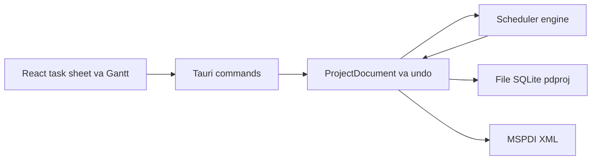

# ProjectDesk — quản lý dự án kiểu Microsoft Project

Pha 1–9 đã xong trên `main`. Pha 1 gồm bảng task, Gantt, menu và cột WBS (PR #3). Pha 2–5 (nguồn lực, theo dõi và chi phí, leveling, MSPDI) đã merge qua PR #5. Pha 6 (lịch trên giao diện) qua PR #6. Pha 7 (lọc, nhóm, highlight) qua PR #7. Pha 8 (PDF Gantt) qua PR #8; hộp thoại file được sửa trong PR #9 đã merge. Pha 9 (công việc lặp) qua PR của nhánh `phase-9-recurring`. Pha 10 chưa làm.

Giao diện tiếng Việt. Các pha mở rộng cùng một mô hình lịch trong engine Rust.

## Kiến trúc

- **Engine Rust** (`crates/engine`) là nguồn sự thật, không phụ thuộc Tauri. Mọi ngày bắt đầu, kết thúc, slack, đường găng, EVM và số cho burn-down do engine tính. Giao diện chỉ gửi lệnh và vẽ kết quả. Test CPM bằng `cargo test`.
- **Lệnh + undo**: mỗi thao tác (thêm task, đổi phụ thuộc, indent, gán nguồn lực, sửa lịch) là một command. Undo/redo đi trên log này.
- **File `.pdproj`**: một file SQLite. Mở/lưu bằng hộp thoại native của macOS. Snapshot burn-down (pha 10) nằm trong cùng file.
- **Hai chế độ task**, giống Project: *tự lên lịch* (engine dời ngày) và *lên lịch tay* (giữ ngày người dùng ghim).
- **Thời gian**: mốc là timestamp; thời lượng là phút làm việc. Lịch (tuần làm việc, ngoại lệ, ngày nghỉ) đổi phút làm việc thành ngày giờ thật.

Quyết định CPM, đã nằm trong engine:

1. Sắp topo theo phụ thuộc; báo vòng lặp.
2. Forward pass: early start/finish, cộng thời lượng trên lịch làm việc, áp ràng buộc và lag.
3. Backward pass: late start/finish, total slack, free slack.
4. Đường găng: total slack nhỏ hơn hoặc bằng 0.
5. Summary lấy min start và max finish của con.

Mô hình đã chốt: dự án có ngày bắt đầu, lịch chuẩn (thứ Hai–thứ Sáu, 08:00–12:00 và 13:00–17:00), ngày trạng thái. Task có tên, WBS, outline level, milestone (thời lượng 0), summary (rollup từ con), ghi chú, priority. Phụ thuộc FS / SS / FF / SF kèm lag theo phút làm việc. Ràng buộc đủ 8 kiểu: ASAP, ALAP, SNET, SNLT, FNET, FNLT, MSO, MFO. Lịch dự án và lịch task dùng cùng một kiểu lịch; pha 2 gắn lịch nguồn lực vào kiểu đó.

Trao đổi file ngoài dùng MSPDI (pha 5). Reader `.mpp` không nằm trong các pha này.

## Pha 1 — đã xong

- Scaffold Tauri 2 + React + TypeScript + Vite; workspace Cargo với `crates/engine`, `src-tauri` (lệnh mở/lưu) và `src` (React).
- Engine: CPM, lịch làm việc, phụ thuộc, ràng buộc, đường găng.
- Lưu trữ: command log undo/redo, file SQLite `.pdproj`, lệnh Tauri áp command.
- Giao diện: bảng task, Gantt (thanh task, summary, milestone, mũi tên phụ thuộc, đường găng, thang ngày/tuần/tháng), menu macOS, phím tắt, cột WBS. PR #3 đã merge.

## Pha 2 đến Pha 5 — đã xong

Pha 2–5 đã xong trên `main` qua PR #5.

### Pha 2 — nguồn lực

Đã xong.

- Resource: người hoặc máy, đơn vị tối đa, lịch riêng, mức giá chuẩn.
- Assignment: task gắn resource với units.
- Ba kiểu task của Project: Fixed Duration, Fixed Units, Fixed Work, kèm cờ effort-driven. Đổi một trong ba đại lượng duration / units / work thì engine tính lại hai đại lượng còn lại theo đúng kiểu task.
- View Resource Sheet và Task Usage (lưới theo ngày). Cột quá tải khi tổng units trong một khoảng vượt max units.

### Pha 3 — theo dõi, baseline, chi phí

Đã xong.

- Phần trăm hoàn thành, actual start/finish, remaining duration, remaining work.
- Baseline 0–10: mỗi mốc lưu start, finish, work, cost.
- Tracking Gantt: thanh kế hoạch và thanh baseline.
- Chi phí: standard rate, overtime rate, cost per use, fixed cost, cách cộng dồn (start / prorated / end).

Pha 10 đọc đúng các số này (baseline 0, ngày trạng thái, % complete, chi phí). UI không tính lại.

### Pha 4 — leveling

Đã xong. Phát hiện quá tải trước. Leveling là heuristic xếp theo priority rồi đến total slack (cùng họ với Project; không cam kết ra cùng một lịch từng giờ với Microsoft). Kết quả ghi vào field leveling delay. Pha này không tách task.

### Pha 5 — trao đổi với Microsoft Project

Đã xong.

- Đọc và ghi **MSPDI** (XML schema công khai của Project) bằng code của mình, cho tập field các pha 1–3 đã có: task, phụ thuộc, lịch, resource, assignment, baseline.
- Không có reader file nhị phân `.mpp` trong pha này. Parser Rust hiện có hoặc đọc một phần (MPP14), hoặc gắn giấy phép LGPL nên không link tĩnh vào app. Hướng đi đã chốt: người dùng Save As XML khi cần đủ field. Reader `.mpp` chỉ được xét lại khi có thư viện tương thích giấy phép và đọc đủ lịch cùng baseline — việc đó nằm ngoài mười pha.

## Pha 6 đến Pha 9

Pha 6–9 đã xong trên `main`.

### Pha 6 — sửa lịch trên giao diện

Đã xong qua PR #6.

- Các ô ngày giờ đang sửa được (ngày công việc, ngày thực, ngày ràng buộc, ngày bắt đầu dự án, ngày trạng thái, ngày nghỉ) dùng bộ chọn ngày giờ dạng popover viết trong app (lưới tháng bắt đầu từ thứ Hai, nút hôm nay, chọn giờ và phút, nút xóa cho ngày không bắt buộc). Lý do: cửa sổ Tauri trên macOS (WKWebView) không mở bộ chọn gốc cho ô nhập ngày/giờ. Vẫn gõ ngày trực tiếp được. Xem PR #12. Mốc thời gian trong engine vẫn là millisecond.
- Sửa tuần làm việc: ngày trong tuần và các khoảng giờ. Mặc định giữ thứ Hai–thứ Sáu, 08:00–12:00 và 13:00–17:00.
- Thêm, sửa, xóa ngày nghỉ và ngoại lệ (một ngày hoặc một khoảng Từ–Đến), nghỉ cả ngày hoặc có giờ làm riêng. Ngày của ngoại lệ chọn bằng bộ chọn ngày, không gõ tự do.
- Sửa lịch dự án, lịch task và lịch nguồn lực trên cùng kiểu lịch của engine. Chọn "lịch dự án" vẫn là kế thừa. Tạo hoặc sửa lịch có tên đi qua command nên undo/redo gồm các lần sửa đó.
- Mỗi lần sửa là một command (undo được). Engine tính lại sớm/muộn, slack và đường găng. Giao diện không tự đổi phút làm việc.

### Pha 7 — lọc, nhóm, highlight

Đã xong qua PR #7.

- Lọc bảng và Gantt theo ba tiêu chí: đường găng (total slack nhỏ hơn hoặc bằng 0), theo người được gán, task trễ hạn.
- Trễ hạn: task bị coi là trễ nếu thỏa một trong các điều kiện: chưa xong và finish sau ngày trạng thái; finish sau finish của baseline 0; hoặc có đặt deadline và finish sau deadline. Deadline là một ngày tùy chọn của task, sửa bằng bộ chọn ngày, undo được, và không phải một kiểu ràng buộc.
- Nhóm có hai kiểu: theo người và theo summary (WBS). Theo người: task có nhiều người hiện dưới từng người, task chưa gán ai nằm trong nhóm "Chưa gán". Theo summary: task lá nằm dưới summary cha gần nhất, tiêu đề nhóm là mã WBS và tên (ví dụ "1.2 Thiết kế"), task lá cấp cao nhất nằm trong nhóm "Không có summary"; nhóm và task trong nhóm giữ thứ tự outline. Nhóm chỉ đổi cách xếp hàng trên view, không ghi đè outline đã lưu.
- Highlight tô đúng ba nhóm trên. Cờ đường găng và trễ hạn lấy từ engine. Bộ lọc và nhóm là trạng thái cửa sổ.

### Pha 8 — in hoặc xuất PDF trang Gantt

Đã xong qua PR #8. Hộp thoại file được sửa trong PR #9 đã merge.

- In hoặc xuất PDF đúng trang đang xem: bảng task bên trái và Gantt bên phải.
- Giữ thang ngày/tuần/tháng, đường găng, mũi tên phụ thuộc, và bộ lọc pha 7 nếu đang bật.
- Cắt trang theo chiều thời gian và theo danh sách task.
- Hộp thoại in/lưu của macOS. Ngày trên trang in là ngày engine đã tính. Không có server.

### Pha 9 — công việc lặp — đã xong

Đã làm (module `recurrence.rs` trong engine, hộp thoại `RecurringDialog`):

- Mẫu lặp theo kiểu MS Project: ngày (mỗi N ngày làm việc trên lịch của chuỗi), tuần (mỗi N tuần vào các thứ đã chọn, tuần bắt đầu thứ Hai), tháng (ngày X của mỗi N tháng; X lớn hơn số ngày của tháng thì rơi vào ngày cuối tháng). Kết thúc sau N lần hoặc tại một ngày (tính cả ngày đó). Tối đa 999 lần như Project.
- Chuỗi là một summary task giữ định nghĩa (`Task.recurrence`). Con của nó là các occurrence thật (`series_uid`, `occurrence_date`), mỗi cái có ràng buộc SNET tại giờ làm việc đầu tiên của ngày mẫu sinh ra, theo lịch của chuỗi hoặc lịch dự án. Ngày nghỉ nên occurrence dời sang giờ làm việc kế tiếp. Summary rollup như summary thường, CPM chạy trên occurrence. Occurrence là fixed units, không effort-driven, nên gán nhiều nguồn lực không rút ngắn thời lượng.
- Lệnh `CreateRecurringTask` và `UpdateRecurringTask` đi qua command log, nên undo/redo và lưu `.pdproj` hoạt động. Đổi tên summary cũng sửa tên chuỗi và sinh lại.
- Sửa riêng một occurrence (tên, thời lượng, ngày, ràng buộc, lịch, nguồn lực, tiến độ, chi phí…) đánh dấu `detached`; sinh lại chuỗi giữ nguyên lần đó và không sinh trùng ngày của nó. Occurrence còn theo chuỗi giữ UID theo thứ tự khi sinh lại, nên liên kết và baseline trên chúng còn.
- Xóa một occurrence ghi ngày đó vào `skipped` để sinh lại không tạo lại. Xóa chuỗi xóa summary và các occurrence còn theo chuỗi; occurrence đã tách và task tự thêm bên dưới được giữ lại, lên một cấp.
- Không đổi cấp (thụt vào/ra) từng occurrence; phải sửa cả chuỗi.
- MSPDI: xuất occurrence như task thường dưới summary, summary có `<Recurring>1</Recurring>`. Nhập lại thành task thường (không dựng lại chuỗi).
- Giao diện: nút "Công việc lặp" trên thanh công cụ và mục "Sửa → Công việc lặp…". Hộp thoại có tên, thời lượng, mẫu, ngày bắt đầu và kết thúc (dùng DateTimeField), lịch, nguồn lực. Dòng summary có biểu tượng ↻, bấm để sửa chuỗi; occurrence có dấu ·, lần đã tách có ↺. Inspector có nút "Sửa cả chuỗi…".

Giới hạn:

- Chưa có mẫu "mỗi N ngày lịch", "thứ X thứ Y trong tháng" (ví dụ thứ Hai đầu tiên) hay lặp theo năm.
- Nhập MSPDI không dựng lại chuỗi lặp; chuỗi thành summary thường với các task con.
- Nguồn lực của chuỗi luôn gán với đơn vị 1.0; hộp thoại chưa cho chọn đơn vị. Muốn khác thì sửa riêng từng lần (lần đó thành tách).
- Chưa kiểm thử tự động phần giao diện; engine có test, giao diện cần kiểm tay trong cửa sổ Tauri.

## Pha 10 — chỉ số EVM và burn-down — chưa làm

Pha 10 chưa làm. Cả panel EVM và burn-down chỉ đọc số do engine trả về. JavaScript không tính lại EVM.

### EVM

Nguồn số liệu là baseline 0, ngày trạng thái, % complete và chi phí đã định ở pha 3 (kể cả cách cộng dồn start / prorated / end). Cộng trên task lá để summary không bị tính hai lần.

- **BAC**: tổng cost baseline 0.
- **PV (BCWS)**: phần cost baseline 0 lẽ ra xong tính đến ngày trạng thái. Cộng dồn `start`: tính cả cost nếu baseline start đã tới. `end`: tính cả cost nếu baseline finish đã tới. `prorated`: tỷ lệ phút làm việc từ baseline start đến ngày trạng thái trên thời lượng baseline, nhân cost baseline.
- **EV (BCWP)**: tổng của % complete × cost baseline 0 của từng task lá.
- **AC (ACWP)**: tổng chi phí thực tế đến ngày trạng thái.
- **SV** = EV − PV. **CV** = EV − AC.
- **SPI** = EV / PV khi PV lớn hơn 0. **CPI** = EV / AC khi AC lớn hơn 0.
- **EAC** = BAC / CPI khi CPI lớn hơn 0. **ETC** = EAC − AC. **VAC** = BAC − EAC.
- Khi mẫu số không lớn hơn 0, engine trả SPI, CPI, EAC, ETC, VAC là không xác định. Không đổi sang công thức EAC khác.

Panel nhỏ cạnh Gantt, nhãn tiếng Việt và viết tắt trong ngoặc:

- Giá trị kế hoạch (PV, BCWS)
- Giá trị đạt được (EV, BCWP)
- Chi phí thực tế (AC, ACWP)
- Chênh lệch tiến độ (SV)
- Chênh lệch chi phí (CV)
- Chỉ số tiến độ (SPI)
- Chỉ số chi phí (CPI)
- Ngân sách khi hoàn thành (BAC)
- Ước tính khi hoàn thành (EAC)
- Ước tính phần còn lại (ETC)
- Chênh lệch khi hoàn thành (VAC)

### Burn-down

- Biểu đồ cùng khu vực cạnh Gantt: trục ngang là ngày, trục dọc là khối lượng còn lại (remaining work của pha 3). Engine lưu phút làm việc; UI có thể hiện giờ.
- Đường thực tế nối các snapshot. Đường lý tưởng là đoạn thẳng từ baseline start (khối lượng = tổng work baseline 0) đến baseline finish (khối lượng = 0).
- Mỗi lần người dùng lưu file, hoặc khi ngày trạng thái đổi, engine ghi thêm một snapshot: ngày, remaining work, EV, AC. Cùng một ngày thì ghi đè snapshot của ngày đó.
- Snapshot nằm trong SQLite `.pdproj`. Không có server, không có dịch vụ ngoài máy.

## Vẫn chưa làm

Tách task, đọc file `.mpp`, sơ đồ mạng, nhiều người dùng, server, công thức trường tùy chỉnh, CI bản cài Windows/Linux.
