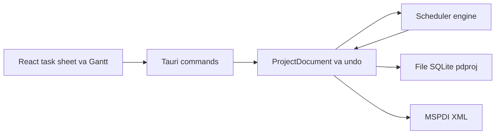

# Sheafly — quản lý dự án kiểu Microsoft Project

Pha 1–10 đã xong. Lõi của pha 1–5 (engine CPM, lịch, nguồn lực, theo dõi và chi phí, leveling, MSPDI, bảng task, Gantt, menu) vào cùng lúc ở PR #1. PR #2 cấu hình CI và định danh app macOS. PR #3 thêm cột WBS. PR #4 thêm bản kế hoạch sửa đổi. PR #5 lấp các chỗ còn thiếu của pha 2, 3 và 5. Pha 6 (lịch trên giao diện) qua PR #6. Pha 7 (lọc, nhóm, highlight) qua PR #7. Pha 8 (PDF Gantt) qua PR #8; hộp thoại file được sửa trong PR #9 đã merge. Pha 9 (công việc lặp) qua PR #15 đã merge. Pha 10 (chỉ số EVM và burn-down) qua PR #16.

Các sửa bổ sung đã merge vào `main`: PR #10 (căn header với độ rộng ngày của Gantt), PR #11 và PR #13 (đồng bộ kế hoạch), PR #12 (bộ chọn ngày giờ trong app), PR #14 (nhóm theo summary ở pha 7).

Sau pha 10 (chi tiết ở mục Sau pha 10): PR #17 (CI build bản cài macOS, Windows, Linux), PR #18 (test frontend với Vitest), PR #19 (phần còn lại của pha 9–10), PR #20 (sơ đồ mạng), PR #21 (tách công việc), PR #22 (CLAUDE.md), PR #23 (an toàn dữ liệu).

Giao diện tiếng Việt. Các pha mở rộng cùng một mô hình lịch trong engine Rust.

## Kiến trúc

- **Engine Rust** (`crates/engine`) là nguồn sự thật, không phụ thuộc Tauri. Mọi ngày bắt đầu, kết thúc, slack, đường găng, EVM và số cho burn-down do engine tính. Giao diện chỉ gửi lệnh và vẽ kết quả. Test CPM bằng `cargo test`.
- **Lệnh + undo**: mỗi thao tác (thêm task, đổi phụ thuộc, indent, gán nguồn lực, sửa lịch) là một command. Undo/redo đi trên log này.
- **File `.sheafly`** (trước khi đổi tên là `.pdproj`; cả hai mở được): một file SQLite. Mở/lưu bằng hộp thoại native của macOS. Snapshot burn-down (pha 10) nằm trong cùng file.
- **Hai chế độ task**, giống Project: *tự lên lịch* (engine dời ngày) và *lên lịch tay* (giữ ngày người dùng ghim).
- **Thời gian**: mốc là timestamp; thời lượng là phút làm việc. Lịch (tuần làm việc, ngoại lệ, ngày nghỉ) đổi phút làm việc thành ngày giờ thật.

Quyết định CPM, đã nằm trong engine:

1. Sắp topo theo phụ thuộc; báo vòng lặp.
2. Forward pass: early start/finish, cộng thời lượng trên lịch làm việc, áp ràng buộc và lag.
3. Backward pass: late start/finish, total slack, free slack.
4. Đường găng: total slack nhỏ hơn hoặc bằng 0.
5. Summary lấy min start và max finish của con.

Mô hình đã chốt: dự án có ngày bắt đầu, lịch chuẩn (thứ Hai–thứ Sáu, 08:00–12:00 và 13:00–17:00), ngày trạng thái. Task có tên, WBS, outline level, milestone (thời lượng 0), summary (rollup từ con), ghi chú, priority. Phụ thuộc FS / SS / FF / SF kèm lag theo phút làm việc. Ràng buộc đủ 8 kiểu: ASAP, ALAP, SNET, SNLT, FNET, FNLT, MSO, MFO. Lịch dự án và lịch task dùng cùng một kiểu lịch; pha 2 gắn lịch nguồn lực vào kiểu đó.

Trao đổi file ngoài dùng MSPDI (pha 5). Reader `.mpp` không nằm trong các pha này.

## Pha 1 — đã xong

- Scaffold Tauri 2 + React + TypeScript + Vite; workspace Cargo với `crates/engine`, `src-tauri` (lệnh mở/lưu) và `src` (React).
- Engine: CPM, lịch làm việc, phụ thuộc, ràng buộc, đường găng.
- Lưu trữ: command log undo/redo, file SQLite `.pdproj`, lệnh Tauri áp command.
- Giao diện: bảng task, Gantt (thanh task, summary, milestone, mũi tên phụ thuộc, đường găng, thang ngày/tuần/tháng), menu macOS, phím tắt (PR #1), cột WBS (PR #3).

## Pha 2 đến Pha 5 — đã xong

Pha 2–5 vào cùng lõi ở PR #1; PR #5 lấp các chỗ còn thiếu (effort-driven, chi phí summary, giờ ngoại lệ trong MSPDI).

### Pha 2 — nguồn lực

Đã xong.

- Resource: người hoặc máy, đơn vị tối đa, lịch riêng, mức giá chuẩn.
- Assignment: task gắn resource với units.
- Ba kiểu task của Project: Fixed Duration, Fixed Units, Fixed Work, kèm cờ effort-driven. Đổi một trong ba đại lượng duration / units / work thì engine tính lại hai đại lượng còn lại theo đúng kiểu task.
- View Resource Sheet và Task Usage (lưới theo ngày). Cột quá tải khi tổng units trong một khoảng vượt max units.

### Pha 3 — theo dõi, baseline, chi phí

Đã xong.

- Phần trăm hoàn thành, actual start/finish, remaining duration, remaining work.
- Baseline 0–10: mỗi mốc lưu start, finish, work, cost.
- Tracking Gantt: thanh kế hoạch và thanh baseline.
- Chi phí: standard rate, overtime rate, cost per use, fixed cost, cách cộng dồn (start / prorated / end).

Pha 10 đọc đúng các số này (baseline 0, ngày trạng thái, % complete, chi phí). UI không tính lại.

### Pha 4 — leveling

Đã xong. Phát hiện quá tải trước. Leveling là heuristic xếp theo priority rồi đến total slack (cùng họ với Project; không cam kết ra cùng một lịch từng giờ với Microsoft). Kết quả ghi vào field leveling delay. Pha này không tách task.

### Pha 5 — trao đổi với Microsoft Project

Đã xong.

- Đọc và ghi **MSPDI** (XML schema công khai của Project) bằng code của mình, cho tập field các pha 1–3 đã có: task, phụ thuộc, lịch, resource, assignment, baseline.
- Không có reader file nhị phân `.mpp` trong pha này. Parser Rust hiện có hoặc đọc một phần (MPP14), hoặc gắn giấy phép LGPL nên không link tĩnh vào app. Hướng đi đã chốt: người dùng Save As XML khi cần đủ field. Reader `.mpp` chỉ được xét lại khi có thư viện tương thích giấy phép và đọc đủ lịch cùng baseline — việc đó nằm ngoài mười pha.

## Pha 6 đến Pha 9

Pha 6–9 đã xong trên `main`.

### Pha 6 — sửa lịch trên giao diện

Đã xong qua PR #6. Bộ chọn ngày giờ được thay bằng popover trong app ở PR #12.

- Các ô ngày giờ đang sửa được (ngày công việc, ngày thực, ngày ràng buộc, ngày bắt đầu dự án, ngày trạng thái, ngày nghỉ) dùng bộ chọn ngày giờ dạng popover viết trong app (lưới tháng bắt đầu từ thứ Hai, nút hôm nay, chọn giờ và phút, nút xóa cho ngày không bắt buộc). Lý do: cửa sổ Tauri trên macOS (WKWebView) không mở bộ chọn gốc cho ô nhập ngày/giờ. Vẫn gõ ngày trực tiếp được. Mốc thời gian trong engine vẫn là millisecond.
- Sửa tuần làm việc: ngày trong tuần và các khoảng giờ. Mặc định giữ thứ Hai–thứ Sáu, 08:00–12:00 và 13:00–17:00.
- Thêm, sửa, xóa ngày nghỉ và ngoại lệ (một ngày hoặc một khoảng Từ–Đến), nghỉ cả ngày hoặc có giờ làm riêng. Ngày của ngoại lệ chọn bằng bộ chọn ngày, không gõ tự do.
- Sửa lịch dự án, lịch task và lịch nguồn lực trên cùng kiểu lịch của engine. Chọn "lịch dự án" vẫn là kế thừa. Tạo hoặc sửa lịch có tên đi qua command nên undo/redo gồm các lần sửa đó.
- Mỗi lần sửa là một command (undo được). Engine tính lại sớm/muộn, slack và đường găng. Giao diện không tự đổi phút làm việc.

### Pha 7 — lọc, nhóm, highlight

Đã xong qua PR #7. Nhóm theo summary được thêm ở PR #14.

- Lọc bảng và Gantt theo ba tiêu chí: đường găng (total slack nhỏ hơn hoặc bằng 0), theo người được gán, task trễ hạn.
- Trễ hạn: task bị coi là trễ nếu thỏa một trong các điều kiện: chưa xong và finish sau ngày trạng thái; finish sau finish của baseline 0; hoặc có đặt deadline và finish sau deadline. Deadline là một ngày tùy chọn của task, sửa bằng bộ chọn ngày, undo được, và không phải một kiểu ràng buộc.
  - Ghi chú (đã sửa ở Pha 13 phần 1): điều kiện đầu khác MS Project. Khi đã đặt ngày trạng thái, mọi task chưa xong có finish trong tương lai đều bị tính là trễ (`Task::is_late` trong `model.rs`). MS Project chỉ tính trễ khi tiến độ thực tế ít hơn phần lẽ ra đã xong tại ngày trạng thái. Sửa ở Pha 13.
- Nhóm có hai kiểu: theo người và theo summary (WBS). Theo người: task có nhiều người hiện dưới từng người, task chưa gán ai nằm trong nhóm "Chưa gán". Theo summary: task lá nằm dưới summary cha gần nhất, tiêu đề nhóm là mã WBS và tên (ví dụ "1.2 Thiết kế"), task lá cấp cao nhất nằm trong nhóm "Không có summary"; nhóm và task trong nhóm giữ thứ tự outline. Nhóm chỉ đổi cách xếp hàng trên view, không ghi đè outline đã lưu.
- Highlight tô đúng ba nhóm trên. Cờ đường găng và trễ hạn lấy từ engine. Bộ lọc và nhóm là trạng thái cửa sổ.

### Pha 8 — in hoặc xuất PDF trang Gantt

Đã xong qua PR #8. Hộp thoại file được sửa trong PR #9 đã merge.

- In hoặc xuất PDF đúng trang đang xem: bảng task bên trái và Gantt bên phải.
- Giữ thang ngày/tuần/tháng, đường găng, mũi tên phụ thuộc, và bộ lọc pha 7 nếu đang bật.
- Cắt trang theo chiều thời gian và theo danh sách task.
- Hộp thoại in/lưu của macOS. Ngày trên trang in là ngày engine đã tính. Không có server.

### Pha 9 — công việc lặp — đã xong (PR #15)

Đã xong qua PR #15 đã merge. Đã làm (module `recurrence.rs` trong engine, hộp thoại `RecurringDialog`):

- Mẫu lặp theo kiểu MS Project: ngày (mỗi N ngày làm việc trên lịch của chuỗi), tuần (mỗi N tuần vào các thứ đã chọn, tuần bắt đầu thứ Hai), tháng (ngày X của mỗi N tháng; X lớn hơn số ngày của tháng thì rơi vào ngày cuối tháng). Kết thúc sau N lần hoặc tại một ngày (tính cả ngày đó). Tối đa 999 lần như Project.
- Chuỗi là một summary task giữ định nghĩa (`Task.recurrence`). Con của nó là các occurrence thật (`series_uid`, `occurrence_date`), mỗi cái có ràng buộc SNET tại giờ làm việc đầu tiên của ngày mẫu sinh ra, theo lịch của chuỗi hoặc lịch dự án. Ngày nghỉ nên occurrence dời sang giờ làm việc kế tiếp. Summary rollup như summary thường, CPM chạy trên occurrence. Occurrence là fixed units, không effort-driven, nên gán nhiều nguồn lực không rút ngắn thời lượng.
- Lệnh `CreateRecurringTask` và `UpdateRecurringTask` đi qua command log, nên undo/redo và lưu `.pdproj` hoạt động. Đổi tên summary cũng sửa tên chuỗi và sinh lại.
- Sửa riêng một occurrence (tên, thời lượng, ngày, ràng buộc, lịch, nguồn lực, tiến độ, chi phí…) đánh dấu `detached`; sinh lại chuỗi giữ nguyên lần đó và không sinh trùng ngày của nó. Occurrence còn theo chuỗi giữ UID theo thứ tự khi sinh lại, nên liên kết và baseline trên chúng còn.
- Xóa một occurrence ghi ngày đó vào `skipped` để sinh lại không tạo lại. Xóa chuỗi xóa summary và các occurrence còn theo chuỗi; occurrence đã tách và task tự thêm bên dưới được giữ lại, lên một cấp.
- Không đổi cấp (thụt vào/ra) từng occurrence; phải sửa cả chuỗi.
- MSPDI: xuất occurrence như task thường dưới summary, summary có `<Recurring>1</Recurring>`. Nhập lại thành task thường (không dựng lại chuỗi).
- Giao diện: nút "Công việc lặp" trên thanh công cụ và mục "Sửa → Công việc lặp…". Hộp thoại có tên, thời lượng, mẫu, ngày bắt đầu và kết thúc (dùng DateTimeField), lịch, nguồn lực. Dòng summary có biểu tượng ↻, bấm để sửa chuỗi; occurrence có dấu ·, lần đã tách có ↺. Inspector có nút "Sửa cả chuỗi…".

Giới hạn:

- ~~Chưa có mẫu "mỗi N ngày lịch", "thứ X thứ Y trong tháng" (ví dụ thứ Hai đầu tiên) hay lặp theo năm.~~ Đã thêm ở PR #19 (`calendar_daily`, `monthly_nth`, `yearly`, `yearly_nth`).
- Nhập MSPDI không dựng lại chuỗi lặp; chuỗi thành summary thường với các task con.
- ~~Nguồn lực của chuỗi luôn gán với đơn vị 1.0.~~ PR #19 cho chọn đơn vị từng nguồn lực của chuỗi.
- ~~Chưa kiểm thử tự động phần giao diện.~~ PR #18 thêm test Vitest cho hộp thoại.

## Pha 10 — chỉ số EVM và burn-down — đã xong (PR #16)

Đã xong qua PR #16. Đã làm (module `evm.rs` trong engine, lệnh Tauri `project_metrics`, panel `EvmPanel`). Cả panel EVM và burn-down chỉ đọc số do engine trả về. JavaScript không tính lại EVM.

- Engine tính BAC, PV, EV, AC, SV, CV, SPI, CPI, EAC, ETC, VAC đúng công thức dưới đây, cộng trên task lá. Cách cộng dồn của PV lấy từ trường cộng dồn của task (Đầu / Phân bổ / Cuối), cùng trường pha 3 dùng cho chi phí thực tế. Với `prorated`, thời lượng baseline là số phút làm việc giữa baseline start và baseline finish trên lịch của task. Baseline thời lượng 0 (mốc) coi như đã lên kế hoạch hết khi tới baseline finish.
- Mẫu số không lớn hơn 0 thì SPI, CPI, EAC, ETC, VAC là `null`; giao diện hiện "—" kèm chú thích. Thiếu ngày trạng thái hoặc không task lá nào có baseline 0 thì engine không trả chỉ số; panel báo rõ thiếu gì và có nút mở hộp thoại tương ứng.
- Snapshot burn-down (ngày, remaining work, EV, AC) nằm trong bảng `burndown` của file `.pdproj`, ngoài command log nên undo không xóa. Ghi khi lưu tệp (Lưu, Lưu thành…) và khi một lệnh làm đổi ngày trạng thái sang một ngày khác rỗng. Ngày của snapshot là 00:00 của ngày trạng thái; chưa có ngày trạng thái thì lấy ngày hiện tại. Cùng ngày thì ghi đè. File cũ không có bảng thì mở với danh sách rỗng.
- Engine trả đường lý tưởng (baseline start, tổng work baseline 0 của task lá) → (baseline finish, 0), các snapshot có ngày không sau ngày trạng thái, và remaining work hiện tại.
- Giao diện: nút "EVM" trên thanh công cụ và mục "Xem → Chỉ số EVM và burn-down" mở panel bên phải Gantt (trong view Gantt và Gantt theo dõi). Panel có bảng 11 chỉ số với nhãn bên dưới, và biểu đồ burn-down vẽ tay bằng SVG cùng bảng màu với Gantt: đường lý tưởng nét đứt xám, đường thực tế xanh có điểm, ngày trạng thái nét đứt đỏ, trục dọc tính bằng giờ.
- Test engine trong `crates/engine/tests/engine.rs`: từng kiểu cộng dồn (kể cả giờ nghỉ trưa trên lịch), bộ chỉ số tính tay, chỉ cộng task lá, các trường hợp chia cho 0, đường lý tưởng, ghi và ghi đè snapshot, lưu/mở, undo, lọc theo ngày trạng thái, file cũ không có bảng.

Giới hạn:

- ~~AC không cắt theo thời gian tại ngày trạng thái.~~ PR #19 rải AC đều theo thời gian làm việc từ ngày bắt đầu thực tế tới điểm tiến độ, theo cách cộng dồn của task.
- Task lá chưa có baseline 0 (thêm sau khi đặt baseline) không góp vào BAC, PV, EV nhưng vẫn góp vào AC. Chi phí cố định đặt trên chính summary không được tính, vì chỉ cộng task lá.
- Đường thực tế chỉ có điểm từ lúc dùng bản này: không dựng lại lịch sử cho file cũ. Hoàn tác việc đổi ngày trạng thái không xóa snapshot đã ghi. Ngày "hiện tại" khi chưa có ngày trạng thái lấy theo giờ UTC, giống ngày bắt đầu mặc định của dự án mới.
- ~~Chưa vẽ đường cong S.~~ PR #19 thêm đường cong S (PV/EV/AC cộng dồn theo ngày hoặc tuần).
- ~~Chưa kiểm thử tự động phần giao diện.~~ PR #18 thêm test cho `EvmPanel`.

### EVM

Nguồn số liệu là baseline 0, ngày trạng thái, % complete và chi phí đã định ở pha 3 (kể cả cách cộng dồn start / prorated / end). Cộng trên task lá để summary không bị tính hai lần.

- **BAC**: tổng cost baseline 0.
- **PV (BCWS)**: phần cost baseline 0 lẽ ra xong tính đến ngày trạng thái. Cộng dồn `start`: tính cả cost nếu baseline start đã tới. `end`: tính cả cost nếu baseline finish đã tới. `prorated`: tỷ lệ phút làm việc từ baseline start đến ngày trạng thái trên thời lượng baseline, nhân cost baseline.
- **EV (BCWP)**: tổng của % complete × cost baseline 0 của từng task lá.
- **AC (ACWP)**: tổng chi phí thực tế đến ngày trạng thái.
- **SV** = EV − PV. **CV** = EV − AC.
- **SPI** = EV / PV khi PV lớn hơn 0. **CPI** = EV / AC khi AC lớn hơn 0.
- **EAC** = BAC / CPI khi CPI lớn hơn 0. **ETC** = EAC − AC. **VAC** = BAC − EAC.
- Khi mẫu số không lớn hơn 0, engine trả SPI, CPI, EAC, ETC, VAC là không xác định. Không đổi sang công thức EAC khác.

Panel nhỏ cạnh Gantt, nhãn tiếng Việt và viết tắt trong ngoặc:

- Giá trị kế hoạch (PV, BCWS)
- Giá trị đạt được (EV, BCWP)
- Chi phí thực tế (AC, ACWP)
- Chênh lệch tiến độ (SV)
- Chênh lệch chi phí (CV)
- Chỉ số tiến độ (SPI)
- Chỉ số chi phí (CPI)
- Ngân sách khi hoàn thành (BAC)
- Ước tính khi hoàn thành (EAC)
- Ước tính phần còn lại (ETC)
- Chênh lệch khi hoàn thành (VAC)

### Burn-down

- Biểu đồ cùng khu vực cạnh Gantt: trục ngang là ngày, trục dọc là khối lượng còn lại (remaining work của pha 3). Engine lưu phút làm việc; UI có thể hiện giờ.
- Đường thực tế nối các snapshot. Đường lý tưởng là đoạn thẳng từ baseline start (khối lượng = tổng work baseline 0) đến baseline finish (khối lượng = 0).
- Mỗi lần người dùng lưu file, hoặc khi ngày trạng thái đổi, engine ghi thêm một snapshot: ngày, remaining work, EV, AC. Cùng một ngày thì ghi đè snapshot của ngày đó.
- Snapshot nằm trong SQLite `.pdproj`. Không có server, không có dịch vụ ngoài máy.

## Sau pha 10 — đã xong

- **Bản cài (PR #17):** `.github/workflows/build.yml` build bản cài chưa ký cho macOS, Windows, Linux; tag `v*` tạo draft release.
- **Test frontend (PR #18):** Vitest, Testing Library, jsdom. `src/test/fakeBackend.ts` thay các lệnh Tauri; không chạy engine thật.
- **Sơ đồ mạng (PR #20):** module `network.rs` xếp ô theo cột và tuyến cạnh; lệnh Tauri `network_layout`; view "Sơ đồ mạng" có kéo, phóng to, chọn chung với bảng task, hộp thoại sửa và xuất PDF. Mặc định ẩn summary.
- **Tách công việc (PR #21):** module `split.rs`. Một lần tách lưu số phút làm việc trước khoảng nghỉ và độ dài khoảng nghỉ; `schedule()` tính ra các đoạn (`segments`). Baseline lưu đoạn của nó, PV và burn-down kế hoạch bỏ qua khoảng nghỉ. MSPDI đọc/ghi các đoạn. Gantt vẽ thanh đứt đoạn.
- **CLAUDE.md (PR #22):** hướng dẫn cho Claude Code: lệnh build/test, kiến trúc, quy tắc của repo.
- **An toàn dữ liệu (PR #23):**
  - Mới, Mở, Nhập MSPDI, đóng cửa sổ, Cmd+Q và thoát từ Dock đều hỏi "Lưu / Không lưu / Hủy" khi còn thay đổi chưa lưu. Cmd+Q dùng mục menu riêng thay cho mục Thoát có sẵn.
  - Lưu ghi ra một tệp tạm ẩn, tên riêng, cạnh tệp thật (đi theo symlink) trong một transaction, giữ quyền của tệp cũ, rồi đổi tên đè lên. App crash giữa chừng không làm hỏng tệp, và không xóa nhầm tệp `.tmp` của người dùng.
  - Trong lúc một hộp thoại native đang mở, các lệnh sửa, hoàn tác, làm lại bị từ chối, để câu trả lời "Lưu / Không lưu" áp đúng trạng thái người dùng đang thấy.
  - Mở tệp kiểm tra `FORMAT_VERSION`: tệp của phiên bản mới hơn bị từ chối với thông báo rõ, và lệnh lạ trong log cũng báo như vậy. Thêm biến thể `Command` hoặc bảng mới thì phải tăng `FORMAT_VERSION`.
  - Đang gõ dở trong ô nhập thì Cmd+Z, Cmd+Shift+Z hoàn tác/làm lại chữ trong ô; ô không còn chữ chưa xác nhận thì chúng hoàn tác dự án như thường. Cmd+Backspace trong ô xóa chữ tới đầu dòng, không xóa công việc (`src/shortcuts.ts`).

## Lộ trình

Theo đánh giá độc lập sau PR #23 (đối chiếu từng mục với code) và kiểm tra giao diện trên một dự án mẫu 21 dòng. Pha 11 làm trước vì nhỏ và người dùng thấy ngay; Pha 12 là nền cho Pha 13 và 16. Pha 14 chạy song song khi có tài khoản Apple Developer.

Trạng thái (13/10/2026): Pha 11–13 và 15–17 đã xong. Pha 14 đã làm phần gắn kiểu tệp, CSP, bản universal; còn ký số và notarize, cần tài khoản Apple Developer. Pha 15 còn đối chiếu với tệp xuất từ Project thật và giao diện lịch nguồn lực. Đã thêm sau Pha 15: chi phí thực tế nhập theo assignment (PR #62) và báo cáo cảnh báo khi nhập MSPDI (PR #63, `mspdi_report.rs`: tuần làm việc bị bỏ, % bị thay bằng số theo ngày thực tế, công việc đổi ngày so với tệp quá một phút); chi phí thực tế theo ngày để backlog.

Kiểm tra thủ công còn nợ trong `pnpm tauri dev` (các PR #28–#33 mới được kiểm bằng test, bench và ảnh chụp trình duyệt):

- Tự lưu và khôi phục: sửa, chờ 30 giây, tắt hẳn tiến trình, mở lại, thử "Khôi phục" và "Bỏ bản tự lưu"; thoát bình thường với "Không lưu" thì lần sau không hỏi.
- Mở tệp có dòng log hỏng: sheet cảnh báo, bản sao chưa có tên, "Lưu" hỏi chỗ lưu mới.
- Nhập ngày thực tế và % trong panel thuộc tính, xem task sau dời theo; "Dời phần chưa xong sau ngày trạng thái"; chuỗi họp có ô "Chuỗi nền".
- "Gộp lịch sử hoàn tác" trên dự án hơn 100 bước.

### Pha 11 — giao diện cơ bản (S–M) — đã xong (PR #25)

Kiểm tra bằng mắt: đã chụp sau Pha 13 trên một dự án mẫu 25 dòng (5 giai đoạn, 3 nguồn lực, baseline, tiến độ thực tế, task tách, chuỗi họp nền), ở 8 view: Gantt, Theo dõi, Nguồn lực, Sử dụng, Sơ đồ mạng, EVM, Gantt thang tuần tô đường găng, lọc trễ hạn. Ảnh chụp giao diện React thật với dữ liệu engine thật trong Chromium và WebKit, chưa chụp cửa sổ Tauri (không có hộp thoại native).

Sửa sau khi chụp (PR #33): tiêu đề ô sơ đồ mạng tách dấu của "ế" trên Chromium vì CSS chỉ khai `-apple-system`; mọi chỗ đặt phông giờ dùng `--font-ui` / `UI_FONT_FAMILY` (thêm `BlinkMacSystemFont`). WebKit (app trên macOS) không bị; bản Windows (WebView2) thì có. Thang tuần của Gantt chỉ ghi ngày thứ Hai, vì cột 14 px không đủ chỗ cho mọi ngày hai chữ số. Các điểm khác thấy khi chụp đã đưa vào Pha 16 và Pha 17.

Mục tiêu: màn hình chính đọc đúng và đủ thông tin mà không phải đoán.

- Thời lượng và việc còn lại hiện theo ngày như Project ("7,5 ngày", mốc "0 ngày"), không lẫn "60 giờ", "768 phút" trong cùng bảng.
- Panel thuộc tính: có tiêu đề là tên task đang chọn, chia nhóm (Lịch, Theo dõi, Chi phí, Nguồn lực), thu gọn được, không hiện ở view Nguồn lực, Sử dụng, Sơ đồ mạng; task summary không hiện trường không áp dụng.
- Nhãn ngày ở thang "Ngày" không đè lên nhau.
- Bảng Gantt có cột Nguồn lực, % hoàn thành, Tiền nhiệm; thanh Gantt ghi tên nguồn lực bên phải như Project.
- Thanh trạng thái nói task nào quyết định ngày kết thúc dự án (ví dụ chuỗi họp lặp kéo dài sau mốc phát hành), để đường găng không gây hiểu lầm.

Nghiệm thu: test Vitest cho định dạng thời lượng, nhãn ngày và cột mới; chụp màn hình dự án mẫu trước và sau.

### Pha 12 — nền tệp và hiệu năng (L) — đã xong (PR #28, #29, phần 3)

Mục tiêu: undo, mở tệp và sửa không làm đứng UI ở dự án lớn, và tệp hỏng một phần vẫn mở được.

Chia 3 PR: (1) hiệu năng và checkpoint, (2) tệp hỏng một phần và báo đổi ngày khi đổi engine, (3) autosave, khôi phục sau crash, gộp lịch sử.

**Phần 1 — đã xong (PR #28).** Bench `crates/engine/benches/large_project.rs` (1.000 task, 10.000 lệnh, máy phát triển):

| | Trước | Sau |
|---|---|---|
| Undo / Redo | 14,5 giây | 40 ms |
| Mở tệp | 14,4 giây | 8 ms |
| Undo ngay sau khi mở (chậm nhất trong 50 lần) | — | 37 ms |
| Một lệnh sửa (chậm nhất) | 25 ms | 4 ms |

- `Calendar::ranges_on` trả về slice, tra ngày ngoại lệ không cấp phát chuỗi; `working_between` tính theo tuần rồi cộng ngoại lệ trong khoảng, bỏ giới hạn 3.660 ngày. Hai thay đổi này chiếm phần lớn thời gian trước đây.
- `graph.rs`: chỉ mục UID → vị trí, cây con, liên kết theo task và thứ tự topo dựng một lần cho mỗi lần `schedule()`. Liên kết giữa hai summary đi qua một node ảo, không bung thành tích chéo các task lá. `work.rs` gom phân công theo task một lần thay vì lọc cho từng task.
- `checkpoint.rs`: checkpoint `Project` trong bộ nhớ mỗi 25 lệnh, tối đa 24 mốc (dày ở gần hiện tại, thưa mỗi 500 lệnh ở xa). Tệp có bảng `checkpoint`, lưu mốc tại cursor và ba mốc ngay dưới, gắn nhãn engine (`engine_tag()` = phiên bản crate + `ENGINE_REVISION`). Nhãn khác, JSON hỏng hoặc bảng hỏng thì bỏ qua và replay. Không tăng `FORMAT_VERSION`: bảng chỉ là bộ đệm, app cũ bỏ qua nó và vẫn mở đúng. JSON đọc lại số thực chính xác (`float_roundtrip`). Lệch so với dự kiến "mỗi 50 lệnh": một mốc khoảng 1 MB ở 1.000 task, lưu mỗi 50 lệnh sẽ thêm khoảng 200 MB cho 10.000 lệnh.
- `apply_command`, `undo`, `redo`, `project_state`, `project_metrics`, `network_layout` chạy trên thread pool (`#[tauri::command(async)]`). `src/api.ts` xếp hàng các lệnh này để giữ đúng thứ tự phím bấm; lệnh tệp chờ hàng đợi xong nhưng không chặn lệnh sau trong lúc hộp thoại mở.
- Đối chiếu engine cũ và mới trên dự án 120 task có summary, FF/SS, ALAP, FNET, ngày nghỉ, phân công và leveling: JSON ra giống hệt.

Còn lại của phần 1: undo sâu hơn khoảng 100 bước ngay sau khi mở tệp dài vẫn phải replay từ `base` một lần (khoảng 14 giây ở 10.000 lệnh); gộp lịch sử ở phần 3 sẽ rút ngắn.

**Phần 2 — đã xong (PR #29).**

- `store::open` không còn từ chối tệp có lệnh hỏng (JSON hỏng, lệnh lạ của bản mới hơn, hoặc lệnh không áp dụng lại được). Thay vì chế độ chỉ đọc như dự kiến, app mở một **bản sao chưa lưu** (không có đường dẫn, đánh dấu đã sửa) ở trạng thái gần nhất dựng lại được: checkpoint do chính engine này lưu sau chỗ hỏng nếu có (khi đó không có lịch sử hoàn tác), không thì phần log trước chỗ hỏng kèm lịch sử hoàn tác. Tệp gốc giữ nguyên; "Lưu" hỏi chỗ lưu mới. Người dùng sửa tiếp được ngay, không phải đi qua "Lưu thành" trước. Hỏng chỉ ở các lệnh làm lại sau cursor thì mở chính tệp đó (trạng thái đã lưu còn nguyên) và báo các lệnh đó sẽ bị bỏ khi lưu. Cursor hoặc bảng burn-down hỏng vẫn mở được. Chỉ `base` hỏng, bảng log không đọc được hoặc định dạng mới hơn mới là lỗi.
- Mở tệp mà checkpoint tại cursor do engine khác ghi: replay rồi so với checkpoint đó, báo các task lá đổi ngày bắt đầu hoặc kết thúc (tối đa 10 tên, ngày cũ → mới). Không đổi thì không báo.
- Cả hai cảnh báo hiện bằng sheet native sau khi mở (`OpenReport::message`, `recovery.rs`). Bỏ lỗi `UnknownCommand`.
- Vòng lặp `n+2` lượt cho ràng buộc kết thúc của summary: đo ở 1.000 task, 100 summary đều có FNET buộc dời: 107 ms mỗi lần `schedule()` (không ràng buộc: 1,6 ms). Mỗi lần dời một summary chạy lại cả lượt xuôi. Kết quả phụ thuộc thứ tự dời, nên muốn nhanh mà giữ đúng lịch phải tính lại tăng dần (ước chừng nhanh gấp 2 ở trường hợp xấu nhất); đổi thuật toán thì phải tăng `ENGINE_REVISION` và lịch tệp cũ có thể đổi. Chưa làm; dự án thường chỉ có vài ràng buộc như vậy, mỗi cái thêm khoảng 1 ms.

**Phần 3 — đã xong.**

- Tự lưu: cứ 30 giây, nếu dự án có thay đổi mới chưa lưu, một luồng nền ghi vào một ô duy nhất trong thư mục dữ liệu của app (`autosave/autosave.pdproj` và `autosave.json` ghi tên dự án và đường dẫn tệp gốc). Lệch so với dự kiến "tệp ẩn cạnh tệp thật": thư mục cạnh tệp có thể chỉ đọc hoặc nằm trong Dropbox/iCloud, và dự án mới chưa có tệp; app chỉ có một cửa sổ nên một ô là đủ.
- Lưu, chọn "Không lưu", mở/tạo/nhập dự án khác và thoát bình thường đều xóa ô tự lưu. Crash thì ô còn lại; lần mở app sau hỏi "Khôi phục / Bỏ bản tự lưu". Khôi phục mở dự án như thay đổi chưa lưu của tệp gốc, kèm lịch sử hoàn tác; tệp gốc chưa bị ghi. Mỗi lần chạy app chỉ hỏi một lần; trước khi hỏi, luồng tự lưu không ghi đè bản của lần crash. Bản tự lưu cũ hơn tệp gốc (lưu xong mà xóa ô thất bại) bị bỏ, không hỏi.
- Gộp lịch sử: menu "Dự án → Gộp lịch sử hoàn tác…" giữ 100 thao tác gần nhất, gộp phần cũ hơn vào `base` (`Document::compact_history`, checkpoint đánh số lại). Có hộp xác nhận; không hoàn tác được. Không tự động gộp.
- Còn mở: không tự lưu khi lỗi ghi (chỉ ghi stderr, chưa báo trên giao diện).

- Hiện trạng đo được: dự án 600 task, 1.800 lệnh thì mỗi lần Undo mất khoảng 3,7 giây, mở tệp tương tự; thời gian tăng gần bậc hai (100 task 71 ms, 300 task 0,72 giây). `apply_command`, `undo`, `redo` là lệnh Tauri đồng bộ nên chạy trên luồng chính.
- Checkpoint `Project` trong bộ nhớ (khoảng 32 mốc) và trong tệp (bảng `checkpoint`, mỗi 50 lệnh và tại cursor khi lưu). `base` và log vẫn là nguồn sự thật; checkpoint chỉ là bộ đệm, bỏ qua khi khác phiên bản engine. Xong ở phần 1 (số mốc khác, xem trên).
- Lệnh Tauri sửa và hoàn tác chạy bất đồng bộ, ngoài luồng chính. Xong ở phần 1.
- Chỉ mục UID → vị trí; `collect_bounds` không quét toàn bộ phụ thuộc cho mỗi task lá. Xong ở phần 1.
- Một lệnh lỗi khi replay không làm mất cả tệp: mở ở checkpoint gần nhất, chỉ đọc, kèm cảnh báo. Xong ở phần 2 (bản sao chưa lưu thay cho chỉ đọc).
- Autosave và khôi phục sau crash vào tệp ẩn cạnh tệp thật. Xong ở phần 3 (thư mục dữ liệu của app).
- Tùy chọn gộp lịch sử cũ để log không phình mãi. Xong ở phần 3.
- Engine đổi logic thì tệp cũ có thể âm thầm ra ngày khác: khi mở tệp của phiên bản engine khác, so lịch replay với checkpoint đã lưu và báo người dùng những task đổi ngày. Xong ở phần 2.
- `schedule()`: bỏ vòng lặp `n+2` lượt cho ràng buộc kết thúc của summary, và không bung liên kết giữa hai summary thành tích chéo các task lá. Phần sau xong ở phần 1; vòng lặp `n+2` còn lại.

Nghiệm thu: bench trong `crates/engine/benches` với 1.000 task, 10.000 lệnh: Undo dưới 100 ms, mở dưới 1 giây; test tệp có lệnh hỏng; test tắt app giữa chừng rồi khôi phục.

### Pha 13 — theo dõi tiến độ (L, cần Pha 12) — đã xong (PR #31, phần 2)

Mục tiêu: nhập tiến độ thực tế làm lịch thay đổi như MS Project.

Chia 2 PR: (1) lõi lịch theo ngày thực tế, (2) lệnh dời phần chưa xong, AC/EV task tách, chuỗi lặp.

**Phần 1 — đã xong (PR #31).** Module `tracking.rs`:

- Ngày bắt đầu thực tế ghim start, thắng phụ thuộc, ràng buộc, độ trễ cân bằng và ngày ghim tay của task lên lịch tay. Ngày kết thúc thực tế ghim finish. Chưa có ngày kết thúc thì phần còn lại nối liền từ ngày bắt đầu thực tế (task tách giữ khoảng nghỉ).
- Task xong (có ngày kết thúc thực tế hoặc 100 %) và nhóm mà mọi task con đều xong không nằm trên đường găng. Task đã bắt đầu tính slack ở đầu kết thúc. ALAP và leveling bỏ qua task đã bắt đầu.
- `SetRemainingDuration` và `SetRemainingWork` giữ phần đã làm: thời lượng (công) = phần đã làm + phần còn lại, % tính lại; còn lại 0 thì xong vào ngày phần việc chạy hết. Chưa bắt đầu thì đặt thẳng thời lượng (công) như trước. `SetActualFinish` đặt thời lượng bằng thời gian làm việc giữa hai ngày thực tế; kết thúc trước ngày bắt đầu thực tế thì bị từ chối. Đổi ngày bắt đầu thực tế của task đã xong thì giữ thời lượng và dời ngày kết thúc thực tế (như Project). Summary không nhận ngày thực tế.
- `work.rs` không còn tự đặt ngày bắt đầu/kết thúc thực tế từ ngày đã tính; ngày thực tế là dữ liệu người dùng nhập.
- Trễ hạn theo MS Project: chỉ trễ khi phần đã làm ít hơn phần lịch nói lẽ ra đã xong tại ngày trạng thái (task tách chỉ tính các đoạn). Mốc chưa đạt mà ngày trạng thái đã qua thì trễ. Summary trễ theo ngày trạng thái khi có task con trễ. Hai điều kiện baseline 0 và deadline giữ nguyên. Thay đổi này áp dụng cả cho dự án chưa có ngày thực tế: task chưa đến lúc bắt đầu không còn bị tính trễ chỉ vì finish sau ngày trạng thái.
- Nhập MSPDI: task có % hoàn thành mà thiếu `ActualStart`/`ActualFinish` lấy ngày đã lên lịch làm ngày thực tế (trước đây `work.rs` làm việc này khi tính lịch).
- `FORMAT_VERSION` = 2 (nghĩa lệnh đổi, app cũ sẽ replay ra ngày khác) và `ENGINE_REVISION` = 2: tệp cũ có ngày thực tế mở ra sẽ báo các task đổi ngày (Pha 12 phần 2).
- `tests/tracking.rs`: 17 test bằng số tính tay. Bench không đổi.

**Phần 2 — đã xong.**

- Lệnh mới `RescheduleUncompleted`, menu "Dự án → Dời phần chưa xong sau ngày trạng thái", cho cả dự án như Project. Task đã bắt đầu mà phần còn lại lẽ ra đã làm: thêm một lần tách tại điểm tiến độ (dùng `split.rs`), phần còn lại tiếp tục từ ngày trạng thái. Task lẽ ra đã bắt đầu mà chưa: ràng buộc SNET tại ngày trạng thái (chỉ khi đang ASAP hoặc SNET sớm hơn). Bỏ qua task xong, task lên lịch tay, ràng buộc chặt hơn và lần chưa bắt đầu của chuỗi lặp. Lệnh đọc ngày trạng thái trong dự án nên replay ra đúng các lần tách; chưa có ngày trạng thái thì báo lỗi.
- AC và EV của task tách trải theo các đoạn làm việc (`evm::progress_intervals`), khoảng nghỉ không phát sinh chi phí. Task không tách cho kết quả như trước.
- Nhập tiến độ (%, ngày thực tế; còn lại khi đã có tiến độ) trên một lần của chuỗi lặp không tách nó khỏi chuỗi. Sửa còn lại khi chưa có tiến độ vẫn là sửa riêng. Sinh lại chuỗi giữ nguyên các lần đã có tiến độ; xóa chuỗi giữ chúng lại như các lần đã sửa riêng.
- Chuỗi nền (`RecurrenceSpec::background`, ô "Chuỗi nền" trong hộp thoại công việc lặp): không tính vào mốc kết thúc khi tính ngược, không nằm trên đường găng, không làm nhóm chứa nó thành găng, và thanh trạng thái không lấy nó làm ngày kết thúc dự án (trừ khi chỉ còn nó).
- `FORMAT_VERSION` = 3 (lệnh mới, trường mới), `ENGINE_REVISION` = 3 (sinh lại chuỗi đổi). `tests/progress.rs`: 10 test.
- Chưa làm: đối chiếu một tệp MSPDI mẫu xuất từ Project (cần tệp thật); tiến độ đầy đủ qua MSPDI đã làm ở Pha 15 (PR A).

- Ngày bắt đầu thực tế ghim start, bỏ qua phụ thuộc và ràng buộc; ngày kết thúc thực tế ghim finish. Phần còn lại nối liền sau phần đã làm.
- Lệnh "Dời phần chưa xong sau ngày trạng thái" dùng `split.rs` để tạo khoảng nghỉ, nên tất định và hoàn tác được.
- Task đã xong không nằm trên đường găng; leveling không dời task đã bắt đầu.
- Sửa cờ trễ hạn theo cách của MS Project (xem ghi chú ở Pha 7).
- `SetRemainingDuration` không xóa tiến độ: duration = phần đã làm + phần còn lại.
- AC và EV của task tách dùng các đoạn trong `progress_window`.
- Lệnh theo dõi trên occurrence của chuỗi lặp không đánh dấu `detached`; sinh lại không động vào occurrence đã có tiến độ.
- Nghĩa của lệnh cũ đổi nên tăng `FORMAT_VERSION`.

- Task lên lịch tay: ngày thực tế đè lên ngày ghim tay.
- Tùy chọn để chuỗi việc lặp (ví dụ họp hằng tuần) không quyết định ngày kết thúc dự án và đường găng; Pha 11 mới giải thích trên thanh trạng thái.

Chỗ phải sửa: `schedule_leaf` và `late_leaf` (`schedule.rs`), `work.rs` (bỏ ép `actual_finish = finish`), `SetPercentComplete` và `SetRemainingDuration` (`command.rs`), `level.rs`, `evm.rs`.

Nghiệm thu: test CPM bằng số tính tay (bắt đầu muộn đẩy task sau, task tách cộng dồn đúng); test task tách × leveling; đối chiếu một tệp MSPDI mẫu xuất từ Project.

### Pha 14 — phát hành macOS (S–M, song song Pha 13)

- Ký số Developer ID, hardened runtime, notarize và staple qua `tauri-action` với secrets Apple trong CI.
- Bản universal (`--target universal-apple-darwin`). **Đã làm:** job macOS trong `build.yml` build universal (Apple Silicon và Intel trong một `.dmg`).
- `bundle.fileAssociations` cho `.sheafly` (và `.pdproj` cũ) với UTI riêng; xử lý `RunEvent::Opened` qua `confirm_discard`; danh sách "Mở gần đây". **Đã làm:** liên kết `.sheafly` và `.pdproj` (UTI `com.hoanghainh.sheafly.project`/`.pdproj`, Editor, Owner); macOS qua `RunEvent::Opened`, Windows/Linux qua tham số dòng lệnh, lần chạy thứ hai chuyển tệp sang app đang mở (`tauri-plugin-single-instance`, cũng tránh hai app cùng ghi ô tự lưu); tệp chờ trong `pending_open` và mở sau hộp hỏi khôi phục tự lưu; Tệp → Mở gần đây (10 tệp, lưu trong `settings.json`, tệp mất thì bỏ khỏi danh sách và báo). Trên Linux, bấm đúp còn phụ thuộc môi trường có nhận MIME type khai trong `.desktop` hay không.
- CSP thay cho `csp: null`, cho phép `data:` và `blob:` mà jsPDF cần. **Đã làm:** script chỉ từ app, style inline được phép (component dùng `style={…}`), ảnh và phông thêm `data:`/`blob:`, `object-src`/`frame-src` `none`; `devCsp` riêng cho Vite (HMR qua ws). Kiểm tra trên bản build production với cùng header: không vi phạm nào khi mở EVM, sơ đồ mạng, hộp thoại và xuất PDF; script inline bị chặn.
- Sửa metadata `src-tauri/Cargo.toml` (`description`, `authors`). (Đã làm ở PR #38.)
- Quy trình phát hành: tăng phiên bản đồng bộ ở `package.json`, `tauri.conf.json`, `Cargo.toml` (workspace và `src-tauri`); ghi chú phát hành kèm giới hạn đã biết trong `docs/releases/v<phiên bản>.md` (tiếng Việt đến 1.1.0; từ 1.2.0 viết bằng tiếng Anh theo quyết định của chủ dự án); tag `v*` từ `main`; workflow tạo bản nháp, rồi thay nội dung bằng ghi chú đó và publish. Bản `v1.0.0` phát hành theo quy trình này, chưa ký số, macOS chỉ arm64. Đổi phiên bản crate cũng đổi `engine_tag()`, nên checkpoint trong tệp cũ bị bỏ qua và tệp được dựng lại bằng replay (chậm hơn một lần, kết quả như nhau).

Nghiệm thu: CI chạy `codesign --verify --strict`, `spctl -a -vv`, `xcrun stapler validate`, `lipo -archs` (có x86_64 và arm64); bấm đúp tệp `.sheafly` hoặc `.pdproj` mở được và vẫn hỏi lưu.

Rủi ro: cần tài khoản Apple Developer; CSP có thể làm hỏng xuất PDF nếu thiếu nguồn.

### Pha 15 — MSPDI đầy đủ (M, cần Pha 13)

- Đọc/ghi `Deadline`, chi phí thực tế, `WorkWeeks` của lịch, và tiến độ theo nghĩa mới của Pha 13.
- Nghiệm thu: test xuất rồi nhập lại với tệp từ Project 2019/365.

Hiện có (13/10/2026): `mspdi.rs` đọc/ghi task (ngày, thời lượng, ràng buộc, lịch, ưu tiên, ghi chú, %, `ActualStart`/`ActualFinish`, `RemainingDuration`, `OvertimeWork`, chi phí cố định, `LevelingDelay`), liên kết, baseline, nguồn lực, assignment kèm timephased, lịch (tuần chuẩn, ngoại lệ), `StatusDate`, task tách. Thiếu: `Deadline` (engine đã có `task.deadline`), chi phí và công thực tế, `WorkWeeks`, `Resume`/`Stop` và timephased công thực tế.

Chia 3 PR:

- **PR A — Deadline và tiến độ (S–M):** đọc/ghi `Deadline`; ghi `ActualDuration`, `ActualWork`, `RemainingWork`, `Resume`, `Stop`; khi đọc, ngày thực tế và phần còn lại trong tệp được ưu tiên hơn % (theo quy tắc Pha 13); ghi timephased công thực tế (`TimephasedData` type 2) cho task đã bắt đầu.
  - **Đã xong (13/10/2026):** module mới `mspdi_progress.rs`; ghi `Deadline`, `ActualDuration`, `ActualWork`, `RemainingWork`, `Resume`/`Stop` (chỉ khi đang làm dở) và timephased type 2 cho từng đoạn đã làm của assignment; khi đọc, thứ tự ưu tiên: `ActualFinish` → thời lượng thực tế/còn lại (giữ `PercentComplete` nếu lệch dưới một phút do làm tròn) → công thực tế/còn lại → công thực tế theo thời gian, rồi mới tới `PercentComplete`; ngày bắt đầu thực tế lấy từ timephased nếu tệp không có `ActualStart`. Không thêm lệnh, không đổi `FORMAT_VERSION`/`ENGINE_REVISION` (chỉ đổi nhập/xuất). Test `tests/mspdi.rs` (7 test, xuất rồi nhập so từng trường) và fixture viết tay `tests/fixtures/progress.xml`. Còn thiếu: nhập MSPDI chưa có báo cáo cảnh báo, nên chỗ tệp mâu thuẫn với engine được xử lý im lặng; task không có nguồn lực không ghi timephased công thực tế (trừ task tách); type 1 vẫn ghi toàn bộ công chứ không chỉ phần còn lại như Project; chưa đối chiếu với tệp Project thật.
- **PR B — chi phí thực tế (M):** ghi `Cost`, `ActualCost`, `RemainingCost` của task, assignment và nguồn lực (engine tính). Chủ dự án chọn có **nhập chi phí thực tế bằng tay** như tùy chọn của Project: thêm cờ dự án "Chi phí thực tế do engine tính" (mặc định bật) và lệnh đặt chi phí thực tế của task/assignment khi cờ tắt; lệnh mới nên tăng `FORMAT_VERSION`, và `ENGINE_REVISION` nếu số dẫn xuất đổi. EVM (AC, đường cong S) dùng số nhập tay khi có, phân bổ theo thời gian như Project (dồn vào ngày trạng thái hoặc theo công thực tế). Nhập MSPDI đọc `ActualCost` và cờ tương ứng (`AutoCalcActualCosts` hay tên trong schema) nếu có. Giao diện: ô chi phí thực tế trong nhóm Chi phí của panel thuộc tính, chỉ sửa được khi cờ tắt; cờ nằm trong Thông tin dự án.
  - **Đã xong (13/10/2026):** `Project.editable_actual_costs` (mặc định tắt = engine tính; khớp `EditableActualCosts` của MSPDI, 1 = nhập tay), `Task.manual_actual_cost`, lệnh `SetEditableActualCosts` và `SetTaskActualCost` (`FORMAT_VERSION` = 6; `ENGINE_REVISION` giữ 4 vì số tính cho các lệnh cũ không đổi). `compute_costs` dùng số nhập tay khi cờ bật, phần nhân công chia cho các assignment; `evm::actual_cost_at` rải chi phí nhập tay theo tiến độ, hoặc dồn vào ngày trạng thái khi task chưa có tiến độ. MSPDI (`mspdi_cost.rs`) ghi `Cost`/`ActualCost`/`RemainingCost` của task, assignment, nguồn lực và `EditableActualCosts`; đọc `ActualCost` của task chỉ khi tệp bật cờ. Giao diện: ô "Chi phí thực tế" trong nhóm Chi phí của panel thuộc tính (chỉ sửa khi cờ bật, để trống = số tính), ô chọn trong Thông tin dự án. Test `tests/actual_cost.rs` và `tests/mspdi.rs`. Sau đó (PR riêng): nhập tay theo assignment (`SetAssignmentActualCost`, `FORMAT_VERSION` = 8): thay phần của assignment, tổng task = phần cố định + các assignment, trừ khi task có số riêng; nhập MSPDI chỉ giữ số khác số tính (`keep_real_entries`). Theo nguồn lực là tổng các assignment (như Project, không nhập riêng). Để backlog (quyết định 13/10/2026): nhập chi phí thực tế theo ngày. Ít người dùng (chủ yếu khi đồng bộ kế toán/chấm công), cỡ L (dữ liệu theo ngày trong model, lệnh mới, lưới trong view Sử dụng, AC của EVM và đường cong S, `TimephasedData` chi phí, quy tắc khi tổng lệch tổng theo ngày) và chưa có tệp Project thật để đối chiếu; làm khi có người cần đường cong S theo AC từng tuần hoặc có tệp MSPDI có dữ liệu này; cách hiểu `EditableActualCosts` dựa trên tên phần tử vì tài liệu Microsoft mô tả mơ hồ, cần đối chiếu với Project thật.
- **PR C — WorkWeeks (M):** `Calendar` thêm các tuần làm việc theo khoảng ngày (7 ngày giờ làm mỗi tuần), ưu tiên: ngoại lệ > tuần theo khoảng > tuần chuẩn; lệnh `set_calendar_work_week`/`clear_calendar_work_week` (tăng `FORMAT_VERSION` và `ENGINE_REVISION`); MSPDI `<WorkWeeks><WorkWeek>` với `TimePeriod` và `WeekDays`; `CalendarEditor` có mục "Tuần làm việc khác"; chạy lại bench `large_project` để chắc không chậm.
  - **Đã xong (13/10/2026):** `Calendar.work_weeks` (`WorkWeek { name, from, to, week }`, khoảng ngày gồm cả hai đầu, không chồng nhau, xếp theo `from`); ưu tiên ngoại lệ > tuần theo khoảng > tuần chuẩn (`ranges_on`/`week_for`). Lệnh `SetCalendarWorkWeek` (thay tuần có cùng `from`) và `ClearCalendarWorkWeek`; `FORMAT_VERSION` = 7, `ENGINE_REVISION` = 5. Có tuần theo khoảng thì `add_working` không nhảy cả tuần, còn `working_between` chia khoảng theo mép các tuần (`pattern_minutes`) nên chi phí theo số tuần riêng, không theo số ngày; bench `large_project` không đổi (16,6 s so với 16,8 s trước). MSPDI `<WorkWeeks>` đọc/ghi (`mspdi_workweeks.rs`), tuần chồng nhau trong tệp thì bỏ tuần sau. Giao diện: mục "Tuần làm việc khác" trong `CalendarEditor` (danh sách, Sửa, Bỏ, thêm với tuần bắt đầu là bản sao tuần chuẩn); phím Alt+mũi tên ở Gantt cũng theo tuần riêng. Test: `tests/work_weeks.rs`, các test trong `calendar.rs` (so với duyệt từng ngày), fixture viết tay `tests/fixtures/workweeks.xml`. Còn thiếu: lịch nguồn lực dùng chung cơ chế này nhưng chưa có giao diện riêng; "Thời gian làm việc mặc định" (`DayType` 0) của Project chưa đọc; chưa đối chiếu với tệp Project thật. Việc đổi ngày bắt đầu dự án theo tuần riêng là có chủ ý: `schedule()` đẩy `project.start` tới giờ làm đầu tiên, và giá trị đó giữ nguyên khi gỡ tuần riêng (giống ngoại lệ ngày nghỉ).
  - **Pha 15 xong** (PR A: #58, B: #59, C: #60).

Nghiệm thu mỗi PR: test xuất rồi nhập lại trong `crates/engine/tests/mspdi.rs` (tệp mới), so từng trường; test giao diện cho phần mới. Chưa có tệp xuất từ Project thật: dùng một fixture XML viết tay theo schema MSPDI công khai (có đủ trường mới); khi có Project 2019/365 thì đối chiếu tệp thật (nợ từ Pha 5 và 13). Rủi ro: Project tính lại một số trường khi mở, nên chỉ kiểm được trọn vẹn bằng Project thật.

### Pha 16 — leveling (M–L, cần Pha 12) — đã xong

**Kết quả.** `level.rs` viết lại:

- Quá tải theo giờ: quét từng nguồn lực theo thời gian; tải chỉ tính trong các khoảng làm việc của lịch task và các đoạn của task tách; khả năng là đơn vị tối đa khi lịch nguồn lực làm việc, 0 khi không. Hai task cùng ngày khác giờ, hoặc nối tiếp nhau trong ngày (0,8 + 7,2 giờ như ví dụ dự án mẫu), không còn bị báo. Không còn giới hạn 3.660 ngày. Mỗi dòng `Overallocation` là một nguồn lực một ngày, với đơn vị đỉnh trong ngày.
- Leveling tuần tự, gần với Project: task không dời được (lên lịch tay, đã bắt đầu, MSO/MFO) xếp trước; còn lại theo ngày bắt đầu, ưu tiên cao hơn, slack ít hơn; mỗi task đặt vào thời điểm sớm nhất mà mọi nguồn lực của nó còn chỗ suốt thời gian làm, nhảy qua cả khối bận; task đã xếp không dời nữa nên không để lại khoảng trống. Task ưu tiên 1000 không bị dời và được xếp trước cùng nhóm không dời được; task có tiền nhiệm chưa xếp được xếp sau; nếu task đã xếp vẫn đổi ngày (liên kết qua summary) thì dựng lại tải đã xếp. Ràng buộc giữ task lại thì bỏ độ trễ vô ích. Nguồn lực không bao giờ làm việc cùng giờ với task: thôi tìm sau 4 năm, để lại quá tải. Dời theo giờ, không còn làm tròn sang ngày sau.
- `schedule()` tách thành `prepare` (dựng đồ thị), `schedule_dates`, `publish_derived`: leveling dựng đồ thị một lần, mỗi bước chỉ tính lại ngày. `Calendar::add_working` nhảy cả tuần khi tuần đó không có ngoại lệ (test so với cách đi từng khoảng), nên độ trễ dài không còn chậm.
- Bấm "Cân bằng nguồn lực" ghi vào log lệnh mới `ApplyLeveling { delays }` với độ trễ cụ thể; replay không chạy lại heuristic. Tệp cũ có `LevelResources` vẫn replay bằng heuristic mới (lịch có thể đổi, được báo nhờ Pha 12 phần 2). `FORMAT_VERSION` = 4, `ENGINE_REVISION` = 4.
- Bench `-- leveling` (500 task, 10 người, 50 task chồng nhau mỗi người): 271 ms, dài 101 ngày đúng bằng mức tối thiểu (tổng việc của người bận nhất). Trước khi sửa thuật toán: 4 giây và 169 ngày.
- Kèm theo từ Pha 17: view Sử dụng chỉ tô quá tải ở ô có giờ, và giờ dùng dấu phẩy thập phân ("7,2").
- `tests/leveling.rs`: 13 test.

Dự kiến ban đầu:

- Quá tải tính theo giờ trùng nhau trong ngày, không cộng đơn vị của mọi task chạm cùng ngày.
- Không chạy lại `schedule()` toàn bộ mỗi vòng.
- Bỏ giới hạn 3.660 ngày khi tính quá tải (`level.rs`).
- Lưu độ trễ cân bằng thành giá trị cụ thể trong log, để replay không chạy lại heuristic.
- Nghiệm thu: hai task cùng ngày nhưng khác giờ không bị báo quá tải; bench 500 task dưới 1 giây.
- Ví dụ thấy khi chụp dự án mẫu: An bị báo quá tải ngày 15/10 dù chỉ 0,8 + 7,2 = 8 giờ, vì hai task nối tiếp nhau trong cùng ngày.

### Pha 17 — UX ngang MS Project (L, tách 2–3 PR) — đã xong

Chia 5 PR: (A) dọn dẹp và chỉnh nhỏ, (B) sơ đồ mạng, (C) thanh công cụ, focus và bàn phím, (D) copy/paste, điền xuống, kéo từng đoạn task tách, (E) token màu, giao diện tối, tách `App.tsx` và test còn thiếu.

**PR A — đã xong:** dọn hết cảnh báo clippy của engine (derive `Default`, gom tham số `apply_text` của MSPDI vào một struct, vài chỗ nhỏ); xóa `src/App.css`; viết lại README; tiêu đề cửa sổ là tên dự án kèm "— Đã sửa" (quyền `core:window:allow-set-title`), thanh trạng thái chỉ hiện tên tệp (đường dẫn đầy đủ trong chú thích); bảng EVM nằm cạnh cột Gantt và panel thuộc tính nên cao hết cửa sổ; nút chọn ngày trong bảng task chỉ hiện ở dòng đang chọn, dòng di chuột qua hoặc ô đang focus.

**PR B — đã xong (gộp chung PR với A):** sơ đồ mạng vẽ mỗi chuỗi lặp thành một ô (summary của chuỗi, nhãn "Lặp · N lần"), hiện khi summary hoặc bất kỳ lần nào qua bộ lọc; dự án mẫu từ 20 ô còn 11. Khi ẩn summary, liên kết của summary chuyển xuống task con: từ các task kết thúc nhóm (không có task sau trong nhóm) và tới các task bắt đầu nhóm (không có task trước trong nhóm). `NetworkEdge.from_uid`/`to_uid` là ô được nối; khóa React của cạnh gồm cả hai đầu. Xuất PDF dùng cùng nhãn.

**PR C — đã xong:** thanh công cụ (`Toolbar.tsx`) chia nhóm Lịch sử / Tạo công việc / Công việc đang chọn / Dự án / Báo cáo, có vạch ngăn. "Thêm việc ▾" gộp công việc, mốc và công việc lặp; "Liên kết ▾" chọn FS/SS/FF/SF với việc liền trước trong dàn ý, hoặc gỡ liên kết đó. Nút menu theo mẫu WAI-ARIA (`MenuButton.tsx`: mũi tên, Home/End, Esc trả focus về nút, Tab hoặc bấm ra ngoài thì đóng). Trạng thái bật/tắt và lý do (chú thích) của từng lệnh tính ở `toolbarState.ts`, dùng chung cho nút và menu macOS (tách, thụt vào/ra, xóa); không liên kết task với nhóm chứa nó, không tạo liên kết trùng. Hàng view riêng (`ViewBar.tsx`): các view là thanh điều hướng, thang ngày/tuần/tháng là nhóm nút, lọc/người/nhóm/tô sáng là điều khiển theo view. Mọi nút, ô nhập và vùng có `tabIndex` có viền `:focus-visible`; nút có kiểu hover/active, Xóa màu đỏ. Gantt nhận focus: ↑ ↓ Home End chọn dòng (cuộn tới), Enter mở task, Alt+← → dời task một ngày làm việc theo lịch, Alt+Shift+← → đổi ngày kết thúc (`ganttKeys.ts`; giữ phím không lặp lệnh). Bảng EVM có nút "Phóng to" mở burn-down và đường cong S cỡ lớn trong hộp thoại. Mọi hộp thoại (Thông tin dự án, Đường cơ sở, Sửa lịch, Tách, Công việc lặp, Sửa công việc, EVM phóng to) dùng chung `Modal.tsx`: `role="dialog"` + `aria-modal`, focus vào hộp khi mở và trả lại khi đóng, Tab chỉ đi vòng trong hộp, Esc hoặc bấm nền để đóng (ô đang sửa được ghi trước khi đóng; Esc trong lịch chọn ngày chỉ đóng lịch). Khi hộp thoại mở, phím tắt và menu chỉ còn Hoàn tác, Làm lại, Lưu, Lưu thành; Xóa, Thụt, đổi view, mở tệp… chờ đến khi đóng. Hộp thoại nằm trên tiêu đề dính của panel thuộc tính (`z-index`).

**PR C2 — tab, màu và biểu tượng (sau góp ý khi chạy thử):** các view là tab thật (`role="tablist"`, ← → Home End chuyển tab, tab đang chọn nối liền vùng view bên dưới); Ngày/Tuần/Tháng thành một nút phân đoạn liền khối. Nút thanh công cụ có biểu tượng Lucide (`lucide-react`, ISC) và màu theo nhóm (token `--tone-*` trong `styles.css`): lịch sử xám, tạo việc xanh lá (nút chính tô đặc), sửa việc xanh dương, xóa đỏ, dự án tím, báo cáo cam; cửa sổ hẹp hơn 1200 px chỉ còn biểu tượng (chữ vẫn có cho trình đọc màn hình và chú thích). Khi hàng view quá hẹp, các điều khiển lên dòng trên, tab vẫn nằm sát view. Nút trong hộp thoại và bảng EVM dùng `Button.tsx` (chính / phụ / xóa, có biểu tượng); hàng nút cuối hộp thoại canh phải, nút chính ở cuối như macOS. Hộp "Giới thiệu Sheafly" có phiên bản, mô tả, bản quyền và ghi công; README thêm mục Giao diện. Hộp thoại có tiêu đề (kèm nút ✕) và hàng nút cuối cố định, chỉ phần giữa cuộn. "Thông tin dự án" thành giao dịch Lưu/Hủy: thay đổi áp dụng ngay để xem trước trên lịch, Lưu giữ lại, Hủy (✕, Esc) hoàn tác về đúng trạng thái lúc mở (`Snapshot.history_cursor`, `undoTo.ts`); trong lúc mở, ⌘Z không lùi quá điểm đó. Các bước đã hủy nằm trong danh sách làm lại; nếu trước khi mở có danh sách làm lại cũ, thay đổi trong hộp thoại thay thế nó (như mọi chỉnh sửa khác). Hoàn tác lỗi giữa chừng thì hộp thoại không đóng và báo lỗi.

**PR E — token màu, giao diện tối, tách `App.tsx`, test:** mọi màu là token CSS trong `src/tokens.css` theo nghĩa (nền `--surface*`, chữ `--text*`, viền `--border*`, lưới `--grid`, cuối tuần `--weekend`, thanh Gantt `--bar-*`, biểu đồ `--chart-*`, nhóm thanh công cụ `--tone-*`…); sáng ở `:root`, tối ở `:root[data-theme="dark"]`. Xem → Giao diện: Theo hệ thống / Sáng / Tối, lưu trong `settings.json` như ngôn ngữ (`get_theme`/`set_theme`), thanh tiêu đề cửa sổ theo cùng (`set_theme` của Tauri); Root áp dụng lựa chọn đã lưu trước khi vẽ lần đầu; đổi giao diện được cả khi hộp thoại đang mở. Gantt (canvas) đọc màu qua `canvasPalette()` (`theme.ts`) và vẽ lại khi giao diện đổi; sơ đồ mạng và biểu đồ EVM (SVG) dùng `var(--…)` trong `style`. Xuất PDF vẫn sáng. `theme.test.ts` kiểm tra mọi token có ở cả hai giao diện và chữ đạt 4.5:1 trên nền nó nằm (WCAG AA); vì vậy `--text-muted` sáng đậm hơn một chút, `--text-faint` thay `#8e8e93` (chỉ 3.3:1), ngày đang chọn trong lịch dùng `--accent-strong`. `App.tsx` còn khoảng 560 dòng: `ProjectDialog`, `BaselineDialog`, `StatusBar` thành component riêng; `useFileDialog` (một hộp thoại tệp mỗi lúc, mở tệp hệ thống gửi khi rảnh); `menuActions.ts` (`handleMenuAction`, thuần, có test); `appCommands.ts`. PDF: `pdfDraw.ts` gom hàm vẽ dùng chung, `ganttPageGrid`, `networkPage`, `nodeFields` tách ra để test. Test mới: `GanttChart` (phím, hàng nhóm, vẽ lại theo giao diện), `ganttPdf`/`networkPdf`/`pdfDraw`, `menuActions`, `theme`, luồng App qua `Root.test.tsx` (giao diện đã lưu, đổi giao diện từ menu, đổi view), thêm ca cho `ResourceSheet`, `CalendarEditor`, `SplitDialog`. `styles.css` dưới 800 dòng nhờ tách `tokens.css`.

**PR D — copy/paste, điền xuống, kéo từng đoạn — đã xong:** ba lệnh mới trong engine, `FORMAT_VERSION` lên 5 (bản cũ từ chối tệp có các lệnh này); `ENGINE_REVISION` giữ nguyên vì lịch của các lệnh cũ không đổi.
- *Copy/paste* (`clipboard.rs`): `copy_tasks` (lệnh Tauri chỉ đọc) lấy các dòng đang chọn kèm task con thành `TaskClipboard` chứa chính dữ liệu (không phải UID), nên `PasteTasks` replay được dù task gốc đã sửa hay xóa. Sao chép: tên, cấp tương đối, thời lượng, công, ngày của task lên lịch tay, ghi chú, ưu tiên, lịch, ràng buộc, hạn chót, kiểu task, chi phí cố định, điểm tách, phân công (nguồn lực, đơn vị, công) và liên kết giữa các task được chép. Không chép: tiến độ và số thực tế, baseline, độ trễ cân bằng, chuỗi lặp (chép chuỗi ra task thường). Dán đặt sau task chọn cuối cùng và cây con của nó (sau cả chuỗi nếu là một lần lặp), cùng cấp; nguồn lực và lịch khớp theo UID và tên, rồi theo tên (dán sang dự án khác); không có thì bỏ, công của task trừ đi phần đó.
- *Phím và menu:* Sửa có Cắt/Sao chép/Dán/Chọn tất cả của hệ thống, nên ô nhập vẫn chép/dán chữ (trước đây macOS thiếu các mục này). Ngoài ô nhập, không bôi đen chữ và không có hộp thoại, ⌘C/⌘V thành sao chép/dán task qua sự kiện `copy`/`paste` của trang (văn bản thường nhận tên các task). Thêm mục Sao chép công việc (⌘⌥C), Dán công việc (⌘⌥V), Điền xuống (⌘D); bật/tắt và lý do ở `toolbarState.ts`. Bộ nhớ tạm nằm trong app (không ghi JSON task vào clipboard hệ thống); dán ngoài ô nhập luôn dán task đã chép.
- *Điền xuống:* bảng chưa có chọn nhiều dòng nên làm bản nhỏ nhất: Shift+bấm chọn dải dòng từ dòng đang chọn (theo thứ tự trên màn hình, kể cả khi lọc/nhóm), ⌘D chép giá trị của cột có ô focus gần nhất (Tên, Thời lượng, Bắt đầu, Tiền nhiệm, %, Lịch) từ dòng đầu xuống. Ô cột khác (ID, Kết thúc, Trễ…) tắt lệnh. `FillDown` áp lệnh sửa của chính ô đó cho từng dòng trong một bước hoàn tác; summary chỉ nhận tên; một dòng lỗi (ví dụ tiền nhiệm thành vòng lặp) làm cả lệnh lỗi.
- *Kéo từng đoạn:* kéo đoạn thứ hai trở đi của task tách trên Gantt gửi `MoveSegment { uid, index, start }`: engine đổi khoảng ngắt ngay trước đoạn (theo phút làm việc trên lịch task), các đoạn sau đi theo; kéo chạm đoạn trước thì nối lại. Đoạn đầu vẫn dời cả task.
- Còn lại: Shift+↑↓ để mở rộng dải bằng bàn phím; dán từ Excel; chọn dải ở sơ đồ mạng.

- Copy/paste và điền xuống (fill-down) task. (PR D)
- Tách `App.tsx` tiếp (PR #25 đã giảm còn 730 dòng); thêm test cho `GanttChart`, `ganttPdf`, `networkPdf`, `App`, `ResourceSheet`, `CalendarEditor`, `SplitDialog`, `TaskUsage`. (PR E; `TaskUsage` đã có test từ trước)
- Gantt dùng được bằng bàn phím; nút có kiểu focus. (PR C; kéo/sửa bằng chuột vẫn như cũ)
- Kéo riêng từng đoạn của task tách. (PR D)
- Sơ đồ mạng giữ liên kết gắn vào summary khi ẩn summary (chuyển xuống task con); các lần của chuỗi lặp không chen vào cột đầu cạnh việc chính (gom lại hoặc tùy chọn ẩn). (PR B: gom chuỗi thành một ô)
- Thiết kế lại điều hướng và thanh công cụ theo luồng làm việc (PR C):
  - Menu macOS giữ các thao tác hệ thống và phím tắt (`Tệp`, `Sửa`, `Xem`, `Dự án`); thanh công cụ ưu tiên thao tác hằng ngày.
  - Chia thanh công cụ thành nhóm rõ ràng: Hoàn tác/Làm lại; tạo task; sửa task đang chọn; điều khiển dự án; xuất/báo cáo. Có vạch ngăn hoặc khoảng cách giữa các nhóm.
  - Gộp “Thêm việc”, mốc và công việc lặp vào nút “Thêm việc ▾”. Đổi “Nối FS” thành “Liên kết”, có chọn FS/SS/FF/SF và gỡ liên kết. “Tách”, thụt vào/ra và xóa chỉ nằm trong nhóm thao tác task, với trạng thái vô hiệu hóa và chú thích theo ngữ cảnh.
  - Đổi nhãn “Lịch” thành “Lịch dự án” hoặc chuyển vào nhóm Dự án. Đặt EVM trong nhóm Báo cáo/Xem thay vì cạnh các lệnh sửa task.
  - Đưa các view thành thanh điều hướng riêng; thang ngày/tuần/tháng, lọc, nhóm và tô sáng là điều khiển theo view ở hàng phụ.
  - Thêm test cho trạng thái bật/tắt của từng lệnh theo task được chọn và view hiện tại.
- Tiêu đề cửa sổ là tên dự án kèm dấu đã sửa; thanh trạng thái chỉ hiện tên tệp. (PR A)
- Bớt biểu tượng lịch lặp lại ở mỗi dòng của bảng task. (PR A; tô quá tải chỉ ở ô có giờ và dấu phẩy thập phân ở view Sử dụng đã làm ở Pha 16.)
- Bảng EVM: biểu đồ burn-down bị ép gần hết khi panel thuộc tính đang mở; cho bảng EVM chiếm đủ chiều cao hoặc thu panel lại khi mở EVM. (PR A: bảng EVM cao hết cửa sổ)
- Màu thành token CSS rồi mới làm giao diện tối; xóa `src/App.css` thừa từ template (đã xóa ở PR A). (PR E)
- Dọn 9 warning clippy của engine. (PR A)
- Viết lại README: tính năng, cách cài bản phát hành, cách build; bỏ đường dẫn cứng. (PR A)

### Tiếng Anh (sau v1.0.0) — đã xong

Giao diện có tiếng Việt và tiếng Anh. Lần đầu mở theo ngôn ngữ hệ thống (máy tiếng Việt thì tiếng Việt, còn lại tiếng Anh, không lưu); Xem → Ngôn ngữ đổi ngay và lưu lựa chọn vào `settings.json`. Mỗi vùng giao diện có catalog `<Tên>.i18n.ts` (`defineMessages(vi, en)`, kiểu của `en` lấy từ `vi` nên thiếu khóa là lỗi biên dịch). Tiếng Anh dùng ngày ISO `2026-01-05 08:00`, dấu chấm thập phân, `7.5 days`, thuật ngữ Microsoft Project (As Soon As Possible, Fixed Units, Effort driven…). Ô nhập nhận cả hai kiểu ở cả hai ngôn ngữ. Menu, hộp hỏi lưu, hộp Giới thiệu, thông báo lỗi của engine và báo cáo khôi phục tệp theo ngôn ngữ đang chọn (`src-tauri/src/i18n.rs`, `EngineError::message(lang)`). Tên đã ghi vào tệp là dữ liệu, không đổi khi đổi ngôn ngữ, nên replay và tệp đã lưu không phụ thuộc ngôn ngữ. Tên mặc định theo ngôn ngữ lúc tạo: giao diện gửi tên cho công việc, nguồn lực, mốc, lịch, chuỗi lặp mới; dự án mới dùng `Document::new_in(lang)` ("New project", "Task 1", lịch "Standard"). Tiếng Anh chỉ nhận ngày dạng ISO để `1/5/2026` không bị hiểu nhầm; độ trễ gõ "2 hrs", "30 mins" được chuẩn hóa thành "2h", "30m" trước khi gửi, để tệp vẫn mở được ở bản cũ.

### Icon ứng dụng — đã xong

Thay icon mặc định của Tauri bằng icon riêng; từ v1.1.0 (tên Sheafly): một xấp giấy xòe ra, tờ trên cùng vẽ hai thanh Gantt, đi chéo lên một mốc vàng phát sáng, trên nền xanh đêm bo góc theo lưới icon macOS (1024 px, ô 824 px, bán kính 186). Nguồn là `src-tauri/icons/icon.svg`; các cỡ PNG, `.icns` và `.ico` sinh bằng `pnpm tauri icon` từ bản PNG 1024 px có nền trong suốt (xuất từ SVG; không dùng `qlmanage` vì nó thêm nền trắng). Chỉ giữ các tệp desktop mà `tauri.conf.json` và Windows Store logo dùng, bỏ thư mục `android/` và `ios/` mà lệnh sinh ra.

### Giấy phép bên thứ ba (v1.0.1) — đã xong

Rà soát giấy phép sau v1.0.0: 30 gói npm và 449 crate Rust đóng trong app đều là giấy phép dễ dãi (MIT, Apache-2.0, ISC, BSD, Zlib, Unicode; vài crate MPL-2.0 của Tauri dùng nguyên bản; không có GPL/AGPL). Thiếu sót là bản cài không kèm thông báo bản quyền và giấy phép như chúng yêu cầu. Từ 1.0.1: `scripts/third-party-licenses.mjs` sinh `src-tauri/THIRD_PARTY_LICENSES.txt` (gói không kèm tệp giấy phép thì dùng văn bản SPDX trong `scripts/license-texts/`), bản cài có tệp đó, menu Trợ giúp → Giấy phép bên thứ ba mở nó, và CI báo lỗi khi tệp cũ so với thư viện. Tên "Sheafly" chưa tra cứu nhãn hiệu; cần làm trước khi thương mại hóa.

### Đổi tên thành Sheafly (v1.1.0) — đã xong

Tra nhãn hiệu sau v1.0.0: "PROJECTDESK" đã đăng ký cho phần mềm ở Mỹ (Reg. 6983996, có cả phần mềm quản lý dự án; thêm "PROJECT DESK" Reg. 4217137 cùng chủ) và ở Úc (2337008, "computer software"). Đổi tên thành **Sheafly** (sheaf = xấp giấy; ý tưởng: cái bàn ngập giấy tờ thành kế hoạch gọn). WIPO Global Brand Database và tìm kiếm web không thấy nhãn hay sản phẩm "Sheafly" vào ngày 12/10/2026; vẫn nên nhờ luật sư xác nhận trước khi đăng ký hay thương mại hóa. Repo đổi thành `hoanghainh1188/sheafly` (link cũ chuyển hướng), crate `sheafly` / `sheafly-engine`, định danh `com.hoanghainh.sheafly` (cài song song với ProjectDesk; cài đặt và bản tự lưu cũ không chuyển sang). Tệp lưu mới dùng đuôi `.sheafly`, mở được cả `.pdproj`; nội dung tệp và `FORMAT_VERSION` không đổi. Tên file plan này giữ nguyên vì nhiều chỗ trỏ tới. Ghi chú phát hành v1.0.0 giữ tên cũ vì là lịch sử; bản 1.0.1 (giấy phép) không phát hành riêng mà gộp vào 1.1.0.

### Ngoài phạm vi

Reader tệp nhị phân `.mpp` (xem pha 5), nhiều người dùng, server, công thức trường tùy chỉnh, ký số bản Windows/Linux, dựng lại chuỗi lặp khi nhập MSPDI. Ngôn ngữ ngoài tiếng Việt và tiếng Anh (ví dụ tiếng Nhật) chưa có; thêm một ngôn ngữ chỉ cần thêm cột trong các catalog và trong `src-tauri/src/i18n.rs`.
