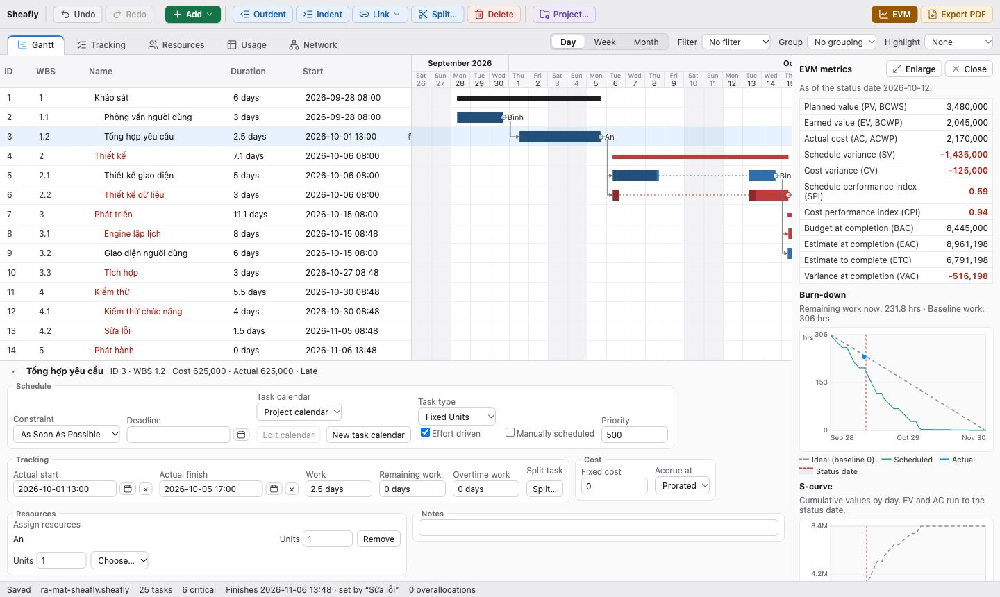

<p align="center"></p>

# ProjectDesk

**English** · [Tiếng Việt](README.vi.md)

A Microsoft Project–style scheduler that runs on your own computer (macOS, Windows, Linux), in English or Vietnamese. Built with Tauri 2, React 19 and a scheduling engine written in Rust. Open source under the MIT license; your projects stay on your machine, with no account or server.

**[Download the latest release](https://github.com/hoanghainh1188/project-decks/releases/latest)**



## Features

- **Scheduling:** critical path (CPM) from FS/SS/FF/SF links with lag; constraints (As Soon As Possible, As Late As Possible, Start/Finish No Earlier/Later Than, Must Start/Finish On); deadlines; manually scheduled tasks; split tasks; recurring tasks.
- **Calendars:** work weeks, nonworking days and exceptions; a project calendar plus calendars for individual tasks and resources.
- **Resources:** people and equipment, max units, rates, task types (Fixed Units, Fixed Duration, Fixed Work), overallocation found from overlapping hours, and resource leveling.
- **Tracking:** baselines 0–10, % complete, actual start and finish that drive the schedule the way Project does, moving unfinished work past the status date, late flags, costs.
- **Reports:** earned value (PV, EV, AC, SPI, CPI, EAC…), burn-down and S-curve.
- **Views:** five tabs (Gantt, Tracking, Resources, Usage, Network diagram); day, week and month timescales; filter, group and highlight per view; PDF export.
- **Languages:** English and Vietnamese. The first launch follows your system language; switch any time in View → Language. English uses ISO dates (`2026-01-05 08:00`) and Microsoft Project terminology.
- **Interface:** a toolbar grouped by colour with icons (history, create, selected task, project, reports), and disabled commands that say why. Works from the keyboard: arrow keys move between tabs; on the Gantt, ↑ ↓ select rows, Enter edits, Option+← → (Alt on Windows and Linux) move a task by a working day; Esc closes dialogs.
- **Files:** `.pdproj` (SQLite) keeps the undo history with the project. Saves are crash-safe, unsaved work is autosaved and offered back after a crash, and partly damaged files still open. Import and export MSPDI (`.xml`) to exchange projects with Microsoft Project; `.mpp` files cannot be read.

## Install

Download an installer from [Releases](https://github.com/hoanghainh1188/project-decks/releases): `.dmg` for macOS (Apple Silicon), `.msi` or `-setup.exe` for Windows, `.AppImage`, `.deb` or `.rpm` for Linux.

The installers are not code-signed yet. On macOS, try to open ProjectDesk once, then go to **System Settings → Privacy & Security** and click **Open Anyway** near the bottom (since macOS 15, right-click → Open no longer works for unsigned apps). If macOS says the app is damaged, run:

```bash
xattr -dr com.apple.quarantine /Applications/ProjectDesk.app
```

On Windows, SmartScreen may ask first; choose **More info → Run anyway**.

## Build from source

You need [Rust](https://rustup.rs) (stable), Node.js 22 (or 20.19 and later) and [pnpm](https://pnpm.io). Linux also needs Tauri's system packages (see the [Tauri prerequisites](https://tauri.app/start/prerequisites/)).

```bash
pnpm install
pnpm tauri dev      # run the app while developing
pnpm tauri build    # build installers into target/release/bundle
```

The interface only works inside the Tauri window; opening `localhost:1420` in a normal browser cannot load a project.

## Tests

```bash
cargo test -p projectdesk-engine      # scheduling engine
cargo test -p projectdesk             # Tauri shell
pnpm exec tsc --noEmit                # type check
pnpm test                             # interface (Vitest)
cargo bench -p projectdesk-engine --bench large_project              # 1,000 tasks, 10,000 commands
cargo bench -p projectdesk-engine --bench large_project -- leveling  # leveling 500 tasks
```

## Project layout

- `crates/engine`: the scheduling engine, with no Tauri dependency. Every date, slack value, critical path, cost and EVM figure is computed here.
- `src-tauri`: the Tauri shell: native menu, file dialogs, autosave, settings.
- `src`: the React interface. It only displays what the engine returns. Text lives in typed message catalogs (`*.i18n.ts`).
- `.cursor/plans/projectdesk_macos_da6c3154.plan.md`: the plan (in Vietnamese), with the decisions behind each phase and the roadmap.
- `CLAUDE.md`: architecture notes for people (and tools) changing the code.

## Known limitations

- `.mpp` files cannot be read; use MSPDI (`.xml`) to exchange projects with Project.
- The installers are not signed or notarized yet; macOS builds are Apple Silicon only.
- One user, one window; no dark mode yet.
- English and Vietnamese only.

## License

MIT. The app bundles open-source packages and the Be Vietnam Pro font (SIL Open Font License); their copyright notices and license texts are in [`src-tauri/THIRD_PARTY_LICENSES.txt`](src-tauri/THIRD_PARTY_LICENSES.txt), which every installer includes and Help → Third-Party Licenses opens. Regenerate it with `node scripts/third-party-licenses.mjs` after changing dependencies; CI checks that it is current.

Microsoft Project is a trademark of Microsoft Corporation. ProjectDesk is independent software, not affiliated with Microsoft.
