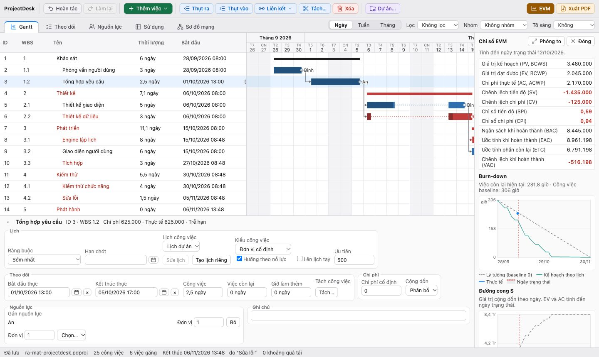

<p align="center"></p>

# Sheafly

[English](README.md) · **Tiếng Việt**

Ứng dụng lập lịch dự án kiểu Microsoft Project, chạy trên máy (macOS, Windows, Linux). Giao diện tiếng Việt và tiếng Anh. Xây bằng Tauri 2, React 19 và một engine lập lịch viết bằng Rust. Mã nguồn mở, giấy phép MIT; dữ liệu nằm trên máy của bạn, không cần tài khoản hay máy chủ.

**[Tải bản mới nhất](https://github.com/hoanghainh1188/sheafly/releases/latest)**



## Tính năng

- **Lập lịch:** đường găng (CPM) với liên kết FS/SS/FF/SF và độ trễ, ràng buộc (sớm nhất, muộn nhất, bắt đầu/kết thúc không sớm/muộn hơn, phải bắt đầu/kết thúc vào), hạn chót, task lên lịch tay, task tách, công việc lặp.
- **Lịch:** tuần làm việc, ngày nghỉ và ngoại lệ; lịch dự án, lịch riêng cho task và cho nguồn lực.
- **Nguồn lực:** người và máy, đơn vị tối đa, đơn giá, kiểu task (đơn vị/thời lượng/công cố định), phát hiện quá tải theo giờ trùng nhau, cân bằng nguồn lực.
- **Theo dõi:** baseline 0–10, % hoàn thành, ngày bắt đầu/kết thúc thực tế điều khiển lịch như Project, dời phần chưa xong sau ngày trạng thái, cờ trễ hạn, chi phí.
- **Báo cáo:** EVM (PV, EV, AC, SPI, CPI, EAC…), burn-down và đường cong S.
- **Các view:** năm tab Gantt, Theo dõi, Nguồn lực, Sử dụng và Sơ đồ mạng; thang ngày/tuần/tháng, lọc, nhóm, tô sáng theo từng view; xuất PDF.
- **Ngôn ngữ:** tiếng Việt và tiếng Anh, đổi trong menu Xem → Ngôn ngữ; lần đầu mở theo ngôn ngữ của máy. Tiếng Anh dùng ngày ISO và thuật ngữ của Microsoft Project.
- **Giao diện:** thanh công cụ chia nhóm theo màu và có biểu tượng (lịch sử, tạo việc, sửa việc đang chọn, dự án, báo cáo); nút bị tắt cho biết lý do. Dùng được bằng bàn phím: chuyển tab bằng mũi tên, chọn và dời task trên Gantt (↑ ↓, Enter, Option+← →), hộp thoại đóng bằng Esc. Biểu đồ EVM xem phóng to được.
- **Tệp:** định dạng `.sheafly` (SQLite; tệp `.pdproj` từ thời ProjectDesk vẫn mở bình thường) lưu cả lịch sử hoàn tác; lưu an toàn, tự lưu và khôi phục sau khi app tắt đột ngột; mở được tệp hỏng một phần. Nhập/xuất MSPDI (`.xml`) để trao đổi với Microsoft Project; không đọc được tệp `.mpp`.

## Cài bản phát hành

Tải bản cài ở trang [Releases](https://github.com/hoanghainh1188/sheafly/releases): `.dmg` cho macOS (Apple Silicon), `.msi` hoặc `-setup.exe` cho Windows, `.AppImage`, `.deb` hoặc `.rpm` cho Linux.

Bản cài chưa ký số. Trên macOS, hãy mở Sheafly một lần, rồi vào **Cài đặt hệ thống → Quyền riêng tư & Bảo mật** và bấm **Vẫn mở** ở phía dưới (từ macOS 15, nhấp chuột phải → Mở không còn dùng được cho app chưa ký). Nếu macOS báo ứng dụng bị hỏng, chạy:

```bash
xattr -dr com.apple.quarantine /Applications/Sheafly.app
```

Trên Windows, SmartScreen có thể hỏi; chọn **More info → Run anyway**.

## Build từ mã nguồn

Cần [Rust](https://rustup.rs) (bản stable), Node.js 22 (hoặc 20.19 trở lên) và [pnpm](https://pnpm.io). Trên Linux cần thêm các gói hệ thống của Tauri (xem [hướng dẫn của Tauri](https://tauri.app/start/prerequisites/)).

```bash
pnpm install
pnpm tauri dev      # chạy app khi phát triển
pnpm tauri build    # tạo bản cài trong target/release/bundle
```

Giao diện chỉ chạy được bên trong cửa sổ Tauri; mở `localhost:1420` bằng trình duyệt thường sẽ không tải được dự án.

## Kiểm thử

```bash
cargo test -p sheafly-engine      # engine lập lịch
cargo test -p sheafly             # lớp vỏ Tauri
pnpm exec tsc --noEmit                # kiểm tra kiểu
pnpm test                             # giao diện (Vitest)
cargo bench -p sheafly-engine --bench large_project              # 1.000 task, 10.000 lệnh
cargo bench -p sheafly-engine --bench large_project -- leveling  # cân bằng 500 task
```

## Cấu trúc

- `crates/engine`: engine lập lịch, không phụ thuộc Tauri. Mọi ngày, slack, đường găng, chi phí và EVM đều tính ở đây.
- `src-tauri`: lớp vỏ Tauri, menu, hộp thoại tệp, tự lưu, cài đặt.
- `src`: giao diện React; chỉ hiển thị kết quả engine trả về. Chữ trên giao diện nằm trong các catalog có kiểu (`*.i18n.ts`).
- `.cursor/plans/projectdesk_macos_da6c3154.plan.md`: kế hoạch, quyết định của từng pha và lộ trình.
- `CLAUDE.md`: ghi chú kiến trúc cho người (và công cụ) sửa code.

## Giới hạn đã biết

- Không đọc tệp `.mpp`; dùng MSPDI (`.xml`) để trao đổi với Project.
- Bản cài chưa ký số và chưa notarize; macOS mới có bản cho Apple Silicon.
- Một người dùng, một cửa sổ; chưa có giao diện tối.
- Chỉ có tiếng Việt và tiếng Anh.

## Giấy phép

MIT. App đóng gói các thư viện mã nguồn mở và phông Be Vietnam Pro (SIL Open Font License); thông báo bản quyền và nguyên văn giấy phép của chúng nằm trong [`src-tauri/THIRD_PARTY_LICENSES.txt`](src-tauri/THIRD_PARTY_LICENSES.txt), có trong mọi bản cài và mở được bằng Trợ giúp → Giấy phép bên thứ ba. Sau khi đổi thư viện, chạy lại `node scripts/third-party-licenses.mjs`; CI kiểm tra tệp này luôn khớp.

Microsoft Project là nhãn hiệu của Microsoft Corporation. Sheafly là phần mềm độc lập, không liên quan đến Microsoft.
